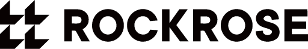
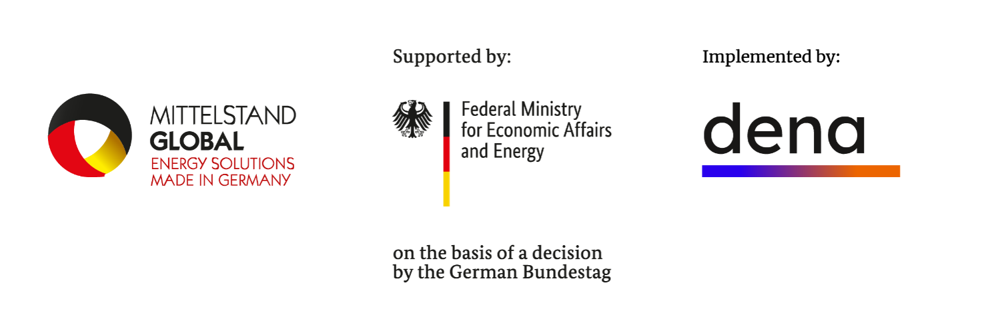

# Rooftop 3D Model And Virtual Showroom Extraction

Generated as a read-only extraction for GPT brainstorming. No application source files were modified.

## Purpose

This file gathers the rooftop 3D model, camera alignment, overlay labels, retrofit visualization, scroll/camera integration, CSS, and asset references that appear related to the virtual showroom rooftop experience.

## Asset Inventory

- `logos/200 water Roof Only.glb` (19.23 MB)
- `logos/200 water Roof Only.opt.glb` (1 MB)
- `logos/200_water.opt.glb` (3.19 MB)
- `logos/Untitled.glb` (6.28 MB)

## Source Files Included

- `index.html`
- `main.js`
- `model-preload.js`
- `building-scroll.js`
- `building-rooftop-mode.js`
- `rooftop-camera.js`
- `rooftop-labels.js`
- `rooftop-retrofit.js`
- `building-scroll-recipe.md`
- `.cursor/rules/building-scroll-end-frame.mdc`
- `styles.css`

## Reading Map

- `model-preload.js`: loads and clones the full-building and roof-only GLB assets.
- `building-scroll.js`: main Three.js scene, full-building scroll inspect state, and virtual showroom integration.
- `building-rooftop-mode.js`: opens the roof-only detail mode, swaps building/roof scenes, drag rotation, reset, label centering, layout caching.
- `rooftop-camera.js`: rooftop alignment, material prep, roof-band sampling, camera fitting, and roof-only-to-building matching.
- `rooftop-labels.js`: callouts, color detection, anchors, flow paths, legend, editing utilities, and screen projection.
- `rooftop-retrofit.js`: procedural rooftop retrofit equipment, flows, fans, labels, and animations.
- `index.html` and `styles.css`: DOM hooks and rooftop/showroom presentation styles.

## Full Related Code

### index.html

````html
<!doctype html>
<html lang="en">
  <head>
    <meta charset="UTF-8" />
    <meta name="viewport" content="width=device-width, initial-scale=1.0" />
    <title>200 Water Street Ventilation Retrofit</title>
    <link rel="preconnect" href="https://fonts.googleapis.com" />
    <link rel="preconnect" href="https://fonts.gstatic.com" crossorigin />
    <link
      href="https://fonts.googleapis.com/css2?family=Roboto:wght@400;500;700;900&display=swap"
      rel="stylesheet"
    />
    <script src="https://cdn.tailwindcss.com"></script>
    <link rel="stylesheet" href="./styles.css" />
    <link rel="preload" href="./logos/200_water.opt.glb" as="fetch" crossorigin />
    <script type="importmap">
      {
        "imports": {
          "three": "https://cdn.jsdelivr.net/npm/three@0.170.0/build/three.module.js",
          "three/addons/": "https://cdn.jsdelivr.net/npm/three@0.170.0/examples/jsm/"
        }
      }
    </script>
    <script type="module" src="./model-preload.js"></script>
  </head>
  <body class="antialiased">
    <main class="min-h-screen bg-[#f7f8f8] text-[#0b1724]">
      <!-- Hero -->
      <section class="hero-section relative overflow-hidden bg-white">
        <a href="https://ruhl.org/" class="ruhl-back-link" aria-label="Back to RUHL">
          <i data-lucide="arrow-left" class="h-4 w-4 stroke-[3]"></i>
          <span>Back to RUHL</span>
        </a>
        <div class="absolute left-1/2 top-[-18rem] h-[36rem] w-[36rem] -translate-x-1/2 rounded-full bg-[#fcbe00]/10 blur-3xl"></div>
        <div class="hero-section-inner page-section-y-lg relative mx-auto w-full max-w-7xl px-6 md:px-10 py-20 lg:py-28">
          <div class="mx-auto max-w-5xl text-center reveal">
            <div class="mb-8 flex flex-wrap items-center justify-center gap-3">
              <span class="rounded-full bg-[#00375a] px-5 py-2 text-sm font-black text-white">RUHL TecDesign</span>
              <span class="text-[#fcbe00]">×</span>
              <span
                class="rounded-full bg-white px-5 py-2 text-sm font-black text-[#00375a] shadow-sm ring-1 ring-slate-200"
                >Rockrose</span
              >
              <span class="text-[#fcbe00]">·</span>
              <span class="rounded-full bg-[#fcbe00] px-5 py-2 text-sm font-black text-[#00375a]"
                >200 Water Street Project</span
              >
            </div>
            <p class="hero-eyebrow text-sm font-black uppercase tracking-[0.28em] text-[#00375a]">
              Closed-loop heat recovery for a 31-story Manhattan residence
            </p>
            <h1 class="hero-title mt-5 text-5xl font-black leading-[0.95] tracking-tight text-[#00375a] md:text-6xl lg:text-7xl">
              200 Water Street Ventilation Retrofit
            </h1>
            <p class="mx-auto mt-6 max-w-3xl text-xl leading-8 text-slate-600">
              Rebalancing airflow, recovering exhaust energy, and creating a scalable path toward Local Law 97
              compliance for large multifamily buildings.
            </p>
            <div class="hero-cta-group mt-9 flex flex-col justify-center gap-3 sm:flex-row">
              <a
                href="#solution"
                class="btn-touch inline-flex items-center justify-center gap-2 rounded-full bg-[#00375a] px-6 py-4 text-sm font-black text-white shadow-lg shadow-[#00375a]/20 transition hover:-translate-y-1"
              >
                See how it works <i data-lucide="arrow-right" class="h-[18px] w-[18px] stroke-[3]"></i>
              </a>
              <a
                href="#impact"
                class="btn-touch inline-flex items-center justify-center gap-2 rounded-full border-2 border-[#00375a] bg-white px-6 py-4 text-sm font-black text-[#00375a] transition hover:-translate-y-1"
              >
                View impact data
              </a>
            </div>
          </div>
          <div class="hero-stats mt-14 grid gap-4 md:grid-cols-2 lg:grid-cols-4">
            <article class="reveal rounded-3xl border border-slate-200 bg-white p-6 shadow-sm transition duration-300 hover:-translate-y-1 hover:shadow-xl">
              <p class="text-4xl font-black tracking-tight text-[#00375a]">541,000</p>
              <p class="mt-2 text-sm font-bold uppercase tracking-wide text-slate-900">sq ft</p>
              <p class="mt-1 text-sm leading-6 text-slate-500">31 floors · 576 residential units</p>
            </article>
            <article class="reveal rounded-3xl border border-slate-200 bg-white p-6 shadow-sm transition duration-300 hover:-translate-y-1 hover:shadow-xl">
              <p class="text-4xl font-black tracking-tight text-[#00375a]">26%</p>
              <p class="mt-2 text-sm font-bold uppercase tracking-wide text-slate-900">energy reduction</p>
              <p class="mt-1 text-sm leading-6 text-slate-500">ventilation retrofit vs. baseline</p>
            </article>
            <article class="reveal rounded-3xl border border-slate-200 bg-white p-6 shadow-sm transition duration-300 hover:-translate-y-1 hover:shadow-xl">
              <p class="text-4xl font-black tracking-tight text-[#00375a]">664</p>
              <p class="mt-2 text-sm font-bold uppercase tracking-wide text-slate-900">tCOâ‚‚e/yr saved</p>
              <p class="mt-1 text-sm leading-6 text-slate-500">annual ventilation retrofit impact</p>
            </article>
            <article class="reveal rounded-3xl border border-slate-200 bg-white p-6 shadow-sm transition duration-300 hover:-translate-y-1 hover:shadow-xl">
              <p class="text-4xl font-black tracking-tight text-[#00375a]">36</p>
              <p class="mt-2 text-sm font-bold uppercase tracking-wide text-slate-900">weeks</p>
              <p class="mt-1 text-sm leading-6 text-slate-500">kickoff to closeout</p>
            </article>
          </div>
        </div>
      </section>

      <!-- 3D Building Scroll Section -->
      <section
        id="building-scroll"
        class="building-scroll-section"
        aria-label="Cinematic 3D building scroll experience"
        data-model-path="./logos/200_water.opt.glb"
        data-roof-model-path="./logos/200 water Roof Only.glb"
      >
        <div class="building-scroll-sticky">
          <canvas id="building-scroll-canvas" class="building-scroll-canvas" aria-hidden="true"></canvas>
          <p id="building-scroll-status" class="building-scroll-status is-hidden" role="status" aria-live="polite"></p>
          <div class="building-scroll-overlay is-disabled" aria-hidden="true">
            <p class="building-scroll-eyebrow">200 Water Street</p>
            <p class="building-scroll-title">Discover the building</p>
            <p class="building-scroll-hint">Scroll for a cinematic journey from reveal to rooftop inspection</p>
          </div>
          <div id="building-scroll-side-story" class="building-scroll-side-story" aria-hidden="false">
            <header class="building-scroll-side-header">
              <p class="building-scroll-side-eyebrow">Engineering approach</p>
              <h2 class="building-scroll-side-title">Reduce, recover, modernize.</h2>
              <p class="building-scroll-side-lead">
                Fix pressure imbalance and recover exhaust energy before scaling HVAC.
              </p>
            </header>
            <div class="building-scroll-side-col building-scroll-side-col--left">
              <div class="building-scroll-side-pillars">
                <article class="building-scroll-side-pillar">
                  <div class="building-scroll-side-icon" aria-hidden="true">
                    <i data-lucide="gauge" class="h-8 w-8 stroke-[2]"></i>
                  </div>
                  <h3>Reduce Loads</h3>
                  <p>Cut heating and cooling demand before adding larger systems.</p>
                </article>
                <article class="building-scroll-side-pillar">
                  <div class="building-scroll-side-icon" aria-hidden="true">
                    <i data-lucide="refresh-cw" class="h-8 w-8 stroke-[2]"></i>
                  </div>
                  <h3>Recover Heat</h3>
                  <p>Transfer exhaust energy to incoming outdoor air without mixing streams.</p>
                </article>
                <article class="building-scroll-side-pillar">
                  <div class="building-scroll-side-icon" aria-hidden="true">
                    <i data-lucide="wind" class="h-8 w-8 stroke-[2]"></i>
                  </div>
                  <h3>Modernize HVAC</h3>
                  <p>Coordinate air handling, heat recovery, and staged water-source heat pump.</p>
                </article>
              </div>
            </div>
            <div class="building-scroll-side-col building-scroll-side-col--right">
              <div class="building-scroll-side-callout building-scroll-side-callout--challenge">
                <h3>The challenge</h3>
                <p>
                  Multiple roof exhaust systems operated continuously without heat recovery or supply coordination,
                  producing a 284% negative-pressure regime and high infiltration losses through doors, windows, and
                  façade leakage.
                </p>
              </div>
              <div class="building-scroll-side-callout building-scroll-side-callout--solution">
                <h3>The solution</h3>
                <p>
                  Centralized exhaust and dedicated outdoor-air supply units connected by a closed-loop refrigerant heat
                  recovery circuit, with water-source heat pump only when recovered heat cannot meet setpoints.
                </p>
              </div>
            </div>
          </div>
        </div>
        <button
          type="button"
          id="building-rooftop-entry"
          class="building-rooftop-entry-btn"
          aria-hidden="true"
        >
          Explore rooftop systems
        </button>
      </section>

      <!-- Organizations -->
      <section class="page-section-y py-20 lg:py-24">
        <div class="mx-auto w-full max-w-7xl px-6 md:px-10">
          <div class="mx-auto max-w-4xl text-center reveal">
            <p class="mb-3 text-xs font-black uppercase tracking-[0.24em] text-[#00375a]">Organizations</p>
            <h2 class="text-3xl font-black tracking-tight text-[#00375a] md:text-4xl lg:text-5xl">
              Project leadership, funding, technology, and support.
            </h2>
          </div>
          <div class="org-partner-grid mt-12 grid auto-rows-fr gap-5 md:grid-cols-2 lg:grid-cols-3">
            <a href="https://ruhl.org/" target="_blank" rel="noopener noreferrer" class="group flex min-h-[260px] flex-col justify-between rounded-3xl border border-[#00375a]/30 bg-white p-6 shadow-sm transition duration-300 hover:-translate-y-1 hover:shadow-xl focus:outline-none focus-visible:ring-2 focus-visible:ring-[#00375a]">
              <div class="flex h-40 w-full items-center justify-center rounded-2xl bg-white px-3 ring-1 ring-slate-100">
                
              </div>
              <div class="mt-5 border-t border-slate-100 pt-4 text-center">
                <p class="text-lg font-black text-[#00375a]">RUHL TecDesign</p>
                <p class="mt-1 text-sm leading-5 text-slate-500">Lead MEP design engineering</p>
              </div>
            </a>
            <a href="https://rockrose.com/" target="_blank" rel="noopener noreferrer" class="group flex min-h-[260px] flex-col justify-between rounded-3xl border border-[#00375a]/30 bg-white p-6 shadow-sm transition duration-300 hover:-translate-y-1 hover:shadow-xl focus:outline-none focus-visible:ring-2 focus-visible:ring-[#00375a]">
              <div class="flex h-40 w-full items-center justify-center rounded-2xl bg-white px-3 ring-1 ring-slate-100">
                
              </div>
              <div class="mt-5 border-t border-slate-100 pt-4 text-center">
                <p class="text-lg font-black text-[#00375a]">Rockrose</p>
                <p class="mt-1 text-sm leading-5 text-slate-500">Owner / development partner</p>
              </div>
            </a>
            <a href="https://www.nyserda.ny.gov/" target="_blank" rel="noopener noreferrer" class="group flex min-h-[260px] flex-col justify-between rounded-3xl border border-slate-200 bg-white p-6 shadow-sm transition duration-300 hover:-translate-y-1 hover:shadow-xl focus:outline-none focus-visible:ring-2 focus-visible:ring-[#00375a]">
              <div class="flex h-40 w-full items-center justify-center rounded-2xl bg-white px-3 ring-1 ring-slate-100">
                
              </div>
              <div class="mt-5 border-t border-slate-100 pt-4 text-center">
                <p class="text-lg font-black text-[#00375a]">NYSERDA</p>
                <p class="mt-1 text-sm leading-5 text-slate-500">Heat Recovery Program funding</p>
              </div>
            </a>
          </div>

          <div class="reveal mt-12 overflow-hidden rounded-3xl border border-[#00375a]/15 bg-white shadow-sm">
            <div class="border-b border-slate-100 bg-white px-6 py-10 md:px-12 md:py-12">
              
              <p class="mx-auto mt-6 max-w-4xl text-center text-sm italic leading-6 text-slate-600">
                This project is supported by the German Federal Ministry for Economic Affairs and Energy as part of the Renewable Energy Solutions Programme of the German Energy Solutions Initiative.
              </p>
            </div>
            <div class="grid gap-5 p-5 md:grid-cols-1 md:gap-6 md:p-8 lg:grid-cols-3 lg:p-10">
              <article class="flex flex-col rounded-2xl border border-slate-100 bg-[#f7f8f8] p-6 md:p-7">
                <span class="mb-3 inline-block h-1 w-8 rounded-full bg-gradient-to-r from-[#00375a] to-sky-400" aria-hidden="true"></span>
                <h3 class="text-lg font-black leading-snug tracking-tight text-[#00375a]">German Energy Agency (dena)</h3>
                <p class="mt-4 flex-1 text-sm leading-[1.75] text-slate-600">
                  The German Energy Agency (dena) is a centre of excellence for the applied energy transition and climate protection. dena studies the challenges of building a climate-neutral society and supports the German government in achieving its energy and climate policy objectives. Since its foundation in 2000, dena has worked to develop and implement solutions and bring together national and international partners from politics, industry, the scientific community and all parts of society. dena is a project enterprise and a public company owned by the German federal government. dena's shareholder is the Federal Republic of Germany.
                </p>
                <a
                  href="https://www.dena.de/en/"
                  target="_blank"
                  rel="noopener noreferrer"
                  class="btn-touch btn-learn-more mt-5 inline-flex items-center justify-center gap-2 self-start rounded-full border-2 border-[#00375a] bg-white px-5 py-2.5 text-sm font-black text-[#00375a] transition hover:-translate-y-1"
                >
                  Learn more <i data-lucide="arrow-right" class="h-4 w-4 stroke-[3]"></i>
                </a>
              </article>
              <article class="flex flex-col rounded-2xl border border-slate-100 bg-[#f7f8f8] p-6 md:p-7">
                <span class="mb-3 inline-block h-1 w-8 rounded-full bg-gradient-to-r from-[#00375a] to-amber-400" aria-hidden="true"></span>
                <h3 class="text-lg font-black leading-snug tracking-tight text-[#00375a]">German Energy Solutions Initiative</h3>
                <p class="mt-4 flex-1 text-sm leading-[1.75] text-slate-600">
                  With the aim of positioning German technologies and know-how worldwide, the German Energy Solutions Initiative of the Federal Ministry for Economic Affairs and Energy (BMWE) supports suppliers of climate-friendly energy solutions in opening up foreign markets. The focus lies on renewable energies, energy efficiency, smart grids and storage, as well as technologies such as power-to-gas and fuel cells. Aimed in particular at small and medium-sized enterprises, the German Energy Solutions Initiative supports participants through measures to prepare market entry as well as to prospect, develop and secure new markets.
                </p>
                <a
                  href="https://www.german-energy-solutions.de/GES/Navigation/EN/Home/home.html"
                  target="_blank"
                  rel="noopener noreferrer"
                  class="btn-touch btn-learn-more mt-5 inline-flex items-center justify-center gap-2 self-start rounded-full border-2 border-[#00375a] bg-white px-5 py-2.5 text-sm font-black text-[#00375a] transition hover:-translate-y-1"
                >
                  Learn more <i data-lucide="arrow-right" class="h-4 w-4 stroke-[3]"></i>
                </a>
              </article>
              <article class="flex flex-col rounded-2xl border border-slate-100 bg-[#f7f8f8] p-6 md:p-7">
                <span class="mb-3 inline-block h-1 w-8 rounded-full bg-gradient-to-r from-[#00375a] to-orange-400" aria-hidden="true"></span>
                <h3 class="text-lg font-black leading-snug tracking-tight text-[#00375a]">Renewable Energy Solutions Programme (RES Programme)</h3>
                <p class="mt-4 flex-1 text-sm leading-[1.75] text-slate-600">
                  With the RES programme, the German Energy Solutions Initiative of the Federal Ministry for Economic Affairs and Energy (BMWE) helps German companies in the renewable energy and energy efficiency sectors enter new markets. Within the framework of the programme, reference plants are installed and marketed with the support of the German Energy Agency (dena). Information and training activities help ensure a sustainable market entry and demonstrate the quality of climate-friendly technologies made in Germany.
                </p>
                <a
                  href="https://www.german-energy-solutions.de/GES/Redaktion/EN/Basepages/Services/dena-res.html"
                  target="_blank"
                  rel="noopener noreferrer"
                  class="btn-touch btn-learn-more mt-5 inline-flex items-center justify-center gap-2 self-start rounded-full border-2 border-[#00375a] bg-white px-5 py-2.5 text-sm font-black text-[#00375a] transition hover:-translate-y-1"
                >
                  Learn more <i data-lucide="arrow-right" class="h-4 w-4 stroke-[3]"></i>
                </a>
              </article>
            </div>
          </div>
        </div>
      </section>

      <section id="solution" class="bg-white">
        <!-- System strategy -->
        <div class="page-section-y py-20 lg:py-24">
          <div class="mx-auto w-full max-w-7xl px-6 md:px-10">
            <div class="mx-auto max-w-4xl text-center reveal">
              <p class="mb-3 text-xs font-black uppercase tracking-[0.24em] text-[#00375a]">System strategy</p>
              <h2 class="text-3xl font-black tracking-tight text-[#00375a] md:text-4xl lg:text-5xl">
                Airflow rebalanced to reduce infiltration losses.
              </h2>
              <p class="mx-auto mt-4 max-w-3xl text-lg leading-8 text-slate-600">
                The proposed system reduces excessive exhaust, increases coordinated supply air, and moves the building
                toward balanced/slight positive pressure.
              </p>
            </div>
            <div id="airflow-charts" class="mt-12 grid gap-5 md:grid-cols-2">
              <!-- Exhaust -->
              <div class="reveal rounded-[2rem] border border-slate-200 bg-white p-6 shadow-sm">
                <div class="mb-6 flex items-start justify-between gap-4">
                  <div>
                    <h3 class="text-xl font-black text-[#00375a]">Exhaust Airflow</h3>
                    <p class="mt-1 text-sm text-slate-500">exhaust reduced and consolidated</p>
                  </div>
                  <span class="rounded-full bg-[#fcbe00]/20 px-3 py-1 text-xs font-black text-[#00375a]">CFM</span>
                </div>
                <div class="space-y-6">
                  <div>
                    <div class="mb-2 flex justify-between text-sm">
                      <span class="font-medium text-slate-500">Baseline</span><strong data-animate-number data-final="74780" data-suffix=" CFM">74,780 CFM</strong>
                    </div>
                    <div class="h-4 rounded-full bg-slate-100">
                      <div class="h-4 rounded-full bg-red-500 transition-all duration-1000" data-animate-width data-final-width="93.475%" style="width: 0%"></div>
                    </div>
                  </div>
                  <div>
                    <div class="mb-2 flex justify-between text-sm">
                      <span class="font-medium text-slate-500">After Retrofit</span><strong data-animate-number data-final="21480" data-suffix=" CFM">21,480 CFM</strong>
                    </div>
                    <div class="h-4 rounded-full bg-slate-100">
                      <div class="h-4 rounded-full bg-[#00375a] transition-all duration-1000" data-animate-width data-final-width="26.85%" style="width: 0%"></div>
                    </div>
                  </div>
                </div>
              </div>
              <!-- Supply -->
              <div class="reveal rounded-[2rem] border border-slate-200 bg-white p-6 shadow-sm">
                <div class="mb-6 flex items-start justify-between gap-4">
                  <div>
                    <h3 class="text-xl font-black text-[#00375a]">Supply Airflow</h3>
                    <p class="mt-1 text-sm text-slate-500">
                      supply increased to support slight positive pressure
                    </p>
                  </div>
                  <span class="rounded-full bg-[#fcbe00]/20 px-3 py-1 text-xs font-black text-[#00375a]">CFM</span>
                </div>
                <div class="space-y-6">
                  <div>
                    <div class="mb-2 flex justify-between text-sm">
                      <span class="font-medium text-slate-500">Baseline</span><strong data-animate-number data-final="26330" data-suffix=" CFM">26,330 CFM</strong>
                    </div>
                    <div class="h-4 rounded-full bg-slate-100">
                      <div class="h-4 rounded-full bg-red-500 transition-all duration-1000" data-animate-width data-final-width="32.9125%" style="width: 0%"></div>
                    </div>
                  </div>
                  <div>
                    <div class="mb-2 flex justify-between text-sm">
                      <span class="font-medium text-slate-500">After Retrofit</span><strong data-animate-number data-final="28316" data-suffix=" CFM">28,316 CFM</strong>
                    </div>
                    <div class="h-4 rounded-full bg-slate-100">
                      <div class="h-4 rounded-full bg-[#00375a] transition-all duration-1000" data-animate-width data-final-width="35.395%" style="width: 0%"></div>
                    </div>
                  </div>
                </div>
              </div>
            </div>
            <div class="reveal mt-6 rounded-3xl border border-slate-200 bg-white p-6 text-center shadow-sm">
              <p class="pressure-callout text-3xl font-black text-[#00375a]">284% negative pressure → balanced / slight positive</p>
              <p class="mt-2 text-slate-500">Ventilation losses collapse when exhaust and supply air are coordinated.</p>
            </div>
            <div class="mt-10 grid gap-5 md:grid-cols-2 lg:grid-cols-3">
              <div class="reveal rounded-[2rem] border border-slate-200 bg-white p-6 shadow-sm">
                <i data-lucide="refresh-cw" class="text-[#00375a]" style="width: 30px; height: 30px"></i>
                <h3 class="mt-5 text-xl font-black text-[#00375a]">Closed-Loop Run-Around Heat Recovery</h3>
                <p class="mt-3 leading-7 text-slate-600">
                  R454B air–refrigerant–air circuit transfers sensible energy between exhaust and supply air without
                  direct mixing.
                </p>
              </div>
              <div class="reveal rounded-[2rem] border border-slate-200 bg-white p-6 shadow-sm">
                <i data-lucide="network" class="text-[#00375a]" style="width: 30px; height: 30px"></i>
                <h3 class="mt-5 text-xl font-black text-[#00375a]">Centralized Exhaust + Dedicated Supply</h3>
                <p class="mt-3 leading-7 text-slate-600">
                  Existing roof exhaust streams are consolidated into paired exhaust and 100% outdoor-air supply units.
                </p>
              </div>
              <div class="reveal rounded-[2rem] border border-slate-200 bg-white p-6 shadow-sm">
                <i data-lucide="thermometer-sun" class="text-[#00375a]" style="width: 30px; height: 30px"></i>
                <h3 class="mt-5 text-xl font-black text-[#00375a]">Water-Source Heat Pump</h3>
                <p class="mt-3 leading-7 text-slate-600">
                  Heat pump acts as a secondary stage only when heat recovery alone cannot meet supply-air setpoints.
                </p>
              </div>
            </div>
          </div>
        </div>
      </section>

      <!-- Impact -->
      <section id="impact" class="bg-white">
        <div class="page-section-y py-20 lg:py-24">
          <div class="mx-auto w-full max-w-7xl px-6 md:px-10">
            <div class="mx-auto max-w-4xl text-center reveal">
              <p class="mb-3 text-xs font-black uppercase tracking-[0.24em] text-[#00375a]">Measured impact</p>
              <h2 class="text-3xl font-black tracking-tight text-[#00375a] md:text-4xl lg:text-5xl">
                Clear evidence for builders, owners, and engineers.
              </h2>
            </div>

            <div class="mt-12 grid gap-5 md:grid-cols-2">
              <article class="reveal rounded-3xl border border-slate-200 bg-white p-6 shadow-sm transition duration-300 hover:-translate-y-1 hover:shadow-xl">
                <p class="text-4xl font-black tracking-tight text-[#00375a]">11.9M</p>
                <p class="mt-2 text-sm font-bold uppercase tracking-wide text-slate-900">kBtu/yr saved</p>
                <p class="mt-1 text-sm leading-6 text-slate-500">annual ventilation retrofit energy savings</p>
              </article>
              <article class="reveal rounded-3xl border border-slate-200 bg-white p-6 shadow-sm transition duration-300 hover:-translate-y-1 hover:shadow-xl">
                <p class="text-4xl font-black tracking-tight text-[#00375a]">~72%</p>
                <p class="mt-2 text-sm font-bold uppercase tracking-wide text-slate-900">heat recovery effectiveness</p>
                <p class="mt-1 text-sm leading-6 text-slate-500">closed-loop system</p>
              </article>
            </div>

            <!-- Emissions chart -->
            <div class="reveal mx-auto mt-12 rounded-[2rem] border border-slate-200 bg-white p-6 shadow-sm md:p-8">
              <div class="mb-8 flex flex-col justify-between gap-4 md:flex-row md:items-end">
                <div>
                  <h3 class="text-2xl font-black text-[#00375a]">COâ‚‚ Emissions vs. LL97 Limits</h3>
                  <p class="mt-2 max-w-2xl text-slate-500">
                    Baseline and projected retrofit emissions shown against the same Local Law 97 thresholds.
                  </p>
                </div>
                <div class="rounded-2xl bg-[#00375a] px-5 py-3 text-sm font-black text-white">50% projected COâ‚‚ reduction</div>
              </div>
              <div class="co2-chart-wrap overflow-hidden pb-2">
                <div id="co2-chart" class="relative h-[585px] min-w-0 pt-4 lg:h-[585px]"></div>
              </div>
            </div>

            <!-- Energy -->
            <div id="energy-chart" class="reveal mx-auto mt-10 rounded-[2rem] border border-slate-200 bg-white p-6 shadow-sm md:p-8">
              <div class="mb-8 flex flex-col justify-between gap-4 md:flex-row md:items-end">
                <div>
                  <h3 class="text-2xl font-black text-[#00375a]">Projected Energy Use: Baseline vs. Retrofit</h3>
                  <p class="mt-2 text-slate-500">A simple before/after view using the energy values from the project data.</p>
                </div>
                <div class="rounded-2xl bg-[#fcbe00]/20 px-5 py-3 text-sm font-black text-[#00375a]">58% reduction in energy use</div>
              </div>
              <div class="space-y-8">
                <div>
                  <div class="mb-2 flex justify-between text-sm energy-data-row">
                    <span class="font-black text-red-600">Baseline Energy Use</span><strong data-animate-number data-final="45919715" data-suffix=" MBtu/year">45,919,715 MBtu/year</strong>
                  </div>
                  <div class="h-5 rounded-full bg-slate-200">
                    <div class="h-5 rounded-full bg-red-500" data-animate-width data-final-width="91.83943%" style="width: 0%"></div>
                  </div>
                </div>
                <div>
                  <div class="mb-2 flex justify-between text-sm energy-data-row">
                    <span class="font-black text-[#00375a]">Expected Energy Use After Retrofit</span><strong data-animate-number data-final="19179665" data-suffix=" MBtu/year"
                      >19,179,665 MBtu/year</strong
                    >
                  </div>
                  <div class="h-5 rounded-full bg-slate-200">
                    <div class="h-5 rounded-full bg-[#00375a]" data-animate-width data-final-width="38.35933%" style="width: 0%"></div>
                  </div>
                </div>
              </div>
              <div class="energy-axis mt-2 flex justify-between text-xs font-bold text-slate-400">
                <span>0</span><span>10M</span><span>20M</span><span>30M</span><span>40M</span><span>50M MBtu/year</span>
              </div>
            </div>

            <!-- Waterfall -->
            <div id="waterfall-chart" class="reveal mt-10 rounded-[2rem] border border-slate-200 bg-white p-6 shadow-sm md:p-8">
              <div class="flex flex-col justify-between gap-4 md:flex-row md:items-end">
                <div>
                  <h3 class="text-2xl font-black text-[#00375a]">Emission Reduction Waterfall</h3>
                  <p class="mt-2 max-w-3xl text-slate-500">
                    Bridge from baseline emissions to projected retrofit emissions. Yellow bars start at the previous
                    level and step down to the final retrofit value.
                  </p>
                </div>
                <div class="rounded-2xl border border-slate-200 px-4 py-3 text-sm font-black text-[#00375a]">
                  Units: tCOâ‚‚e/year
                </div>
              </div>
              <div class="waterfall-chart-wrap mt-10 overflow-x-auto lg:overflow-x-auto">
                <div class="waterfall-chart-scale">
                  <div class="waterfall-chart-inner relative min-w-[1120px] pr-8 pl-20" style="height: 510px">
                  <div class="absolute left-20 right-8 border-t border-dashed border-slate-200" style="top: 0">
                    <span class="absolute -left-14 -top-3 text-xs font-bold text-slate-400">4,000</span>
                  </div>
                  <div class="absolute left-20 right-8 border-t border-dashed border-slate-200" style="top: 90px">
                    <span class="absolute -left-14 -top-3 text-xs font-bold text-slate-400">3,000</span>
                  </div>
                  <div class="absolute left-20 right-8 border-t border-dashed border-slate-200" style="top: 180px">
                    <span class="absolute -left-14 -top-3 text-xs font-bold text-slate-400">2,000</span>
                  </div>
                  <div class="absolute left-20 right-8 border-t border-dashed border-slate-200" style="top: 270px">
                    <span class="absolute -left-14 -top-3 text-xs font-bold text-slate-400">1,000</span>
                  </div>
                  <div class="absolute left-20 right-8 border-t border-dashed border-slate-200" style="top: 360px">
                    <span class="absolute -left-14 -top-3 text-xs font-bold text-slate-400">0</span>
                  </div>
                  <div class="absolute left-2 top-[150px] -rotate-90 text-sm font-black text-[#00375a]">
                    Emissions (tCOâ‚‚e/year)
                  </div>
                  <div
                    class="absolute left-20 right-8 grid"
                    style="grid-template-columns: repeat(8, minmax(110px, 1fr)); height: 360px"
                  >
                    <!-- start -->
                    <div class="relative flex justify-center">
                      <div class="wf-bar absolute bottom-0 w-20 rounded-t-xl bg-[#00375a]" style="height: 283.86px"></div>
                      <p class="wf-label absolute text-sm font-black text-[#00375a]" style="bottom: 293.86px" data-animate-number data-final="3154">3,154</p>
                      <p class="absolute top-[382px] max-w-[105px] text-center text-xs font-black leading-4 text-slate-900">
                        Baseline Emissions
                      </p>
                    </div>
                    <!-- reductions -->
                    <div class="relative flex justify-center">
                      <div class="wf-bar absolute w-20 rounded-sm bg-[#fcbe00]" style="bottom: 234.09px; height: 49.77px"></div>
                      <p class="wf-label absolute text-sm font-black text-slate-900" style="bottom: 293.85999999999996px" data-animate-number data-final="553">553</p>
                      <p class="absolute top-[382px] max-w-[105px] text-center text-xs font-black leading-4 text-slate-900">
                        Ventilation Initiatives
                      </p>
                    </div>
                    <div class="relative flex justify-center">
                      <div class="wf-bar absolute w-20 rounded-sm bg-[#fcbe00]" style="bottom: 168.12px; height: 65.97px"></div>
                      <p class="wf-label absolute text-sm font-black text-slate-900" style="bottom: 244.08999999999997px" data-animate-number data-final="733">733</p>
                      <p class="absolute top-[382px] max-w-[105px] text-center text-xs font-black leading-4 text-slate-900">
                        ITENâ„¢ + Heat Pump
                      </p>
                    </div>
                    <div class="relative flex justify-center">
                      <div class="wf-bar absolute w-20 rounded-sm bg-[#fcbe00]" style="bottom: 162.36px; height: 5.76px"></div>
                      <p class="wf-label absolute text-sm font-black text-slate-900" style="bottom: 178.11999999999998px" data-animate-number data-final="64">64</p>
                      <p class="absolute top-[382px] max-w-[105px] text-center text-xs font-black leading-4 text-slate-900">
                        DHW Electrification
                      </p>
                    </div>
                    <div class="relative flex justify-center">
                      <div class="wf-bar absolute w-20 rounded-sm bg-[#fcbe00]" style="bottom: 158.13px; height: 4.23px"></div>
                      <p class="wf-label absolute text-sm font-black text-slate-900" style="bottom: 172.36px" data-animate-number data-final="47">47</p>
                      <p class="absolute top-[382px] max-w-[105px] text-center text-xs font-black leading-4 text-slate-900">
                        Smart Controls
                      </p>
                    </div>
                    <div class="relative flex justify-center">
                      <div class="wf-bar absolute w-20 rounded-sm bg-[#fcbe00]" style="bottom: 149.04px; height: 9.09px"></div>
                      <p class="wf-label absolute text-sm font-black text-slate-900" style="bottom: 168.12999999999997px" data-animate-number data-final="101">101</p>
                      <p class="absolute top-[382px] max-w-[105px] text-center text-xs font-black leading-4 text-slate-900">
                        Sun Protection Film
                      </p>
                    </div>
                    <div class="relative flex justify-center">
                      <div class="wf-bar absolute w-20 rounded-sm bg-[#fcbe00]" style="bottom: 142.74px; height: 6.3px"></div>
                      <p class="wf-label absolute text-sm font-black text-slate-900" style="bottom: 159.04px" data-animate-number data-final="70">70</p>
                      <p class="absolute top-[382px] max-w-[105px] text-center text-xs font-black leading-4 text-slate-900">
                        Additional ECM Margin
                      </p>
                    </div>
                    <!-- end -->
                    <div class="relative flex justify-center">
                      <div class="wf-bar absolute bottom-0 w-20 rounded-t-xl bg-[#00375a]" style="height: 142.74px"></div>
                      <p class="wf-label absolute text-sm font-black text-[#00375a]" style="bottom: 152.74px" data-animate-number data-final="1586">1,586</p>
                      <p class="absolute top-[382px] max-w-[105px] text-center text-xs font-black leading-4 text-slate-900">
                        Projected Retrofit
                      </p>
                    </div>
                  </div>
                  <div class="absolute bottom-10 left-20 right-8 h-[1px] bg-slate-300"></div>
                  <div class="absolute bottom-0 left-1/2 -translate-x-1/2 text-sm font-black text-[#00375a]">
                    Emission pathway measures
                  </div>
                  </div>
                </div>
              </div>
              <div class="mt-5 rounded-2xl bg-slate-50 p-5 text-sm leading-7 text-slate-600">
                <strong class="text-[#00375a]">Broader ECM reference from the project data:</strong>
                Exhaust Air Energy Recovery + Balancing: 853 tons · ITEN™ + Heat Pump + Wastewater HR: 1,068 tons · DHW Booster Heat Pumps: 93 tons · Smart Automation + Hydronics: 67 tons · Building Envelope Optimization: 148 tons.
              </div>
            </div>
          </div>
        </div>
      </section>

      <!-- Implementation -->
      <section class="page-section-y py-20 lg:py-24">
        <div class="mx-auto w-full max-w-7xl px-6 md:px-10">
          <div class="mx-auto max-w-4xl text-center reveal">
            <p class="mb-3 text-xs font-black uppercase tracking-[0.24em] text-[#00375a]">Implementation</p>
            <h2 class="text-3xl font-black tracking-tight text-[#00375a] md:text-4xl lg:text-5xl">Roadmap to Net Zero</h2>
            <p class="mx-auto mt-4 max-w-3xl text-lg leading-8 text-slate-600">
              A phased view of the broader retrofit strategy, including supporting controls and adaptation measures.
            </p>
          </div>
          <div class="mt-12">
            <div class="implementation-timeline relative border-l-4 border-[#00375a] pl-7">
              <!-- phase 01 -->
              <div class="reveal relative mb-6 rounded-3xl border border-slate-200 bg-white p-6 shadow-sm">
                <div
                  class="timeline-step-badge absolute -left-[3.35rem] top-6 flex h-12 w-12 items-center justify-center rounded-full border-4 border-white bg-[#00375a] text-lg font-black text-[#fcbe00] shadow"
                >
                  01
                </div>
                <h3 class="text-xl font-black text-[#00375a]">Balance + Recover</h3>
                <p class="mt-2 leading-7 text-slate-600">
                  Reduce apartment exhaust airflow, recover roof exhaust energy, add reversible WSHP and low-temp hot/chilled water storage;
                  optional ASHP can inject heat into ITENâ„¢.
                </p>
              </div>
              <div class="reveal relative mb-6 rounded-3xl border border-slate-200 bg-white p-6 shadow-sm">
                <div
                  class="timeline-step-badge absolute -left-[3.35rem] top-6 flex h-12 w-12 items-center justify-center rounded-full border-4 border-white bg-[#00375a] text-lg font-black text-[#fcbe00] shadow"
                >
                  02
                </div>
                <h3 class="text-xl font-black text-[#00375a]">Wastewater Recovery</h3>
                <p class="mt-2 leading-7 text-slate-600">
                  Recover heat from the internal sewer system with water-source heat pumps and low-temperature energy storage.
                </p>
              </div>
              <div class="reveal relative mb-6 rounded-3xl border border-slate-200 bg-white p-6 shadow-sm">
                <div
                  class="timeline-step-badge absolute -left-[3.35rem] top-6 flex h-12 w-12 items-center justify-center rounded-full border-4 border-white bg-[#00375a] text-lg font-black text-[#fcbe00] shadow"
                >
                  03
                </div>
                <h3 class="text-xl font-black text-[#00375a]">DHW Low/Mid Zones</h3>
                <p class="mt-2 leading-7 text-slate-600">
                  Introduce booster heat pump DHW for low- and mid-zones using high-temperature storage to reduce summer steam boiler operation.
                </p>
              </div>
              <div class="reveal relative mb-6 rounded-3xl border border-slate-200 bg-white p-6 shadow-sm">
                <div
                  class="timeline-step-badge absolute -left-[3.35rem] top-6 flex h-12 w-12 items-center justify-center rounded-full border-4 border-white bg-[#00375a] text-lg font-black text-[#fcbe00] shadow"
                >
                  04
                </div>
                <h3 class="text-xl font-black text-[#00375a]">DHW High Zone</h3>
                <p class="mt-2 leading-7 text-slate-600">
                  Extend booster heat pump DHW to the high zone and use rooftop condensing boilers for heat injection into ITENâ„¢.
                </p>
              </div>
              <div class="reveal relative mb-6 rounded-3xl border border-slate-200 bg-white p-6 shadow-sm">
                <div
                  class="timeline-step-badge absolute -left-[3.35rem] top-6 flex h-12 w-12 items-center justify-center rounded-full border-4 border-white bg-[#00375a] text-lg font-black text-[#fcbe00] shadow"
                >
                  05
                </div>
                <h3 class="text-xl font-black text-[#00375a]">Boiler Cascade</h3>
                <p class="mt-2 leading-7 text-slate-600">
                  Install rooftop condensing boiler cascade using existing gas service and dismantle second-floor steam boilers.
                </p>
              </div>
              <div class="reveal relative mb-6 rounded-3xl border border-slate-200 bg-white p-6 shadow-sm">
                <div
                  class="timeline-step-badge absolute -left-[3.35rem] top-6 flex h-12 w-12 items-center justify-center rounded-full border-4 border-white bg-[#00375a] text-lg font-black text-[#fcbe00] shadow"
                >
                  06
                </div>
                <h3 class="text-xl font-black text-[#00375a]">Public Sewer Connection</h3>
                <p class="mt-2 leading-7 text-slate-600">
                  Connect wastewater heat recovery to the public sewer system with WSHPs and low-temperature storage.
                </p>
              </div>
            </div>
          </div>
          <div class="mt-6 grid gap-4 md:grid-cols-2">
            <div class="rounded-3xl bg-[#00375a] p-6 text-white">
              <strong>Supporting measures:</strong>
              BMS upgrades, smart automation, hydronic optimization, solid-state heat pump replacement, app-based room
              control, and demand-based primary flow control.
            </div>
            <div class="rounded-3xl bg-[#fcbe00] p-6 text-[#00375a]">
              <strong>Adaptation measures:</strong>
              building envelope optimization with sun protection screens to manage climate-related cooling load increases.
            </div>
          </div>
        </div>
      </section>

      <!-- What RUHL delivers -->
      <section class="bg-[#00375a] text-white">
        <div class="page-section-y-lg mx-auto grid w-full max-w-7xl gap-10 px-6 py-20 lg:grid-cols-[1fr_0.85fr] lg:px-10 lg:py-24">
          <div class="reveal">
            <p class="text-xs font-black uppercase tracking-[0.24em] text-[#fcbe00]">What RUHL delivers</p>
            <h2 class="mt-4 text-4xl font-black tracking-tight lg:text-5xl">
              A replicable retrofit model for multifamily decarbonization.
            </h2>
            <p class="mt-6 max-w-2xl text-lg leading-8 text-white/75">
              RUHL's scope connects decarbonization roadmaps, engineering integration, and measurement frameworks for heat recovery, ventilation balance, hydronic optimization, and heat pump integration.
            </p>
          </div>
          <div class="reveal space-y-4">
            <div class="flex items-center gap-4 rounded-2xl bg-white/10 p-5 ring-1 ring-white/10">
              <i data-lucide="shield-check" class="flex-shrink-0 text-[#fcbe00]" style="width: 24px; height: 24px"></i><span class="font-black">Decarbonization Roadmaps</span>
            </div>
            <div class="flex items-center gap-4 rounded-2xl bg-white/10 p-5 ring-1 ring-white/10">
              <i data-lucide="shield-check" class="flex-shrink-0 text-[#fcbe00]" style="width: 24px; height: 24px"></i><span class="font-black">Engineering & Integration</span>
            </div>
            <div class="flex items-center gap-4 rounded-2xl bg-white/10 p-5 ring-1 ring-white/10">
              <i data-lucide="shield-check" class="flex-shrink-0 text-[#fcbe00]" style="width: 24px; height: 24px"></i><span class="font-black">Measurement & Verification</span>
            </div>
            <div class="flex items-center gap-4 rounded-2xl bg-white/10 p-5 ring-1 ring-white/10">
              <i data-lucide="shield-check" class="flex-shrink-0 text-[#fcbe00]" style="width: 24px; height: 24px"></i><span class="font-black">Heat Recovery + HVAC Modernization</span>
            </div>
          </div>
        </div>
      </section>

      <footer class="bg-white py-16">
        <div class="mx-auto w-full max-w-7xl px-6 md:px-10">
          <div class="grid gap-8 rounded-[2rem] border border-slate-200 bg-[#f7f8f8] p-8 lg:grid-cols-[1fr_0.9fr]">
            <div>
              <h2 class="text-3xl font-black text-[#00375a]">
                Interested in heat recovery, HVAC modernization, or a decarbonization roadmap?
              </h2>
              <p class="mt-4 text-slate-600">
                Contact RUHL TecDesign to discuss building-scale retrofit strategy and implementation.
              </p>
            </div>
            <div class="rounded-3xl bg-white p-6 shadow-sm">
              <p class="text-xl font-black text-[#00375a]">RUHL TecDesign LLC</p>
              <p class="mt-4 flex items-center gap-3 text-slate-600">
                <i data-lucide="map-pin" class="flex-shrink-0" style="width: 18px; height: 18px"></i> One World Trade Center, New York, NY 10007
              </p>
              <p class="mt-3 flex items-center gap-3 text-slate-600">
                <i data-lucide="mail" class="flex-shrink-0" style="width: 18px; height: 18px"></i> info@ruhl.org
              </p>
              <p class="mt-3 flex items-center gap-3 text-slate-600">
                <i data-lucide="phone" class="flex-shrink-0" style="width: 18px; height: 18px"></i> (212) 555-0123
              </p>
            </div>
          </div>
        </div>
      </footer>
    </main>

    <!-- Rooftop detail overlay (hidden until opened from building scroll) -->
    <section
      id="rooftop-detail"
      class="rooftop-detail-section"
      aria-label="Rooftop HVAC systems detail"
      aria-hidden="true"
      data-roof-model-path="./logos/200 water Roof Only.glb"
      hidden
    >
      <div class="rooftop-detail-sticky">
        <button type="button" class="rooftop-detail-back-link">← Back to building tour</button>
        <div class="rooftop-detail-controls">
          <button type="button" class="rooftop-detail-reset-btn" hidden aria-label="Reset rooftop view">
            Reset view
          </button>
        </div>
      </div>
    </section>

    <script src="https://cdn.jsdelivr.net/npm/lucide@0.454.0/dist/umd/lucide.min.js"></script>
    <script src="https://cdn.jsdelivr.net/npm/gsap@3.12.7/dist/gsap.min.js"></script>
    <script src="https://cdn.jsdelivr.net/npm/gsap@3.12.7/dist/ScrollTrigger.min.js"></script>
    <script>
      if (window.location.protocol === 'file:') {
        document.documentElement.classList.add('building-scroll-file-protocol');
        document.addEventListener('DOMContentLoaded', function () {
          var section = document.getElementById('building-scroll');
          var status = document.getElementById('building-scroll-status');
          if (section) section.classList.add('is-blocked');
          if (status) {
            status.textContent =
              'The 3D model cannot load from a saved HTML file. Open the site through a local web server, for example: python -m http.server 8765';
            status.classList.add('is-error');
          }
        });
      }
    </script>
    <script type="module" src="./building-scroll.js"></script>
    <script defer src="./main.js"></script>
  </body>
</html>
````

### main.js

````js
document.addEventListener('DOMContentLoaded', () => {
  if (window.lucide && typeof lucide.createIcons === 'function') {
    lucide.createIcons();
  }

  const compactMq = window.matchMedia('(max-width: 1023px)');
  const reduceMotionMq = window.matchMedia('(prefers-reduced-motion: reduce)');

  function isMobileViewport() {
    return window.matchMedia('(max-width: 767px)').matches;
  }

  function getCo2SvgFit() {
    if (isMobileViewport()) return 'xMinYMin meet';
    if (isCompactViewport()) return 'xMidYMid meet';
    return 'xMinYMin meet';
  }

  function isCompactViewport() {
    return compactMq.matches;
  }

  function prefersReducedMotion() {
    return reduceMotionMq.matches;
  }

  function getViewOpts(threshold = 0.2) {
    if (!isCompactViewport()) {
      return { threshold };
    }
    return {
      threshold: Math.min(threshold, 0.12),
      rootMargin: '0px 0px 6% 0px',
    };
  }

  function easeOutCubic(t) {
    return 1 - Math.pow(1 - t, 3);
  }

  function formatNumber(n) {
    return Math.round(n).toLocaleString();
  }

  function setWillChange(els, value) {
    els.forEach((el) => {
      if (value) el.style.willChange = value;
      else el.style.removeProperty('will-change');
    });
  }

  function whenStableLayout(el, callback, { minHeight = 48, timeoutMs = 800 } = {}) {
    if (!el) return;

    const ready = () => {
      const { height, width } = el.getBoundingClientRect();
      return height >= minHeight && width > 0;
    };

    if (!isCompactViewport() || ready()) {
      callback();
      return;
    }

    let done = false;
    const finish = () => {
      if (done) return;
      done = true;
      ro.disconnect();
      clearTimeout(timer);
      callback();
    };

    const ro = new ResizeObserver(() => {
      if (ready()) finish();
    });
    ro.observe(el);

    const timer = setTimeout(() => {
      if (ready()) finish();
    }, timeoutMs);
  }

  function prepareAnimatedNumbers(container) {
    if (!container) return;
    container.querySelectorAll('[data-animate-number][data-final]').forEach((el) => {
      el.style.fontVariantNumeric = 'tabular-nums';
    });
  }

  function animateWidthsAndNumbers(container, { durationMs = 1100 } = {}) {
    if (!container || container.dataset.animated === 'true') return;
    container.dataset.animated = 'true';

    prepareAnimatedNumbers(container);

    const widthEls = Array.from(container.querySelectorAll('[data-animate-width][data-final-width]'));
    const numEls = Array.from(container.querySelectorAll('[data-animate-number][data-final]'));

    const widths = widthEls.map((el) => {
      const finalWidth = String(el.getAttribute('data-final-width') || '').trim();
      const n = Number(finalWidth.replace('%', ''));
      el.style.width = '0%';
      return { el, finalWidth, n: Number.isFinite(n) ? n : 0 };
    });

    const numbers = numEls.map((el) => {
      const final = Number(el.getAttribute('data-final') || '0');
      const suffix = el.getAttribute('data-suffix') || '';
      el.textContent = `0${suffix}`;
      return { el, final: Number.isFinite(final) ? final : 0, suffix };
    });

    const finalize = () => {
      widths.forEach(({ el, n }) => {
        el.style.width = `${n}%`;
      });
      numbers.forEach(({ el, final, suffix }) => {
        el.textContent = `${formatNumber(final)}${suffix}`;
      });
      setWillChange(widthEls, null);
    };

    if (prefersReducedMotion()) {
      finalize();
      return;
    }

    widths.forEach(({ el }) => void el.offsetWidth);
    if (isCompactViewport()) {
      setWillChange(widthEls, 'width');
    }

    let start = 0;
    function tick(now) {
      if (!start) start = now;
      const raw = Math.min(1, (now - start) / durationMs);
      const t = easeOutCubic(raw);

      widths.forEach(({ el, n }) => {
        el.style.width = `${n * t}%`;
      });
      numbers.forEach(({ el, final, suffix }) => {
        el.textContent = `${formatNumber(final * t)}${suffix}`;
      });

      if (raw < 1) requestAnimationFrame(tick);
      else finalize();
    }
    requestAnimationFrame(() => requestAnimationFrame(tick));
  }

  function animateWaterfall(container, { durationMs = 1100 } = {}) {
    if (!container || container.dataset.animated === 'true') return;
    container.dataset.animated = 'true';

    const bars = Array.from(container.querySelectorAll('.wf-bar'));
    const labels = Array.from(container.querySelectorAll('.wf-label[data-animate-number][data-final]'));

    prepareAnimatedNumbers(container);

    const finalize = () => {
      bars.forEach((bar) => {
        bar.style.transform = 'scaleY(1)';
        bar.classList.remove('is-animating');
      });
      labels.forEach((el) => {
        const final = Number(el.getAttribute('data-final') || '0');
        const suffix = el.getAttribute('data-suffix') || '';
        el.textContent = `${formatNumber(final)}${suffix}`;
      });
      setWillChange(bars, null);
    };

    bars.forEach((bar) => {
      bar.style.transformOrigin = 'bottom';
      bar.style.transform = 'scaleY(0)';
    });

    labels.forEach((el) => {
      const suffix = el.getAttribute('data-suffix') || '';
      el.textContent = `0${suffix}`;
    });

    if (prefersReducedMotion()) {
      finalize();
      return;
    }

    if (isCompactViewport()) {
      bars.forEach((bar) => bar.classList.add('is-animating'));
      setWillChange(bars, 'transform');
    }

    const start = performance.now();
    function tick(now) {
      const raw = Math.min(1, (now - start) / durationMs);
      const t = easeOutCubic(raw);

      bars.forEach((bar) => {
        bar.style.transform = `scaleY(${t})`;
      });
      labels.forEach((el) => {
        const final = Number(el.getAttribute('data-final') || '0');
        const suffix = el.getAttribute('data-suffix') || '';
        el.textContent = `${formatNumber((Number.isFinite(final) ? final : 0) * t)}${suffix}`;
      });

      if (raw < 1) requestAnimationFrame(tick);
      else finalize();
    }
    requestAnimationFrame(tick);
  }

  function triggerOnceInView(el, onEnter, { threshold = 0.2 } = {}) {
    if (!el) return;

    const rect = el.getBoundingClientRect();
    const vh = window.innerHeight || document.documentElement.clientHeight;
    if (rect.top < vh && rect.bottom > 0) {
      onEnter();
      return;
    }

    if (!('IntersectionObserver' in window)) return;

    const obs = new IntersectionObserver(
      (entries) => {
        entries.forEach((entry) => {
          if (entry.isIntersecting) {
            onEnter();
            obs.disconnect();
          }
        });
      },
      getViewOpts(threshold)
    );
    obs.observe(el);
  }

  function whenRevealReady(el, callback, { threshold = 0.2 } = {}) {
    if (!el) return;

    let started = false;
    const run = () => {
      if (started) return;
      started = true;
      whenStableLayout(el, callback);
    };

    const revealHost = el.classList.contains('reveal') ? el : el.closest('.reveal');

    const canRun = () => {
      if (!isCompactViewport()) return true;
      if (!revealHost) return true;
      return revealHost.classList.contains('in-view');
    };

    const tryStart = () => {
      if (!canRun()) return;
      run();
    };

    if (canRun()) {
      triggerOnceInView(el, tryStart, { threshold });
      return;
    }

    const mo = new MutationObserver(() => {
      tryStart();
      if (started) mo.disconnect();
    });
    mo.observe(revealHost, { attributes: true, attributeFilter: ['class'] });

    triggerOnceInView(
      el,
      () => {
        tryStart();
        if (started) mo.disconnect();
      },
      { threshold }
    );
  }

  function renderAndAnimateCO2Chart(container) {
    if (!container || container.dataset.rendered === 'true') return;
    container.dataset.rendered = 'true';

    const data = {
      max: 4000,
      baseline: 3154,
      retrofit: 1586,
      ll97Future: 1801,
      ll97Current: 3658,
    };

    const vbW = 1200;
    const vbH = 585;
    const padL = 20;
    const padR = 0;
    const trackX = padL;
    const trackW = vbW - padL - padR;

    const x = (value) => trackX + (value / data.max) * trackW;

    const y1Title = 30;
    const y1Sub = 50;

    const y1Label = 116;
    const y1Track = 160;
    const y1Axis = 210;

    const y2Label = 368;
    const y2Track = 422;
    const y2Axis = 482;

    const trackH = 16;
    const trackR = 8;

    const labelFont = 'Roboto, Arial, sans-serif';
    const gold = '#fcbe00';
    const navy = '#00375a';
    const red = '#ef4444';
    const slate200 = '#e2e8f0';
    const slate400 = '#94a3b8';
    const slate600 = '#475569';

    const tickStepMinor = 200;
    const tickStepMajor = 1000;
    const minorTickLen = 8;
    const majorTickLen = 14;

    const tickLines = (yBase) => {
      const lines = [];
      for (let v = 0; v <= data.max; v += tickStepMinor) {
        const isMajor = v % tickStepMajor === 0;
        const len = isMajor ? majorTickLen : minorTickLen;
        const y1 = yBase;
        const y2 = yBase + len;
        lines.push(`<line x1="${x(v)}" y1="${y1}" x2="${x(v)}" y2="${y2}" stroke="${slate400}" stroke-width="${isMajor ? 1.5 : 1}" opacity="${isMajor ? 1 : 0.6}" />`);
      }
      return lines.join('');
    };

    const majorLabels = (yText) => `
      <text x="${trackX}" y="${yText}" font-family="${labelFont}" font-size="16" font-weight="700" fill="${slate600}">0</text>
      <text x="${x(1000)}" y="${yText}" text-anchor="middle" font-family="${labelFont}" font-size="16" font-weight="700" fill="${slate600}">1,000</text>
      <text x="${x(2000)}" y="${yText}" text-anchor="middle" font-family="${labelFont}" font-size="16" font-weight="700" fill="${slate600}">2,000</text>
      <text x="${x(3000)}" y="${yText}" text-anchor="middle" font-family="${labelFont}" font-size="16" font-weight="700" fill="${slate600}">3,000</text>
      <text x="${trackX + trackW}" y="${yText}" text-anchor="end" font-family="${labelFont}" font-size="16" font-weight="700" fill="${slate600}">4,000</text>
    `;

    const axisUnit = (yText) => `
      <text x="${trackX + trackW / 2}" y="${yText}" text-anchor="middle" font-family="${labelFont}" font-size="16" font-weight="500" fill="${slate600}">
        tCOâ‚‚e/year
      </text>
    `;

    const collisionPx = 120;
    const offsetPx = 20;

    const p1DeltaFuture = Math.abs(x(data.baseline) - x(data.ll97Future));
    const p2DeltaFuture = Math.abs(x(data.retrofit) - x(data.ll97Future));

    const p1BaselineAnchor = p1DeltaFuture < collisionPx ? 'end' : 'middle';
    const p1BaselineDx = p1DeltaFuture < collisionPx ? -offsetPx : 0;
    const p1FutureAnchor = p1DeltaFuture < collisionPx ? 'start' : 'middle';
    const p1FutureDx = p1DeltaFuture < collisionPx ? offsetPx : 0;

    const p2RetrofitAnchor = p2DeltaFuture < collisionPx ? 'end' : 'middle';
    const p2RetrofitDx = p2DeltaFuture < collisionPx ? -offsetPx : 0;
    const p2FutureAnchor = p2DeltaFuture < collisionPx ? 'start' : 'middle';
    const p2FutureDx = p2DeltaFuture < collisionPx ? offsetPx : 0;

    const limitLabelY1 = y1Label - 26;
    const limitNumY1 = y1Label - 4;
    const limitStemStartY1 = y1Label + 6;

    const limitLabelY2 = y2Label - 26;
    const limitNumY2 = y2Label - 4;
    const limitStemStartY2 = y2Label + 6;

    const svgFit = getCo2SvgFit();

    container.innerHTML = `
      <svg viewBox="0 0 ${vbW} ${vbH}" width="100%" height="100%" preserveAspectRatio="${svgFit}" role="img" aria-label="Projected COâ‚‚ emissions vs permitted limits">
        <defs>
          <linearGradient id="co2RedGrad" x1="0" y1="0" x2="1" y2="0">
            <stop offset="0%" stop-color="#b91c1c" />
            <stop offset="100%" stop-color="${red}" />
          </linearGradient>
        </defs>

        <text x="${trackX}" y="${y1Title}" font-family="${labelFont}" font-size="28" font-weight="900" fill="${navy}">
          Projected COâ‚‚ Emissions vs. Permitted Limits
        </text>
        <text x="${trackX}" y="${y1Sub}" font-family="${labelFont}" font-size="14" font-weight="500" fill="${slate600}">
          Comparison of baseline and post-retrofit emissions against Local Law 97 thresholds.
        </text>

        <text x="${trackX}" y="${y1Label}" font-family="${labelFont}" font-size="16" font-weight="800" fill="${navy}">Baseline COâ‚‚ Emissions</text>

        <rect x="${trackX}" y="${y1Track}" width="${trackW}" height="${trackH}" rx="${trackR}" fill="${slate200}" />
        <rect id="co2-baseline-fill" x="${trackX}" y="${y1Track}" width="0" height="${trackH}" rx="${trackR}" fill="url(#co2RedGrad)" />

        <g id="co2-p1-limit-future" transform="translate(${x(data.ll97Future)} 0)" opacity="0">
          <text x="${p1FutureDx}" y="${limitLabelY1}" text-anchor="${p1FutureAnchor}" font-family="${labelFont}" font-size="12" font-weight="800" fill="${gold}">2030–2034 Limit</text>
          <text id="co2-p1-limit-future-num" x="${p1FutureDx}" y="${limitNumY1}" text-anchor="${p1FutureAnchor}" font-family="${labelFont}" font-size="22" font-weight="900" fill="${gold}">0</text>
          <line id="co2-p1-limit-future-stem" x1="0" y1="${limitStemStartY1}" x2="0" y2="${limitStemStartY1}" stroke="${gold}" stroke-width="2" />
          <circle cx="0" cy="${y1Track + trackH / 2}" r="9" fill="${gold}" stroke="#fff" stroke-width="4" />
        </g>

        <g id="co2-p1-baseline" transform="translate(${x(data.baseline)} 0)" opacity="0">
          <text id="co2-p1-baseline-num" x="-18" y="${y1Label + 2}" text-anchor="end" font-family="${labelFont}" font-size="24" font-weight="900" fill="#991b1b">0</text>
          <text x="-18" y="${y1Label + 24}" text-anchor="end" font-family="${labelFont}" font-size="13" font-weight="800" fill="#991b1b">Baseline</text>
          <line id="co2-p1-baseline-stem" x1="0" y1="${y1Label + 40}" x2="0" y2="${y1Label + 40}" stroke="#991b1b" stroke-width="2" />
          <circle cx="0" cy="${y1Track + trackH / 2}" r="9" fill="#991b1b" stroke="#fff" stroke-width="4" />
        </g>

        <g id="co2-p1-limit-current" transform="translate(${x(data.ll97Current)} 0)" opacity="0">
          <text x="0" y="${limitLabelY1}" text-anchor="middle" font-family="${labelFont}" font-size="12" font-weight="800" fill="${gold}">2024–2029 Limit</text>
          <text id="co2-p1-limit-current-num" x="0" y="${limitNumY1}" text-anchor="middle" font-family="${labelFont}" font-size="22" font-weight="900" fill="${gold}">0</text>
          <line id="co2-p1-limit-current-stem" x1="0" y1="${limitStemStartY1}" x2="0" y2="${limitStemStartY1}" stroke="${gold}" stroke-width="2" />
          <circle cx="0" cy="${y1Track + trackH / 2}" r="9" fill="${gold}" stroke="#fff" stroke-width="4" />
        </g>

        ${tickLines(y1Axis)}
        ${majorLabels(y1Axis + 42)}
        ${axisUnit(y1Axis + 78)}

        <text x="${trackX}" y="${y2Label}" font-family="${labelFont}" font-size="16" font-weight="800" fill="${navy}">Expected COâ‚‚ After Retrofit</text>

        <rect x="${trackX}" y="${y2Track}" width="${trackW}" height="${trackH}" rx="${trackR}" fill="${slate200}" />
        <rect id="co2-retrofit-fill" x="${trackX}" y="${y2Track}" width="0" height="${trackH}" rx="${trackR}" fill="${navy}" />

        <g id="co2-p2-retrofit" transform="translate(${x(data.retrofit)} 0)" opacity="0">
          <text id="co2-p2-retrofit-num" x="${p2RetrofitDx}" y="${y2Label + 10}" text-anchor="${p2RetrofitAnchor}" font-family="${labelFont}" font-size="24" font-weight="900" fill="${navy}">0</text>
          <text x="${p2RetrofitDx}" y="${y2Label + 32}" text-anchor="${p2RetrofitAnchor}" font-family="${labelFont}" font-size="13" font-weight="800" fill="${navy}">After Retrofit</text>
          <line id="co2-p2-retrofit-stem" x1="0" y1="${y2Label + 40}" x2="0" y2="${y2Label + 40}" stroke="${navy}" stroke-width="2" />
          <circle cx="0" cy="${y2Track + trackH / 2}" r="9" fill="${navy}" stroke="#fff" stroke-width="4" />
        </g>

        <g id="co2-p2-limit-future" transform="translate(${x(data.ll97Future)} 0)" opacity="0">
          <text x="${p2FutureDx}" y="${limitLabelY2}" text-anchor="${p2FutureAnchor}" font-family="${labelFont}" font-size="12" font-weight="800" fill="${gold}">2030–2034 Limit</text>
          <text id="co2-p2-limit-future-num" x="${p2FutureDx}" y="${limitNumY2}" text-anchor="${p2FutureAnchor}" font-family="${labelFont}" font-size="22" font-weight="900" fill="${gold}">0</text>
          <line id="co2-p2-limit-future-stem" x1="0" y1="${limitStemStartY2}" x2="0" y2="${limitStemStartY2}" stroke="${gold}" stroke-width="2" />
          <circle cx="0" cy="${y2Track + trackH / 2}" r="9" fill="${gold}" stroke="#fff" stroke-width="4" />
        </g>

        <g id="co2-p2-limit-current" transform="translate(${x(data.ll97Current)} 0)" opacity="0">
          <text x="0" y="${limitLabelY2}" text-anchor="middle" font-family="${labelFont}" font-size="12" font-weight="800" fill="${gold}">2024–2029 Limit</text>
          <text id="co2-p2-limit-current-num" x="0" y="${limitNumY2}" text-anchor="middle" font-family="${labelFont}" font-size="22" font-weight="900" fill="${gold}">0</text>
          <line id="co2-p2-limit-current-stem" x1="0" y1="${limitStemStartY2}" x2="0" y2="${limitStemStartY2}" stroke="${gold}" stroke-width="2" />
          <circle cx="0" cy="${y2Track + trackH / 2}" r="9" fill="${gold}" stroke="#fff" stroke-width="4" />
        </g>

        ${tickLines(y2Axis)}
        ${majorLabels(y2Axis + 42)}
        ${axisUnit(y2Axis + 78)}

      </svg>
    `;

    const svg = container.querySelector('svg');
    const baselineFill = svg.querySelector('#co2-baseline-fill');
    const retrofitFill = svg.querySelector('#co2-retrofit-fill');

    const groups = {
      p1Future: svg.querySelector('#co2-p1-limit-future'),
      p1Current: svg.querySelector('#co2-p1-limit-current'),
      p1Baseline: svg.querySelector('#co2-p1-baseline'),
      p2Retrofit: svg.querySelector('#co2-p2-retrofit'),
      p2Future: svg.querySelector('#co2-p2-limit-future'),
      p2Current: svg.querySelector('#co2-p2-limit-current'),
    };

    const stems = {
      p1Future: svg.querySelector('#co2-p1-limit-future-stem'),
      p1Current: svg.querySelector('#co2-p1-limit-current-stem'),
      p1Baseline: svg.querySelector('#co2-p1-baseline-stem'),
      p2Retrofit: svg.querySelector('#co2-p2-retrofit-stem'),
      p2Future: svg.querySelector('#co2-p2-limit-future-stem'),
      p2Current: svg.querySelector('#co2-p2-limit-current-stem'),
    };

    const nums = {
      p1Future: svg.querySelector('#co2-p1-limit-future-num'),
      p1Current: svg.querySelector('#co2-p1-limit-current-num'),
      p1Baseline: svg.querySelector('#co2-p1-baseline-num'),
      p2Retrofit: svg.querySelector('#co2-p2-retrofit-num'),
      p2Future: svg.querySelector('#co2-p2-limit-future-num'),
      p2Current: svg.querySelector('#co2-p2-limit-current-num'),
    };

    const targets = {
      baselineW: x(data.baseline) - trackX,
      retrofitW: x(data.retrofit) - trackX,
      baseline: data.baseline,
      retrofit: data.retrofit,
      ll97Future: data.ll97Future,
      ll97Current: data.ll97Current,
    };

    const p1StemStart = limitStemStartY1;
    const p1StemEnd = y1Track + trackH / 2;
    const p2StemStart = limitStemStartY2;
    const p2StemEnd = y2Track + trackH / 2;

    const durationMs = 1200;

    function setStem(lineEl, y1, y2) {
      lineEl.setAttribute('y1', String(y1));
      lineEl.setAttribute('y2', String(y2));
    }

    const finalize = () => {
      baselineFill.setAttribute('width', String(targets.baselineW));
      retrofitFill.setAttribute('width', String(targets.retrofitW));
      Object.values(groups).forEach((g) => g && g.setAttribute('opacity', '1'));
      setStem(stems.p1Future, p1StemStart, p1StemEnd);
      setStem(stems.p1Baseline, p1StemStart, p1StemEnd);
      setStem(stems.p1Current, p1StemStart, p1StemEnd);
      setStem(stems.p2Retrofit, p2StemStart, p2StemEnd);
      setStem(stems.p2Future, p2StemStart, p2StemEnd);
      setStem(stems.p2Current, p2StemStart, p2StemEnd);
      nums.p1Future.textContent = formatNumber(targets.ll97Future);
      nums.p1Current.textContent = formatNumber(targets.ll97Current);
      nums.p1Baseline.textContent = formatNumber(targets.baseline);
      nums.p2Retrofit.textContent = formatNumber(targets.retrofit);
      nums.p2Future.textContent = formatNumber(targets.ll97Future);
      nums.p2Current.textContent = formatNumber(targets.ll97Current);
    };

    if (prefersReducedMotion()) {
      finalize();
      return;
    }

    const start = performance.now();

    function tick(now) {
      const raw = Math.min(1, (now - start) / durationMs);
      const t = easeOutCubic(raw);

      baselineFill.setAttribute('width', String(targets.baselineW * t));
      retrofitFill.setAttribute('width', String(targets.retrofitW * t));

      Object.values(groups).forEach((g) => g && g.setAttribute('opacity', String(Math.min(1, t * 1.1))));

      setStem(stems.p1Future, p1StemStart, p1StemStart + (p1StemEnd - p1StemStart) * t);
      setStem(stems.p1Baseline, p1StemStart, p1StemStart + (p1StemEnd - p1StemStart) * t);
      setStem(stems.p1Current, p1StemStart, p1StemStart + (p1StemEnd - p1StemStart) * t);

      setStem(stems.p2Retrofit, p2StemStart, p2StemStart + (p2StemEnd - p2StemStart) * t);
      setStem(stems.p2Future, p2StemStart, p2StemStart + (p2StemEnd - p2StemStart) * t);
      setStem(stems.p2Current, p2StemStart, p2StemStart + (p2StemEnd - p2StemStart) * t);

      nums.p1Future.textContent = formatNumber(targets.ll97Future * t);
      nums.p1Current.textContent = formatNumber(targets.ll97Current * t);
      nums.p1Baseline.textContent = formatNumber(targets.baseline * t);
      nums.p2Retrofit.textContent = formatNumber(targets.retrofit * t);
      nums.p2Future.textContent = formatNumber(targets.ll97Future * t);
      nums.p2Current.textContent = formatNumber(targets.ll97Current * t);

      if (raw < 1) requestAnimationFrame(tick);
      else finalize();
    }

    requestAnimationFrame(tick);
  }

  const revealEls = Array.from(document.querySelectorAll('.reveal'));
  const revealThreshold = isCompactViewport() ? 0.1 : 0.14;

  if (!('IntersectionObserver' in window)) {
    revealEls.forEach((el) => el.classList.add('in-view'));
    const chart = document.getElementById('co2-chart');
    renderAndAnimateCO2Chart(chart);
    animateWidthsAndNumbers(document.getElementById('airflow-charts'));
    animateWidthsAndNumbers(document.getElementById('energy-chart'));
    animateWaterfall(document.getElementById('waterfall-chart'));
    return;
  }

  const observer = new IntersectionObserver(
    (entries) => {
      entries.forEach((entry) => {
        if (entry.isIntersecting) {
          entry.target.classList.add('in-view');
          observer.unobserve(entry.target);
        }
      });
    },
    getViewOpts(revealThreshold)
  );

  revealEls.forEach((el) => observer.observe(el));

  const co2Chart = document.getElementById('co2-chart');
  if (co2Chart) {
    whenRevealReady(co2Chart, () => renderAndAnimateCO2Chart(co2Chart), { threshold: 0.2 });
  }

  const energyChart = document.getElementById('energy-chart');
  whenRevealReady(energyChart, () => animateWidthsAndNumbers(energyChart));

  const airflowCharts = document.getElementById('airflow-charts');
  whenRevealReady(airflowCharts, () => animateWidthsAndNumbers(airflowCharts));

  const waterfallChart = document.getElementById('waterfall-chart');
  whenRevealReady(waterfallChart, () => animateWaterfall(waterfallChart));
});
````

### model-preload.js

````js
import { GLTFLoader } from 'three/addons/loaders/GLTFLoader.js';
import { MeshoptDecoder } from 'three/addons/libs/meshopt_decoder.module.js';

const loader = new GLTFLoader();
loader.setMeshoptDecoder(MeshoptDecoder);

const loads = new Map();

function resolveUrl(path) {
  try {
    return new URL(path, document.baseURI).href;
  } catch {
    return path;
  }
}

export function preloadGltf(path) {
  const url = resolveUrl(path);
  if (!loads.has(url)) {
    loads.set(
      url,
      loader.loadAsync(url).catch((error) => {
        loads.delete(url);
        throw error;
      })
    );
  }
  return loads.get(url);
}

export function cloneSceneFromGltf(gltf) {
  return gltf.scene.clone(true);
}

function readModelPaths() {
  const section = document.getElementById('building-scroll');
  const rooftop = document.getElementById('rooftop-detail');
  return {
    building:
      section?.getAttribute('data-model-path') ||
      rooftop?.getAttribute('data-building-model-path') ||
      './logos/200_water.glb',
    roof:
      section?.getAttribute('data-roof-model-path') ||
      rooftop?.getAttribute('data-roof-model-path') ||
      './logos/200 water Roof Only.glb',
  };
}

const paths = readModelPaths();

/** Building model — needed for scroll tour (priority). */
export const buildingGltfPromise = preloadGltf(paths.building);

/** Roof-only model — deferred until explicitly requested. */
let roofGltfPromise = null;

export function loadRoofGltf() {
  if (!roofGltfPromise) {
    roofGltfPromise = preloadGltf(paths.roof);
  }
  return roofGltfPromise;
}
````

### building-scroll.js

````js
import * as THREE from 'three';
import { buildingGltfPromise, cloneSceneFromGltf } from './model-preload.js';
import { createBuildingRooftopMode } from './building-rooftop-mode.js';

const SCROLL_ENTRY_END = 0;
const SCROLL_ORBIT_END = 0.68;
const SCROLL_ROOFTOP_END = 1;
/** Show rooftop entry CTA through the rooftop approach while the building section is in view. */
const ROOFTOP_ENTRY_SHOW_START = 0.88;
const BUILDING_SCALE_TOP_GUARD_PX = 110;
/** Playhead catch-up — higher = snappier scroll follow, lower = more cinematic lag. */
const PLAYHEAD_SMOOTHING = 0.16;
const PLAYHEAD_SMOOTHING_END = 0.24;
/** Preserve the established facade/camera choreography when using the optimized full-building GLB. */
const OPT_MODEL_ROTATION_COMPENSATION = 1.6876762151311447;
const ROOFTOP_END_FIT_MARGIN = 0.72;
const ROOFTOP_END_DISTANCE_SCALE = 0.96;

/** Site-matched studio sky (CSS + WebGL share these stops). */
const SKY_SITE_BOTTOM = 0xf7f8f8;

function createStudioSkyBackground(THREE) {
  const canvas = document.createElement('canvas');
  canvas.width = 4;
  canvas.height = 512;
  const ctx = canvas.getContext('2d');
  const gradient = ctx.createLinearGradient(0, 0, 0, canvas.height);
  gradient.addColorStop(0, '#dce6ee');
  gradient.addColorStop(0.46, '#eef2f5');
  gradient.addColorStop(1, '#f7f8f8');
  ctx.fillStyle = gradient;
  ctx.fillRect(0, 0, canvas.width, canvas.height);
  const texture = new THREE.CanvasTexture(canvas);
  texture.colorSpace = THREE.SRGBColorSpace;
  return texture;
}

function applyStudioAtmosphere(scene, THREE, viewRadius) {
  const r = Math.max(viewRadius || 12, 8);
  scene.fog = new THREE.Fog(SKY_SITE_BOTTOM, r * 0.85, r * 3.15);
}

const section = document.getElementById('building-scroll');
const canvas = document.getElementById('building-scroll-canvas');
const sticky = section?.querySelector('.building-scroll-sticky');
const statusEl = document.getElementById('building-scroll-status');
const sideStoryEl = document.getElementById('building-scroll-side-story');
const rooftopEntryBtn = document.getElementById('building-rooftop-entry');

/** Side story visible through early orbit; fades before rooftop approach. */
const SIDE_STORY_FADE_START = 0.05;
const SIDE_STORY_FADE_END = 0.1;

boot();

function boot() {
  if (!section || !canvas || !sticky) return;

  if (window.location.protocol === 'file:') {
    showStatus(
      'The 3D model cannot load from a local file. Run a local web server and open http://localhost:PORT/.',
      'error'
    );
    section.classList.add('is-blocked');
    return;
  }

  if (!window.gsap || !window.ScrollTrigger) {
    window.setTimeout(boot, 16);
    return;
  }

  try {
    initBuildingScroll();
  } catch (error) {
    console.error('Building scroll init failed:', error);
    showStatus('3D viewer failed to start. Check the browser console for details.', 'error');
    section.classList.add('is-blocked');
  }
}

function showStatus(message, type = 'info') {
  if (!statusEl) return;
  statusEl.textContent = message;
  statusEl.classList.remove('is-hidden', 'is-error');
  if (type === 'error') statusEl.classList.add('is-error');
  if (type === 'hidden') statusEl.classList.add('is-hidden');
}

function resolveModelPath() {
  const attr = section.getAttribute('data-model-path') || 'logos/200_water.glb';
  try {
    return new URL(attr, document.baseURI).href;
  } catch {
    return attr;
  }
}

function initBuildingScroll() {
  const gsap = window.gsap;
  const ScrollTrigger = window.ScrollTrigger;
  gsap.registerPlugin(ScrollTrigger);

  const reduceMotionMq = window.matchMedia('(prefers-reduced-motion: reduce)');
  const mobileMq = window.matchMedia('(max-width: 767px)');
  rooftopEntryBtn?.classList.remove('is-visible');
  rooftopEntryBtn?.setAttribute('aria-hidden', 'true');

  if (reduceMotionMq.matches) {
    section.classList.add('is-reduced-motion');
  }

  let scrollTriggerInstance = null;
  let resizeObserver = null;
  let modelReady = false;
  let sectionVisible = false;
  let disposed = false;
  let timeline = null;
  let targetProgress = 0;
  const playhead = { progress: 0 };
  let buildingScene = null;
  let studioSkyBackground = null;
  let roofVertexCache = null;
  let rooftopMode = null;

  const modelPath = resolveModelPath();
  const renderer = new THREE.WebGLRenderer({
    canvas,
    antialias: !mobileMq.matches,
    alpha: false,
    powerPreference: 'high-performance',
  });

  if (!renderer.getContext()) {
    showStatus('WebGL is unavailable in this browser or device.', 'error');
    section.classList.add('is-blocked');
    return;
  }

  renderer.outputColorSpace = THREE.SRGBColorSpace;
  renderer.toneMapping = THREE.ACESFilmicToneMapping;
  renderer.toneMappingExposure = 1.1;
  renderer.setClearColor(SKY_SITE_BOTTOM, 1);

  const scene = new THREE.Scene();
  studioSkyBackground = createStudioSkyBackground(THREE);
  scene.background = studioSkyBackground;

  const camera = new THREE.PerspectiveCamera(42, 1, 0.1, 500);
  const lookTarget = new THREE.Vector3();

  const ambient = new THREE.AmbientLight(0xffffff, 0.85);
  const keyLight = new THREE.DirectionalLight(0xffffff, 1.35);
  keyLight.position.set(6, 12, 8);
  const fillLight = new THREE.DirectionalLight(0xdce8f5, 0.75);
  fillLight.position.set(-8, 4, -6);
  const rimLight = new THREE.DirectionalLight(0xffffff, 0.45);
  rimLight.position.set(0, 8, -10);

  const lightRig = {
    keyX: keyLight.position.x,
    keyY: keyLight.position.y,
    keyZ: keyLight.position.z,
    fillX: fillLight.position.x,
    fillY: fillLight.position.y,
    fillZ: fillLight.position.z,
    rimX: rimLight.position.x,
    rimY: rimLight.position.y,
    rimZ: rimLight.position.z,
  };

  scene.add(ambient, keyLight, fillLight, rimLight);

  const modelRoot = new THREE.Group();
  scene.add(modelRoot);

  const camPos = { x: 0, y: 0, z: 0 };
  const camLook = { x: 0, y: 0, z: 0 };
  const orbitRig = { azimuth: 0, elevation: 0, radius: 0 };
  const sizeRig = { progress: 0 };
  const orbitScratch = new THREE.Vector3();
  const framingPoint = new THREE.Vector3();
  const framingBounds = [
    new THREE.Vector3(),
    new THREE.Vector3(),
    new THREE.Vector3(),
    new THREE.Vector3(),
    new THREE.Vector3(),
    new THREE.Vector3(),
    new THREE.Vector3(),
    new THREE.Vector3(),
  ];
  let framingOffsetCache = null;

  const state = {
    startFov: 42,
    midFov: 38,
    endFov: 32,
    lightBase: {
      key: keyLight.position.clone(),
      fill: fillLight.position.clone(),
      rim: rimLight.position.clone(),
    },
  };

  function getPixelRatio() {
    return Math.min(window.devicePixelRatio || 1, mobileMq.matches ? 1.35 : 2);
  }

  function resizeRenderer() {
    const { width, height } = sticky.getBoundingClientRect();
    if (!width || !height) return false;

    renderer.setPixelRatio(getPixelRatio());
    renderer.setSize(width, height, false);
    camera.aspect = width / height;
    camera.updateProjectionMatrix();
    return true;
  }

  function getBuildingFramingRegion(stickyRect) {
    const leftCol = sideStoryEl?.querySelector('.building-scroll-side-col--left');
    const rightCol = sideStoryEl?.querySelector('.building-scroll-side-col--right');
    const header = sideStoryEl?.querySelector('.building-scroll-side-header');
    if (!leftCol || !rightCol) return null;

    const leftRect = leftCol.getBoundingClientRect();
    const rightRect = rightCol.getBoundingClientRect();
    const columnTop = Math.min(leftRect.top, rightRect.top) - stickyRect.top;
    const headerBottom = header ? header.getBoundingClientRect().bottom - stickyRect.top + 28 : columnTop;
    const top = Math.min(columnTop, headerBottom);
    const bottom = Math.max(leftRect.bottom, rightRect.bottom) - stickyRect.top;
    const left = leftRect.right - stickyRect.left;
    const right = rightRect.left - stickyRect.left;

    if (bottom <= top || right <= left) return null;

    return {
      left,
      right,
      top,
      bottom,
      cx: (left + right) * 0.5,
      cy: (top + bottom) * 0.5,
    };
  }

  function invalidateFramingOffset() {
    framingOffsetCache = null;
  }

  function measureBuildingScreenBounds(stickyRect) {
    if (!buildingScene) return null;

    buildingScene.updateMatrixWorld(true);
    camera.updateMatrixWorld(true);

    const box = new THREE.Box3().setFromObject(buildingScene);
    const { min, max } = box;

    framingBounds[0].set(min.x, min.y, min.z);
    framingBounds[1].set(max.x, min.y, min.z);
    framingBounds[2].set(min.x, max.y, min.z);
    framingBounds[3].set(max.x, max.y, min.z);
    framingBounds[4].set(min.x, min.y, max.z);
    framingBounds[5].set(max.x, min.y, max.z);
    framingBounds[6].set(min.x, max.y, max.z);
    framingBounds[7].set(max.x, max.y, max.z);

    let minX = Infinity;
    let maxX = -Infinity;
    let minY = Infinity;
    let maxY = -Infinity;
    let sampleCount = 0;

    for (let i = 0; i < 8; i += 1) {
      framingPoint.copy(framingBounds[i]);
      framingPoint.project(camera);
      if (framingPoint.z > 1) continue;

      const sx = (framingPoint.x * 0.5 + 0.5) * stickyRect.width;
      const sy = (-framingPoint.y * 0.5 + 0.5) * stickyRect.height;
      minX = Math.min(minX, sx);
      maxX = Math.max(maxX, sx);
      minY = Math.min(minY, sy);
      maxY = Math.max(maxY, sy);
      sampleCount += 1;
    }

    if (!sampleCount || !Number.isFinite(minX)) return null;

    return { minX, maxX, minY, maxY };
  }

  function computeFramingShift(region, bounds, opacity) {
    const gapLeft = bounds.minX - region.left;
    const gapRight = region.right - bounds.maxX;
    const gapTop = bounds.minY - region.top;
    const gapBottom = region.bottom - bounds.maxY;

    return {
      shiftX: ((gapRight - gapLeft) * 0.5) * opacity,
      shiftY: ((gapBottom - gapTop) * 0.5) * opacity,
    };
  }

  function computeFramingOffset(stickyRect, opacity) {
    const region = getBuildingFramingRegion(stickyRect);
    if (!region) return null;

    let totalShiftX = 0;
    let totalShiftY = 0;

    for (let pass = 0; pass < 3; pass += 1) {
      if (pass > 0) {
        camera.setViewOffset(
          stickyRect.width,
          stickyRect.height,
          -totalShiftX,
          -totalShiftY,
          stickyRect.width,
          stickyRect.height
        );
        camera.updateProjectionMatrix();
      }

      const bounds = measureBuildingScreenBounds(stickyRect);
      if (!bounds) return null;

      const { shiftX, shiftY } = computeFramingShift(region, bounds, opacity);
      totalShiftX += shiftX;
      totalShiftY += shiftY;
    }

    if (Math.abs(totalShiftX) < 0.5 && Math.abs(totalShiftY) < 0.5) {
      return { shiftX: 0, shiftY: 0 };
    }

    return { shiftX: totalShiftX, shiftY: totalShiftY };
  }

  function getBuildingViewOffsetWeight() {
    const progress = playhead.progress ?? targetProgress;
    if (progress <= SCROLL_ORBIT_END) return 1;
    const fadeEnd = ROOFTOP_ENTRY_SHOW_START;
    if (progress >= fadeEnd) return 0;

    const t = (progress - SCROLL_ORBIT_END) / (fadeEnd - SCROLL_ORBIT_END);
    return 0.5 + Math.cos(t * Math.PI) * 0.5;
  }

  function getScaleTopGuardShift() {
    const progress = playhead.progress ?? targetProgress;
    if (progress <= 0 || progress >= ROOFTOP_ENTRY_SHOW_START) return 0;

    const scaleIn = Math.min(progress / SCROLL_ORBIT_END, 1);
    const fadeOut =
      progress <= SCROLL_ORBIT_END
        ? 1
        : 1 - (progress - SCROLL_ORBIT_END) / (ROOFTOP_ENTRY_SHOW_START - SCROLL_ORBIT_END);
    return BUILDING_SCALE_TOP_GUARD_PX * gsap.parseEase('sine.inOut')(scaleIn) * Math.max(0, fadeOut);
  }

  function applyBuildingViewOffset() {
    if (camera.view) camera.clearViewOffset();

    if (rooftopMode?.isOpen?.() || !sideStoryEl || !sticky || !buildingScene || reduceMotionMq.matches) return;
    if (window.matchMedia('(max-width: 1100px)').matches) return;

    const opacity = getBuildingViewOffsetWeight();
    if (opacity < 0.001) return;

    const stickyRect = sticky.getBoundingClientRect();
    if (!stickyRect.width || !stickyRect.height) return;

    const cacheKey = [
      Math.round(opacity * 40),
      Math.round(stickyRect.width),
      Math.round(stickyRect.height),
      Math.round(camPos.x * 80),
      Math.round(camPos.y * 80),
      Math.round(camPos.z * 80),
      Math.round(camera.fov * 10),
    ].join(':');

    if (framingOffsetCache?.key !== cacheKey) {
      camera.updateProjectionMatrix();
      const offset = computeFramingOffset(stickyRect, opacity);
      framingOffsetCache = offset ? { key: cacheKey, ...offset } : null;
    }

    if (!framingOffsetCache) return;

    const { shiftX } = framingOffsetCache;
    const shiftY = framingOffsetCache.shiftY + getScaleTopGuardShift();
    if (Math.abs(shiftX) < 0.5 && Math.abs(shiftY) < 0.5) return;

    camera.setViewOffset(
      stickyRect.width,
      stickyRect.height,
      -shiftX,
      -shiftY,
      stickyRect.width,
      stickyRect.height
    );
    camera.updateProjectionMatrix();
  }

  function applyCameraFromState() {
    camera.up.set(0, 1, 0);
    camera.position.set(camPos.x, camPos.y, camPos.z);
    lookTarget.set(camLook.x, camLook.y, camLook.z);
    camera.lookAt(lookTarget);
    applyBuildingViewOffset();
  }

  function syncCameraFromOrbit() {
    if (!state.focus) return;
    orbitPoint(orbitRig.azimuth, orbitRig.elevation, orbitRig.radius, state.focus, orbitScratch);
    camPos.x = orbitScratch.x;
    camPos.y = orbitScratch.y;
    camPos.z = orbitScratch.z;
    camLook.x = state.focus.x;
    camLook.y = state.focus.y;
    camLook.z = state.focus.z;
  }

  function applyLightParallax() {
    const dx = camPos.x - state.revealPos.x;
    const dy = camPos.y - state.revealPos.y;
    const dz = camPos.z - state.revealPos.z;

    keyLight.position.set(
      lightRig.keyX + dx * 0.12,
      lightRig.keyY + dy * 0.08,
      lightRig.keyZ + dz * 0.1
    );
    fillLight.position.set(
      lightRig.fillX + dx * 0.06,
      lightRig.fillY + dy * 0.05,
      lightRig.fillZ + dx * 0.04
    );
    rimLight.position.set(
      lightRig.rimX + dx * 0.04,
      lightRig.rimY + dy * 0.06,
      lightRig.rimZ + dz * 0.05
    );
  }

  function renderScene() {
    if (disposed) return;
    if (!modelReady) {
      camera.up.set(0, 1, 0);
      camera.lookAt(lookTarget);
      renderer.render(scene, camera);
      return;
    }
    if (rooftopMode?.isOpen()) {
      rooftopMode.updateCamera();
      renderer.render(scene, camera);
      return;
    }
    applyCameraFromState();
    applyLightParallax();
    renderer.render(scene, camera);
  }

  function updateRooftopEntryButton(scrollProgress) {
    if (!rooftopEntryBtn) return;
    const progress = scrollProgress ?? playhead.progress;
    const sectionRect = section.getBoundingClientRect();
    const sectionInView = sectionRect.bottom > 0 && sectionRect.top < window.innerHeight;
    const reachedEntryPoint = progress >= ROOFTOP_ENTRY_SHOW_START;
    const docked = reachedEntryPoint && sectionRect.bottom <= window.innerHeight && sectionRect.bottom > 0;
    const active = progress > 0.001 && sectionInView && ((scrollTriggerInstance?.isActive ?? sectionVisible) || docked);
    const show = active && !reduceMotionMq.matches && reachedEntryPoint;
    rooftopEntryBtn.classList.toggle('is-visible', show);
    rooftopEntryBtn.classList.toggle('is-docked', show && docked);
    rooftopEntryBtn.setAttribute('aria-hidden', show ? 'false' : 'true');
  }

  function resetToScrollStart() {
    targetProgress = 0;
    playhead.progress = 0;
    sizeRig.progress = 0;
    if (timeline) {
      timeline.pause(0);
    }
    if (state.startAzimuth !== undefined) {
      orbitRig.azimuth = state.startAzimuth;
      orbitRig.elevation = state.startElevation;
      orbitRig.radius = state.startRadius;
      syncCameraFromOrbit();
    }
    camera.fov = state.startFov;
    camera.updateProjectionMatrix();
    if (state.lightBase) {
      lightRig.keyX = state.lightBase.key.x;
      lightRig.keyY = state.lightBase.key.y;
      lightRig.keyZ = state.lightBase.key.z;
      lightRig.fillX = state.lightBase.fill.x;
      lightRig.fillY = state.lightBase.fill.y;
      lightRig.fillZ = state.lightBase.fill.z;
      lightRig.rimX = state.lightBase.rim.x;
      lightRig.rimY = state.lightBase.rim.y;
      lightRig.rimZ = state.lightBase.rim.z;
    }
    updateSideStoryUI(0);
    updateRooftopEntryButton(0);
    renderScene();
  }

  function tickRender() {
    if (!modelReady) return;

    if (rooftopMode?.isOpen()) {
      renderScene();
      return;
    }

    if (!sectionVisible) return;

    if (timeline && !reduceMotionMq.matches) {
      const delta = targetProgress - playhead.progress;
      const smoothing = targetProgress > 0.9 ? PLAYHEAD_SMOOTHING_END : PLAYHEAD_SMOOTHING;
      playhead.progress += delta * smoothing;
      if (Math.abs(delta) < 0.0004) playhead.progress = targetProgress;
      timeline.progress(playhead.progress);
      updateSideStoryUI(playhead.progress);
      rooftopMode?.maybePrefetch(playhead.progress);
    }

    updateRooftopEntryButton(playhead.progress);
    renderScene();
  }

  function getCameraDistance(radius, fov, aspect, padding = 1.2) {
    const vFov = (fov * Math.PI) / 180;
    const hFov = 2 * Math.atan(Math.tan(vFov / 2) * aspect);
    const distV = radius / Math.sin(vFov / 2);
    const distH = radius / Math.sin(hFov / 2);
    return Math.max(distV, distH) * padding;
  }

  function orbitPoint(azimuth, elevation, radius, target, out) {
    const cosEl = Math.cos(elevation);
    out.set(
      target.x + radius * cosEl * Math.sin(azimuth),
      target.y + radius * Math.sin(elevation),
      target.z + radius * cosEl * Math.cos(azimuth)
    );
    return out;
  }

  function getFovScale(fov) {
    return Math.tan((fov * Math.PI) / 360);
  }

  function applySmoothSizeProgress(progress) {
    if (!state.sizeIncrementFactor) return;

    const easedProgress = gsap.parseEase('sine.inOut')(progress);
    const apparentScale = 1 + (state.sizeIncrementFactor - 1) * easedProgress;
    const fov = state.startFov + (state.midFov - state.startFov) * easedProgress;
    const startFrustum = state.startRadius * getFovScale(state.startFov);

    orbitRig.radius = startFrustum / (apparentScale * getFovScale(fov));
    camera.fov = fov;
    camera.updateProjectionMatrix();
    syncCameraFromOrbit();
  }

  function prepareMaterials(object) {
    object.traverse((node) => {
      if (!node.isMesh) return;
      node.frustumCulled = false;
      const materials = Array.isArray(node.material) ? node.material : [node.material];
      materials.forEach((material) => {
        if (!material) return;
        material.side = THREE.DoubleSide;
        if (material.map) material.map.colorSpace = THREE.SRGBColorSpace;
        material.needsUpdate = true;
      });
    });
  }

  function rebuildRoofVertexCache(object) {
    const localSamples = [];
    const vertex = new THREE.Vector3();
    const local = new THREE.Vector3();

    object.updateMatrixWorld(true);
    object.traverse((node) => {
      if (!node.isMesh || !node.geometry?.attributes?.position) return;
      const positions = node.geometry.attributes.position;
      const stride = Math.max(1, Math.floor(positions.count / 1200));

      for (let i = 0; i < positions.count; i += stride) {
        vertex.fromBufferAttribute(positions, i);
        local.copy(vertex);
        node.localToWorld(local);
        object.worldToLocal(local);
        localSamples.push(local.clone());
      }
    });

    if (!localSamples.length) {
      roofVertexCache = null;
      return;
    }

    const localBox = new THREE.Box3();
    localSamples.forEach((point) => localBox.expandByPoint(point));
    const roofBandMin = localBox.min.y + (localBox.max.y - localBox.min.y) * 0.82;
    roofVertexCache = {
      object,
      localVertices: localSamples.filter((point) => point.y >= roofBandMin),
    };
  }

  function getRooftopMeshBounds(object) {
    if (!roofVertexCache || roofVertexCache.object !== object) {
      rebuildRoofVertexCache(object);
    }

    if (roofVertexCache?.localVertices.length) {
      const roofBox = new THREE.Box3();
      const world = new THREE.Vector3();
      roofVertexCache.localVertices.forEach((local) => {
        world.copy(local);
        object.localToWorld(world);
        roofBox.expandByPoint(world);
      });
      if (!roofBox.isEmpty()) return roofBox;
    }

    return new THREE.Box3().setFromObject(object);
  }

  function getBoundsFramePoints(box) {
    const { min, max } = box;
    const height = Math.max(max.y - min.y, 0.001);
    const yLevels = [max.y, max.y - height * 0.35, max.y - height * 0.7];
    const points = [];

    yLevels.forEach((y) => {
      points.push(
        new THREE.Vector3(min.x, y, min.z),
        new THREE.Vector3(max.x, y, min.z),
        new THREE.Vector3(max.x, y, max.z),
        new THREE.Vector3(min.x, y, max.z)
      );
    });

    return points;
  }

  function getRooftopFramePoints(object) {
    return getBoundsFramePoints(getRooftopMeshBounds(object));
  }

  function estimateFootprintLongAxisAngle(object) {
    const box = new THREE.Box3().setFromObject(object);
    const bandTop = box.min.y + (box.max.y - box.min.y) * 0.2;
    const samples = [];
    const vertex = new THREE.Vector3();

    object.traverse((node) => {
      if (!node.isMesh || !node.geometry?.attributes?.position) return;
      const positions = node.geometry.attributes.position;
      const stride = Math.max(1, Math.floor(positions.count / 800));

      for (let i = 0; i < positions.count; i += stride) {
        vertex.fromBufferAttribute(positions, i);
        node.localToWorld(vertex);
        if (vertex.y <= bandTop) samples.push(new THREE.Vector2(vertex.x, vertex.z));
      }
    });

    if (samples.length < 8) return 0;

    let meanX = 0;
    let meanZ = 0;
    samples.forEach((point) => {
      meanX += point.x;
      meanZ += point.y;
    });
    meanX /= samples.length;
    meanZ /= samples.length;

    let covXX = 0;
    let covZZ = 0;
    let covXZ = 0;
    samples.forEach((point) => {
      const dx = point.x - meanX;
      const dz = point.y - meanZ;
      covXX += dx * dx;
      covZZ += dz * dz;
      covXZ += dx * dz;
    });

    return 0.5 * Math.atan2(2 * covXZ, covXX - covZZ);
  }

  function getLongFootprintEdges(object) {
    const box = new THREE.Box3().setFromObject(object);
    const size = box.getSize(new THREE.Vector3());
    const { min, max } = box;
    const yBase = min.y + size.y * 0.06;
    const yRoof = max.y - size.y * 0.04;
    const longAxisX = size.x >= size.z;

    const edgesForY = (y) => {
      if (longAxisX) {
        return [
          [new THREE.Vector3(min.x, y, min.z), new THREE.Vector3(max.x, y, min.z)],
          [new THREE.Vector3(min.x, y, max.z), new THREE.Vector3(max.x, y, max.z)],
        ];
      }
      return [
        [new THREE.Vector3(min.x, y, min.z), new THREE.Vector3(min.x, y, max.z)],
        [new THREE.Vector3(max.x, y, min.z), new THREE.Vector3(max.x, y, max.z)],
      ];
    };

    return [...edgesForY(yBase), ...edgesForY(yRoof)];
  }

  function screenEdgeTiltFromHorizontal(start, end, cam) {
    const a = start.clone().project(cam);
    const b = end.clone().project(cam);
    const dx = b.x - a.x;
    const dy = b.y - a.y;
    if (dx * dx + dy * dy < 1e-8) return Math.PI / 2;

    let angle = Math.abs(Math.atan2(dy, dx));
    if (angle > Math.PI / 2) angle = Math.PI - angle;
    return angle;
  }

  function createRooftopAlignCamera(roofPos, roofLook, fov) {
    const alignCam = new THREE.PerspectiveCamera(fov, camera.aspect, 0.1, 500);
    alignCam.position.copy(roofPos);
    alignCam.up.set(0, 1, 0);
    alignCam.lookAt(roofLook);
    alignCam.updateMatrixWorld(true);
    return alignCam;
  }

  function measureLongFootprintEdgeTilt(object, roofPos, roofLook, fov) {
    const alignCam = createRooftopAlignCamera(roofPos, roofLook, fov);

    let worst = 0;
    getLongFootprintEdges(object).forEach(([start, end]) => {
      worst = Math.max(worst, screenEdgeTiltFromHorizontal(start, end, alignCam));
    });
    return worst;
  }

  function snapRooftopLongEdgeHorizontal(object, fov) {
    rebuildRoofVertexCache(object);
    const pcaBase = -estimateFootprintLongAxisAngle(object);
    const roofPos = new THREE.Vector3();
    const roofLook = new THREE.Vector3();
    let bestRotation = pcaBase;
    let bestTilt = Infinity;

    for (let step = 0; step < 72; step += 1) {
      object.rotation.y = pcaBase + (step * Math.PI * 2) / 72;
      object.updateMatrixWorld(true);
      buildRooftopCameraVectors(object, roofPos, roofLook, fov);
      const tilt = measureLongFootprintEdgeTilt(object, roofPos, roofLook, fov);
      if (tilt < bestTilt) {
        bestTilt = tilt;
        bestRotation = object.rotation.y;
      }
    }

    for (let step = -120; step <= 120; step += 1) {
      object.rotation.y = bestRotation + step / 1200;
      object.updateMatrixWorld(true);
      buildRooftopCameraVectors(object, roofPos, roofLook, fov);
      const tilt = measureLongFootprintEdgeTilt(object, roofPos, roofLook, fov);
      if (tilt < bestTilt) {
        bestTilt = tilt;
        bestRotation = object.rotation.y;
      }
    }

    object.rotation.y = bestRotation + Math.PI;
    object.updateMatrixWorld(true);
  }

  function buildRooftopCameraVectors(object, outPos, outLook, fov = state.rooftopInspectFov ?? state.endFov - 3) {
    const roofBox = getRooftopMeshBounds(object);
    const roofSize = roofBox.getSize(new THREE.Vector3());
    const roofCenter = roofBox.getCenter(new THREE.Vector3());
    const pitchDown = (52 * Math.PI) / 180;
    const compositionLift = roofSize.y * (mobileMq.matches ? 0.08 : 0.1);
    const roofSpan = Math.max(roofSize.x, roofSize.z, roofSize.y * 0.5);
    let horizontalDist = roofSpan * (mobileMq.matches ? 0.92 : 1.0);

    outLook.set(roofCenter.x, roofCenter.y - roofSize.y * 0.12 + compositionLift, roofCenter.z);

    const alignCam = createRooftopAlignCamera(outPos, outLook, fov);
    const corners = getRooftopFramePoints(object);

    for (let attempt = 0; attempt < 18; attempt += 1) {
      const verticalDist = horizontalDist * Math.tan(pitchDown);
      outPos.set(outLook.x, outLook.y + verticalDist, outLook.z + horizontalDist);
      alignCam.position.copy(outPos);
      alignCam.lookAt(outLook);
      alignCam.updateMatrixWorld(true);

      const projected = corners.map((corner) => corner.clone().project(alignCam));
      const maxExtent = projected.reduce(
        (peak, point) => Math.max(peak, Math.abs(point.x), Math.abs(point.y)),
        0
      );

      if (maxExtent <= ROOFTOP_END_FIT_MARGIN) break;
      horizontalDist *= 1.08;
    }

    horizontalDist *= ROOFTOP_END_DISTANCE_SCALE;
    const verticalDist = horizontalDist * Math.tan(pitchDown);
    outPos.set(outLook.x, outLook.y + verticalDist, outLook.z + horizontalDist);
  }

  function getInspectState() {
    if (!state.buildingFit || !state.roofPos || !state.roofLook) return null;
    return {
      buildingFit: state.buildingFit,
      roofPos: state.roofPos,
      roofLook: state.roofLook,
      inspectFov: state.rooftopInspectFov ?? state.endFov - 3,
    };
  }

  function finalizeRooftopSnap(object) {
    state.rooftopInspectFov = Math.max(29, state.endFov - 3);
    snapRooftopLongEdgeHorizontal(object, state.endFov);
    if (modelPath.includes('.opt.glb')) {
      object.rotation.y += OPT_MODEL_ROTATION_COMPENSATION;
      object.updateMatrixWorld(true);
      rebuildRoofVertexCache(object);
    }
    state.buildingFit.finalRotationY = object.rotation.y;

    if (!state.roofPos) state.roofPos = new THREE.Vector3();
    if (!state.roofLook) state.roofLook = new THREE.Vector3();
    buildRooftopCameraVectors(object, state.roofPos, state.roofLook, state.rooftopInspectFov);
    rooftopMode?.onBuildingInspectReady();
  }

  function fitModelCore(object) {
    object.updateMatrixWorld(true);
    prepareMaterials(object);

    const box = new THREE.Box3().setFromObject(object);
    const size = box.getSize(new THREE.Vector3());
    const center = box.getCenter(new THREE.Vector3());
    const initialCenter = center.clone();

    object.position.sub(center);

    const maxDim = Math.max(size.x, size.y, size.z);
    const targetSize = mobileMq.matches ? 7.5 : 8.5;
    const fitScale = maxDim > 0 ? targetSize / maxDim : 1;
    object.scale.setScalar(fitScale);
    object.updateMatrixWorld(true);

    const fittedBox = new THREE.Box3().setFromObject(object);
    const fittedCenter = fittedBox.getCenter(new THREE.Vector3());
    const fittedCenterBeforeRecenter = fittedCenter.clone();
    object.position.sub(fittedCenter);
    object.updateMatrixWorld(true);

    fittedBox.setFromObject(object);
    const fittedSize = fittedBox.getSize(new THREE.Vector3());
    const sphere = fittedBox.getBoundingSphere(new THREE.Sphere());

    if (fittedSize.z > fittedSize.x) {
      object.rotation.y = Math.PI / 2;
      object.updateMatrixWorld(true);
      fittedBox.setFromObject(object);
      fittedBox.getSize(fittedSize);
      fittedBox.getBoundingSphere(sphere);
    }

    state.rooftopInspectFov = Math.max(29, state.endFov - 3);

    state.buildingFit = {
      initialCenter,
      fittedCenter: fittedCenterBeforeRecenter,
      fitScale,
      finalRotationY: object.rotation.y,
    };

    fittedBox.setFromObject(object);
    fittedBox.getSize(fittedSize);
    fittedBox.getBoundingSphere(sphere);

    const focus = new THREE.Vector3(0, fittedSize.y * 0.115, 0);
    const orbitDistance = getCameraDistance(sphere.radius, state.startFov, camera.aspect, 1.22);

    const orbitSpan = (38 * Math.PI) / 180;
    const endAzimuth = 0.38;
    const startAzimuth = endAzimuth - orbitSpan;
    const startElevation = 0.32;
    const endElevation = 0.17;
    const startRadius = orbitDistance * 1.18;
    const endRadius = orbitDistance * 0.68;

    const revealPos = new THREE.Vector3();
    const phase2EndPos = new THREE.Vector3();
    const roofPos = new THREE.Vector3();
    const revealLook = new THREE.Vector3();
    const roofLook = new THREE.Vector3();

    orbitPoint(startAzimuth, startElevation, startRadius, focus, revealPos);
    orbitPoint(endAzimuth, endElevation, endRadius, focus, phase2EndPos);

    revealLook.copy(focus);

    state.focus = focus;
    state.startAzimuth = startAzimuth;
    state.endAzimuth = endAzimuth;
    state.startElevation = startElevation;
    state.endElevation = endElevation;
    state.startRadius = startRadius;
    state.endRadius = endRadius;
    state.sizeIncrementFactor =
      (startRadius * getFovScale(state.startFov)) / (endRadius * getFovScale(state.midFov));

    orbitRig.azimuth = startAzimuth;
    orbitRig.elevation = startElevation;
    orbitRig.radius = startRadius;

    buildRooftopCameraVectors(object, roofPos, roofLook, state.rooftopInspectFov);

    state.entryAzimuth = startAzimuth + (endAzimuth - startAzimuth) * 0.025;
    state.entryElevation = startElevation + (endElevation - startElevation) * 0.02;
    state.entryRadius = startRadius + (endRadius - startRadius) * 0.015;

    state.revealPos = revealPos;
    state.phase2EndPos = phase2EndPos;
    state.roofPos = roofPos;
    state.revealLook = revealLook;
    state.roofLook = roofLook;

    const roofTopY = fittedSize.y * 0.5 - 0.03;
    state.roofTopY = roofTopY;
    state.fittedSize = fittedSize;

    syncCameraFromOrbit();

    camera.fov = state.startFov;
    camera.updateProjectionMatrix();

    lightRig.keyX = state.lightBase.key.x;
    lightRig.keyY = state.lightBase.key.y;
    lightRig.keyZ = state.lightBase.key.z;
    lightRig.fillX = state.lightBase.fill.x;
    lightRig.fillY = state.lightBase.fill.y;
    lightRig.fillZ = state.lightBase.fill.z;
    lightRig.rimX = state.lightBase.rim.x;
    lightRig.rimY = state.lightBase.rim.y;
    lightRig.rimZ = state.lightBase.rim.z;

    applyStudioAtmosphere(scene, THREE, Math.max(startRadius, endRadius, sphere.radius * 2.2));
  }

  function fitModel(object) {
    fitModelCore(object);
    finalizeRooftopSnap(object);
  }

  function updateSideStoryUI(scrollProgress) {
    if (!sideStoryEl) return;
    if (reduceMotionMq.matches) {
      sideStoryEl.style.opacity = '0';
      sideStoryEl.style.visibility = 'hidden';
      sideStoryEl.setAttribute('aria-hidden', 'true');
      return;
    }

    const p = scrollProgress ?? targetProgress;
    let opacity = 1;
    if (p >= SIDE_STORY_FADE_END) {
      opacity = 0;
    } else if (p > SIDE_STORY_FADE_START) {
      opacity = 1 - (p - SIDE_STORY_FADE_START) / (SIDE_STORY_FADE_END - SIDE_STORY_FADE_START);
    }

    sideStoryEl.style.opacity = String(opacity);
    sideStoryEl.style.visibility = opacity < 0.04 ? 'hidden' : 'visible';
    sideStoryEl.setAttribute('aria-hidden', opacity < 0.08 ? 'true' : 'false');
  }

  function updateApproachUI() {
    updateSideStoryUI();
  }

  function syncTimeline(activeTimeline) {
    if (!activeTimeline?.scrollTrigger) return;
    const progress = activeTimeline.scrollTrigger.progress;
    targetProgress = progress;
    playhead.progress = progress;
    activeTimeline.progress(progress);
  }

  function setupScrollAnimation() {
    if (reduceMotionMq.matches) {
      if (state.roofPos) {
        camPos.x = state.roofPos.x;
        camPos.y = state.roofPos.y;
        camPos.z = state.roofPos.z;
        camLook.x = state.roofLook.x;
        camLook.y = state.roofLook.y;
        camLook.z = state.roofLook.z;
        camera.fov = state.rooftopInspectFov ?? state.endFov - 3;
        camera.updateProjectionMatrix();
      }
      updateApproachUI();
      updateSideStoryUI(0);
      updateRooftopEntryButton();
      renderScene();
      showStatus('', 'hidden');
      return;
    }

    timeline?.scrollTrigger?.kill();
    timeline?.kill();
    timeline = null;

    timeline = gsap.timeline({
      defaults: { ease: 'none' },
      paused: true,
      scrollTrigger: {
        trigger: section,
        start: 'top top',
        end: 'bottom bottom',
        scrub: false,
        invalidateOnRefresh: true,
        onToggle: (self) => {
          sectionVisible = self.isActive;
          if (self.progress <= 0.001) {
            resetToScrollStart();
            return;
          }
          updateRooftopEntryButton(self.progress);
          if (sectionVisible) {
            targetProgress = self.progress;
            renderScene();
          }
        },
        onEnter: (self) => {
          sectionVisible = true;
          if (self.progress <= 0.001) {
            resetToScrollStart();
            return;
          }
          targetProgress = self.progress;
          playhead.progress = self.progress;
          updateRooftopEntryButton(self.progress);
          renderScene();
        },
        onEnterBack: (self) => {
          sectionVisible = true;
          if (self.progress <= 0.001) {
            resetToScrollStart();
            return;
          }
          targetProgress = self.progress;
          playhead.progress = self.progress;
          updateRooftopEntryButton(self.progress);
          renderScene();
        },
        onLeave: (self) => {
          sectionVisible = false;
          targetProgress = self.progress;
          playhead.progress = self.progress;
          if (timeline) timeline.progress(self.progress);
          updateSideStoryUI(self.progress);
          updateRooftopEntryButton(self.progress);
          renderScene();
        },
        onLeaveBack: (self) => {
          sectionVisible = false;
          resetToScrollStart();
        },
        onRefresh: (self) => {
          sectionVisible = self.isActive;
          if (self.progress <= 0.001) {
            resetToScrollStart();
            return;
          }
          targetProgress = self.progress;
          playhead.progress = self.progress;
          if (timeline) timeline.progress(self.progress);
          updateSideStoryUI(self.progress);
          updateRooftopEntryButton(self.progress);
          renderScene();
        },
        onUpdate: (self) => {
          targetProgress = self.progress;
          if (self.progress <= 0.001) {
            resetToScrollStart();
            return;
          }
          updateRooftopEntryButton(self.progress);
        },
      },
    });

    scrollTriggerInstance = timeline.scrollTrigger;
    const orbitDuration = SCROLL_ORBIT_END - SCROLL_ENTRY_END;
    const rooftopDuration = SCROLL_ROOFTOP_END - SCROLL_ORBIT_END;

    timeline
      .addLabel('phase1', 0)
      .to(
        sizeRig,
        {
          progress: 1,
          duration: orbitDuration,
          ease: 'none',
          onUpdate: () => applySmoothSizeProgress(sizeRig.progress),
        },
        SCROLL_ENTRY_END
      )
      .to(
        lightRig,
        {
          keyX: state.lightBase.key.x + 0.6,
          keyY: state.lightBase.key.y + 0.35,
          keyZ: state.lightBase.key.z - 0.4,
          fillX: state.lightBase.fill.x - 0.5,
          fillY: state.lightBase.fill.y + 0.25,
          duration: orbitDuration,
          ease: 'sine.inOut',
        },
        SCROLL_ENTRY_END
      )
      .addLabel('phase3', SCROLL_ORBIT_END)
      .to(
        camPos,
        {
          x: state.roofPos.x,
          y: state.roofPos.y,
          z: state.roofPos.z,
          duration: rooftopDuration,
          ease: 'sine.inOut',
        },
        SCROLL_ORBIT_END
      )
      .to(
        camLook,
        {
          x: state.roofLook.x,
          y: state.roofLook.y,
          z: state.roofLook.z,
          duration: rooftopDuration,
          ease: 'sine.inOut',
        },
        SCROLL_ORBIT_END
      )
      .to(
        camera,
        {
          fov: state.rooftopInspectFov ?? state.endFov - 3,
          duration: rooftopDuration,
          ease: 'sine.inOut',
          onUpdate: () => camera.updateProjectionMatrix(),
        },
        SCROLL_ORBIT_END
      )
      .to(
        lightRig,
        {
          keyX: state.lightBase.key.x + 1.6,
          keyY: state.lightBase.key.y + 1.4,
          keyZ: state.lightBase.key.z - 1.2,
          fillX: state.lightBase.fill.x - 0.9,
          fillY: state.lightBase.fill.y + 0.55,
          rimY: state.lightBase.rim.y + 0.8,
          duration: rooftopDuration,
          ease: 'sine.inOut',
        },
        SCROLL_ORBIT_END
      );

    syncTimeline(timeline);
    scrollTriggerInstance = timeline.scrollTrigger;
    sectionVisible = scrollTriggerInstance?.isActive ?? false;
    targetProgress = scrollTriggerInstance?.progress ?? 0;
    playhead.progress = targetProgress;
    updateRooftopEntryButton();
    renderScene();
    showStatus('', 'hidden');
  }

  function handleReducedMotionChange(event) {
    if (event.matches) {
      section.classList.add('is-reduced-motion');
      scrollTriggerInstance?.kill();
      timeline?.kill();
      scrollTriggerInstance = null;
      timeline = null;
      gsap.killTweensOf([camPos, camLook, camera, lightRig, orbitRig]);
      targetProgress = 0;
      playhead.progress = 0;
      updateRooftopEntryButton();

      if (state.startAzimuth !== undefined) {
        orbitRig.azimuth = state.startAzimuth;
        orbitRig.elevation = state.startElevation;
        orbitRig.radius = state.startRadius;
        syncCameraFromOrbit();
      }

      camera.fov = state.startFov;
      camera.updateProjectionMatrix();
      renderScene();
      ScrollTrigger.refresh();
      return;
    }

    section.classList.remove('is-reduced-motion');
    setupScrollAnimation();
    ScrollTrigger.refresh();
  }

  function onModelLoaded(gltf) {
    try {
      buildingScene = cloneSceneFromGltf(gltf);
      modelRoot.add(buildingScene);
      fitModelCore(buildingScene);
      finalizeRooftopSnap(buildingScene);
      modelReady = true;
      invalidateFramingOffset();
      showStatus('', 'hidden');

      const finishSetup = () => {
        setupScrollAnimation();
        ScrollTrigger.refresh();
        if (scrollTriggerInstance && timeline) {
          targetProgress = scrollTriggerInstance.progress;
          playhead.progress = targetProgress;
          timeline.progress(targetProgress);
        }
        if (window.lucide?.createIcons) window.lucide.createIcons();
        updateSideStoryUI(playhead.progress);
        renderScene();
      };

      if (!resizeRenderer()) {
        window.requestAnimationFrame(() => {
          resizeRenderer();
          finishSetup();
        });
      } else {
        finishSetup();
      }
    } catch (error) {
      console.error('Building scene setup failed:', error);
      showStatus('3D scene failed to initialize. Check the browser console for details.', 'error');
      section.classList.add('is-blocked');
    }
  }

  function onModelError(error) {
    console.error('Building model failed to load:', error);
    showStatus(`Could not load 3D model (${modelPath}).`, 'error');
    section.classList.add('is-blocked');
  }

  resizeRenderer();
  showStatus('Loading 3D building…');
  renderScene();
  gsap.ticker.add(tickRender);
  ScrollTrigger.refresh();

  rooftopMode = createBuildingRooftopMode({
    scene,
    camera,
    canvas,
    sticky,
    modelRoot,
    getBuildingScene: () => buildingScene,
    getInspectState,
    onResizeRenderer: resizeRenderer,
    mobileMq,
  });

  window.addEventListener('resize', () => {
    if (!resizeRenderer()) return;
    invalidateFramingOffset();
    rooftopMode?.onResize();
    ScrollTrigger.refresh();
    renderScene();
  });

  if ('ResizeObserver' in window) {
    resizeObserver = new ResizeObserver(() => {
      if (resizeRenderer()) {
        invalidateFramingOffset();
        renderScene();
      }
    });
    resizeObserver.observe(sticky);
  }

  reduceMotionMq.addEventListener('change', handleReducedMotionChange);

  buildingGltfPromise.then(onModelLoaded).catch(onModelError);

  window.addEventListener(
    'beforeunload',
    () => {
      disposed = true;
      rooftopMode?.dispose();
      gsap.ticker.remove(tickRender);
      resizeObserver?.disconnect();
      scrollTriggerInstance?.kill();
      timeline?.kill();
      renderer.dispose();
      studioSkyBackground?.dispose();
    },
    { once: true }
  );
}
````

### building-rooftop-mode.js

````js
import * as THREE from 'three';
import { loadRoofGltf, cloneSceneFromGltf } from './model-preload.js';
import { createRooftopLabels } from './rooftop-labels.js';
import {
  alignRoofOnlyToBuildingInspect,
  applyStudioAtmosphere,
  getObjectPivot,
  panObjectScreenDelta,
} from './rooftop-camera.js';

const ROOF_DRAG_YAW_SENS = 0.008;
const ROOF_DRAG_PITCH_SENS = 0.005;
const ROOF_DRAG_PITCH_LIMIT = 0.55;
const ROOF_DRAG_RESET_DURATION = 0.32;

export function createBuildingRooftopMode({
  scene,
  camera,
  canvas,
  sticky,
  modelRoot,
  getBuildingScene,
  getInspectState,
  onResizeRenderer,
  mobileMq,
}) {
  const overlay = document.getElementById('rooftop-detail');
  const labelHost = overlay?.querySelector('.rooftop-detail-sticky');
  const backBtn = overlay?.querySelector('.rooftop-detail-back-link');
  const resetBtn = overlay?.querySelector('.rooftop-detail-reset-btn');
  const entryBtn = document.getElementById('building-rooftop-entry');

  let open = false;
  let disposed = false;
  let roofScene = null;
  let roofLoadStarted = false;
  let roofModelReady = false;
  let layoutReady = false;
  let rooftopLabels = null;
  let cachedLayout = null;

  const lookTarget = new THREE.Vector3();
  const roofDrag = {
    yaw: 0,
    pitch: 0,
    active: false,
    pointerId: null,
    lastX: 0,
    lastY: 0,
    resetTween: null,
  };
  const roofDragReset = { yaw: 0, pitch: 0 };
  const roofDragQuat = new THREE.Quaternion();
  const roofDragEuler = new THREE.Euler(0, 0, 0, 'YXZ');
  const roofPivotScratch = new THREE.Vector3();
  const roofOffsetScratch = new THREE.Vector3();
  let roofBase = null;
  let roofPivot = new THREE.Vector3();

  function updateDragControls() {
    const hasRotation = Math.abs(roofDrag.yaw) > 1e-4 || Math.abs(roofDrag.pitch) > 1e-4;
    if (resetBtn) resetBtn.hidden = !hasRotation;
    canvas?.classList.toggle('is-roof-draggable', Boolean(open && roofScene && !roofDrag.resetTween));
  }

  function centerRoofBetweenLabelCards() {
    const inspect = getInspectState();
    const offsetPx = rooftopLabels?.getLabelGutterCenterOffset?.();
    if (!roofScene || !inspect?.roofPos || offsetPx == null || Math.abs(offsetPx) < 2) return;

    const rect = (sticky ?? labelHost)?.getBoundingClientRect();
    if (!rect?.width) return;

    panObjectScreenDelta(
      roofScene,
      camera.position,
      lookTarget,
      camera.fov,
      camera.aspect,
      (offsetPx / rect.width) * 2,
      0
    );
  }

  function finalizeRoofPresentation() {
    applyRoofTransform();
    camera.up.set(0, 1, 0);
    camera.lookAt(lookTarget);
    rooftopLabels?.update();
    for (let pass = 0; pass < 2; pass += 1) {
      centerRoofBetweenLabelCards();
      rooftopLabels?.update();
    }
    captureRoofBaseTransform();
    const inspect = getInspectState();
    if (inspect && roofScene) storeLayoutCache(inspect);
    rooftopLabels?.update();
    updateDragControls();
  }

  function resetRoofDrag(animated = true) {
    roofDrag.resetTween?.kill();
    roofDrag.resetTween = null;

    if (!animated || (Math.abs(roofDrag.yaw) < 1e-6 && Math.abs(roofDrag.pitch) < 1e-6)) {
      roofDrag.yaw = 0;
      roofDrag.pitch = 0;
      applyRoofTransform();
      updateDragControls();
      return;
    }

    const gsap = window.gsap;
    if (!gsap) {
      roofDrag.yaw = 0;
      roofDrag.pitch = 0;
      applyRoofTransform();
      updateDragControls();
      return;
    }

    roofDragReset.yaw = roofDrag.yaw;
    roofDragReset.pitch = roofDrag.pitch;
    updateDragControls();
    roofDrag.resetTween = gsap.to(roofDragReset, {
      yaw: 0,
      pitch: 0,
      duration: ROOF_DRAG_RESET_DURATION,
      ease: 'power2.out',
      onUpdate: () => {
        roofDrag.yaw = roofDragReset.yaw;
        roofDrag.pitch = roofDragReset.pitch;
        applyRoofTransform();
        rooftopLabels?.update();
      },
      onComplete: () => {
        roofDrag.resetTween = null;
        roofDrag.yaw = 0;
        roofDrag.pitch = 0;
        applyRoofTransform();
        updateDragControls();
      },
    });
  }

  function captureRoofBaseTransform() {
    if (!roofScene) return;
    roofScene.updateMatrixWorld(true);
    roofBase = {
      position: roofScene.position.clone(),
      quaternion: roofScene.quaternion.clone(),
      scale: roofScene.scale.clone(),
    };
    roofPivot = getObjectPivot(roofScene);
    roofDrag.yaw = 0;
    roofDrag.pitch = 0;
    updateDragControls();
  }

  function applyRoofTransform() {
    if (!roofScene || !roofBase) return;
    roofScene.position.copy(roofBase.position);
    roofScene.quaternion.copy(roofBase.quaternion);
    roofScene.scale.copy(roofBase.scale);

    if (Math.abs(roofDrag.yaw) > 1e-6 || Math.abs(roofDrag.pitch) > 1e-6) {
      roofDragEuler.set(roofDrag.pitch, roofDrag.yaw, 0);
      roofDragQuat.setFromEuler(roofDragEuler);
      roofPivotScratch.copy(roofPivot);
      roofOffsetScratch.copy(roofBase.position).sub(roofPivotScratch);
      roofOffsetScratch.applyQuaternion(roofDragQuat);
      roofScene.position.copy(roofPivotScratch).add(roofOffsetScratch);
      roofScene.quaternion.copy(roofDragQuat).multiply(roofBase.quaternion);
    }
    roofScene.updateMatrixWorld(true);
  }

  function storeLayoutCache(inspect) {
    cachedLayout = {
      aspect: camera.aspect,
      cameraFov: inspect.inspectFov,
      cameraPos: inspect.roofPos.clone(),
      lookTarget: inspect.roofLook.clone(),
      roofPosition: roofScene.position.clone(),
      roofQuaternion: roofScene.quaternion.clone(),
      roofScale: roofScene.scale.clone(),
      fogNear: scene.fog?.near ?? 0,
      fogFar: scene.fog?.far ?? 0,
    };
  }

  function applyCachedLayout() {
    if (!cachedLayout || !roofScene) return false;
    camera.fov = cachedLayout.cameraFov;
    camera.position.copy(cachedLayout.cameraPos);
    lookTarget.copy(cachedLayout.lookTarget);
    camera.updateProjectionMatrix();
    roofScene.position.copy(cachedLayout.roofPosition);
    roofScene.quaternion.copy(cachedLayout.roofQuaternion);
    roofScene.scale.copy(cachedLayout.roofScale);
    roofScene.updateMatrixWorld(true);
    if (scene.fog) {
      scene.fog.near = cachedLayout.fogNear;
      scene.fog.far = cachedLayout.fogFar;
    }
    captureRoofBaseTransform();
    layoutReady = true;
    rooftopLabels?.rebuild();
    return true;
  }

  function applyRoofLayout(force = false) {
    const buildingScene = getBuildingScene();
    const inspect = getInspectState();
    if (!roofScene || !buildingScene || !inspect?.buildingFit || !inspect.roofPos) return false;

    const aspect = camera.aspect;
    if (!force && cachedLayout && Math.abs(cachedLayout.aspect - aspect) < 0.02) {
      return applyCachedLayout();
    }

    alignRoofOnlyToBuildingInspect(
      roofScene,
      buildingScene,
      inspect.buildingFit,
      inspect.roofPos,
      inspect.roofLook,
      inspect.inspectFov,
      aspect,
      { current: null }
    );

    camera.fov = inspect.inspectFov;
    camera.position.copy(inspect.roofPos);
    lookTarget.copy(inspect.roofLook);
    camera.updateProjectionMatrix();
    applyStudioAtmosphere(scene, inspect.roofPos.distanceTo(inspect.roofLook) * 2.4);
    captureRoofBaseTransform();
    storeLayoutCache(inspect);
    layoutReady = true;
    rooftopLabels?.rebuild();
    return true;
  }

  function ensureLabels() {
    if (rooftopLabels || !labelHost) return;
    rooftopLabels = createRooftopLabels({
      host: labelHost,
      projectionHost: sticky ?? labelHost,
      camera,
      getRoofOnly: () => roofScene,
      getAlpha: () => (open ? 1 : 0),
    });
  }

  function syncViewportAndLayout() {
    onResizeRenderer?.();
    applyRoofLayout(true);
    finalizeRoofPresentation();
  }

  function prewarm() {
    if (!roofModelReady || layoutReady) return;
    if (!applyRoofLayout(false)) return;
    applyRoofTransform();
    camera.up.set(0, 1, 0);
    camera.lookAt(lookTarget);
    rooftopLabels?.update();
  }

  function ensureRoofLoaded() {
    if (roofLoadStarted) return loadRoofGltf();
    roofLoadStarted = true;
    return loadRoofGltf()
      .then((gltf) => {
        if (disposed || roofScene) return;
        roofScene = cloneSceneFromGltf(gltf);
        roofScene.visible = false;
        modelRoot.add(roofScene);
        roofModelReady = true;
        ensureLabels();
        prewarm();
      })
      .catch((error) => {
        roofLoadStarted = false;
        console.error('Roof model failed to load:', error);
        throw error;
      });
  }

  function applyOpenState() {
    const buildingScene = getBuildingScene();
    if (buildingScene) buildingScene.visible = false;
    if (roofScene) roofScene.visible = true;
    sticky?.classList.add('is-rooftop-mode');
    canvas?.classList.add('is-rooftop-mode');
    overlay.hidden = false;
    overlay.classList.add('is-open');
    overlay.setAttribute('aria-hidden', 'false');
    document.body.classList.add('is-rooftop-detail-open');
    open = true;
    updateDragControls();
  }

  function openDetail() {
    if (open || !overlay) return;

    const finishOpen = () => {
      applyOpenState();
      syncViewportAndLayout();
    };

    if (roofModelReady) {
      finishOpen();
      return;
    }

    applyOpenState();
    ensureRoofLoaded().then(finishOpen);
  }

  function closeDetail() {
    if (!open || !overlay) return;
    roofDrag.resetTween?.kill();
    roofDrag.resetTween = null;
    const buildingScene = getBuildingScene();
    if (buildingScene) buildingScene.visible = true;
    if (roofScene) roofScene.visible = false;
    sticky?.classList.remove('is-rooftop-mode');
    canvas?.classList.remove('is-rooftop-mode');
    overlay.classList.remove('is-open');
    overlay.setAttribute('aria-hidden', 'true');
    overlay.hidden = true;
    document.body.classList.remove('is-rooftop-detail-open');
    roofDrag.active = false;
    roofDrag.pointerId = null;
    roofDrag.yaw = 0;
    roofDrag.pitch = 0;
    canvas?.classList.remove('is-roof-dragging', 'is-roof-draggable');
    open = false;
  }

  function updateCamera() {
    if (!open || !layoutReady) return;
    applyRoofTransform();
    camera.up.set(0, 1, 0);
    camera.lookAt(lookTarget);
    rooftopLabels?.update();
  }

  function onPointerDown(event) {
    if (!open || !roofScene || roofDrag.active || roofDrag.resetTween) return;
    if (event.button !== 0) return;
    roofDrag.active = true;
    roofDrag.pointerId = event.pointerId;
    roofDrag.lastX = event.clientX;
    roofDrag.lastY = event.clientY;
    canvas?.classList.add('is-roof-dragging');
    canvas?.setPointerCapture(event.pointerId);
    event.preventDefault();
  }

  function onPointerMove(event) {
    if (!roofDrag.active || event.pointerId !== roofDrag.pointerId) return;
    const dx = event.clientX - roofDrag.lastX;
    const dy = event.clientY - roofDrag.lastY;
    roofDrag.lastX = event.clientX;
    roofDrag.lastY = event.clientY;
    roofDrag.yaw += dx * ROOF_DRAG_YAW_SENS;
    roofDrag.pitch = THREE.MathUtils.clamp(
      roofDrag.pitch + dy * ROOF_DRAG_PITCH_SENS,
      -ROOF_DRAG_PITCH_LIMIT,
      ROOF_DRAG_PITCH_LIMIT
    );
    applyRoofTransform();
    rooftopLabels?.update();
    updateDragControls();
    event.preventDefault();
  }

  function onPointerEnd(event) {
    if (!roofDrag.active || event.pointerId !== roofDrag.pointerId) return;
    roofDrag.active = false;
    roofDrag.pointerId = null;
    canvas?.classList.remove('is-roof-dragging');
    updateDragControls();
    if (canvas?.hasPointerCapture(event.pointerId)) {
      canvas.releasePointerCapture(event.pointerId);
    }
  }

  entryBtn?.addEventListener('click', openDetail);
  backBtn?.addEventListener('click', closeDetail);
  resetBtn?.addEventListener('click', () => resetRoofDrag(true));
  window.addEventListener('keydown', (event) => {
    if (event.key === 'Escape') closeDetail();
  });
  canvas?.addEventListener('pointerdown', onPointerDown);
  canvas?.addEventListener('pointermove', onPointerMove);
  canvas?.addEventListener('pointerup', onPointerEnd);
  canvas?.addEventListener('pointercancel', onPointerEnd);

  ensureLabels();

  return {
    isOpen: () => open,
    maybePrefetch: (scrollProgress = 0) => {
      if (scrollProgress >= 0.5 || open) ensureRoofLoaded();
    },
    onBuildingInspectReady: () => {
      if (roofModelReady) prewarm();
      else ensureRoofLoaded();
    },
    onResize: () => {
      if (!open || !roofModelReady) return;
      onResizeRenderer?.();
      applyRoofLayout(true);
      finalizeRoofPresentation();
    },
    updateCamera,
    openDetail,
    closeDetail,
    dispose: () => {
      disposed = true;
      roofDrag.resetTween?.kill();
      closeDetail();
      rooftopLabels?.dispose();
      canvas?.removeEventListener('pointerdown', onPointerDown);
      canvas?.removeEventListener('pointermove', onPointerMove);
      canvas?.removeEventListener('pointerup', onPointerEnd);
      canvas?.removeEventListener('pointercancel', onPointerEnd);
    },
  };
}
````

### rooftop-camera.js

````js
import * as THREE from 'three';

export const ROOFTOP_END_FIT_MARGIN = 0.72;
export const ROOFTOP_END_DISTANCE_SCALE = 0.96;
export const SKY_SITE_BOTTOM = 0xf7f8f8;

export function createStudioSkyBackground() {
  const canvas = document.createElement('canvas');
  canvas.width = 4;
  canvas.height = 512;
  const ctx = canvas.getContext('2d');
  const gradient = ctx.createLinearGradient(0, 0, 0, canvas.height);
  gradient.addColorStop(0, '#dce6ee');
  gradient.addColorStop(0.46, '#eef2f5');
  gradient.addColorStop(1, '#f7f8f8');
  ctx.fillStyle = gradient;
  ctx.fillRect(0, 0, canvas.width, canvas.height);
  const texture = new THREE.CanvasTexture(canvas);
  texture.colorSpace = THREE.SRGBColorSpace;
  return texture;
}

export function applyStudioAtmosphere(scene, viewRadius) {
  const r = Math.max(viewRadius || 12, 8);
  scene.fog = new THREE.Fog(SKY_SITE_BOTTOM, r * 0.85, r * 3.15);
}

export function prepareMaterials(object) {
  object.traverse((node) => {
    if (!node.isMesh) return;
    node.frustumCulled = false;
    const materials = Array.isArray(node.material) ? node.material : [node.material];
    materials.forEach((material) => {
      if (!material) return;
      material.side = THREE.DoubleSide;
      if (material.map) material.map.colorSpace = THREE.SRGBColorSpace;
      material.needsUpdate = true;
    });
  });
}

function rebuildRoofVertexCache(object, cacheRef) {
  const localSamples = [];
  const vertex = new THREE.Vector3();
  const local = new THREE.Vector3();

  object.updateMatrixWorld(true);
  object.traverse((node) => {
    if (!node.isMesh || !node.geometry?.attributes?.position) return;
    const positions = node.geometry.attributes.position;
    const stride = Math.max(1, Math.floor(positions.count / 1200));

    for (let i = 0; i < positions.count; i += stride) {
      vertex.fromBufferAttribute(positions, i);
      local.copy(vertex);
      node.localToWorld(local);
      object.worldToLocal(local);
      localSamples.push(local.clone());
    }
  });

  if (!localSamples.length) {
    cacheRef.current = null;
    return;
  }

  const localBox = new THREE.Box3();
  localSamples.forEach((point) => localBox.expandByPoint(point));
  const roofBandMin = localBox.min.y + (localBox.max.y - localBox.min.y) * 0.82;
  cacheRef.current = {
    object,
    localVertices: localSamples.filter((point) => point.y >= roofBandMin),
  };
}

function getRooftopMeshBounds(object, cacheRef) {
  if (!cacheRef.current || cacheRef.current.object !== object) {
    rebuildRoofVertexCache(object, cacheRef);
  }

  if (cacheRef.current?.localVertices.length) {
    const roofBox = new THREE.Box3();
    const world = new THREE.Vector3();
    cacheRef.current.localVertices.forEach((local) => {
      world.copy(local);
      object.localToWorld(world);
      roofBox.expandByPoint(world);
    });
    if (!roofBox.isEmpty()) return roofBox;
  }

  return new THREE.Box3().setFromObject(object);
}

function getBoundsFramePoints(box) {
  const { min, max } = box;
  const height = Math.max(max.y - min.y, 0.001);
  const yLevels = [max.y, max.y - height * 0.35, max.y - height * 0.7];
  const points = [];

  yLevels.forEach((y) => {
    points.push(
      new THREE.Vector3(min.x, y, min.z),
      new THREE.Vector3(max.x, y, min.z),
      new THREE.Vector3(max.x, y, max.z),
      new THREE.Vector3(min.x, y, max.z)
    );
  });

  return points;
}

function getRooftopFramePoints(object, cacheRef) {
  return getBoundsFramePoints(getRooftopMeshBounds(object, cacheRef));
}

function estimateFootprintLongAxisAngle(object) {
  const box = new THREE.Box3().setFromObject(object);
  const bandTop = box.min.y + (box.max.y - box.min.y) * 0.2;
  const samples = [];
  const vertex = new THREE.Vector3();

  object.traverse((node) => {
    if (!node.isMesh || !node.geometry?.attributes?.position) return;
    const positions = node.geometry.attributes.position;
    const stride = Math.max(1, Math.floor(positions.count / 800));

    for (let i = 0; i < positions.count; i += stride) {
      vertex.fromBufferAttribute(positions, i);
      node.localToWorld(vertex);
      if (vertex.y <= bandTop) samples.push(new THREE.Vector2(vertex.x, vertex.z));
    }
  });

  if (samples.length < 8) return 0;

  let meanX = 0;
  let meanZ = 0;
  samples.forEach((point) => {
    meanX += point.x;
    meanZ += point.y;
  });
  meanX /= samples.length;
  meanZ /= samples.length;

  let covXX = 0;
  let covZZ = 0;
  let covXZ = 0;
  samples.forEach((point) => {
    const dx = point.x - meanX;
    const dz = point.y - meanZ;
    covXX += dx * dx;
    covZZ += dz * dz;
    covXZ += dx * dz;
  });

  return 0.5 * Math.atan2(2 * covXZ, covXX - covZZ);
}

function getLongFootprintEdges(object) {
  const box = new THREE.Box3().setFromObject(object);
  const size = box.getSize(new THREE.Vector3());
  const { min, max } = box;
  const yBase = min.y + size.y * 0.06;
  const yRoof = max.y - size.y * 0.04;
  const longAxisX = size.x >= size.z;

  const edgesForY = (y) => {
    if (longAxisX) {
      return [
        [new THREE.Vector3(min.x, y, min.z), new THREE.Vector3(max.x, y, min.z)],
        [new THREE.Vector3(min.x, y, max.z), new THREE.Vector3(max.x, y, max.z)],
      ];
    }
    return [
      [new THREE.Vector3(min.x, y, min.z), new THREE.Vector3(min.x, y, max.z)],
      [new THREE.Vector3(max.x, y, min.z), new THREE.Vector3(max.x, y, max.z)],
    ];
  };

  return [...edgesForY(yBase), ...edgesForY(yRoof)];
}

function screenEdgeTiltFromHorizontal(start, end, cam) {
  const a = start.clone().project(cam);
  const b = end.clone().project(cam);
  const dx = b.x - a.x;
  const dy = b.y - a.y;
  if (dx * dx + dy * dy < 1e-8) return Math.PI / 2;

  let angle = Math.abs(Math.atan2(dy, dx));
  if (angle > Math.PI / 2) angle = Math.PI - angle;
  return angle;
}

function createRooftopAlignCamera(roofPos, roofLook, fov, aspect) {
  const alignCam = new THREE.PerspectiveCamera(fov, aspect, 0.1, 500);
  alignCam.position.copy(roofPos);
  alignCam.up.set(0, 1, 0);
  alignCam.lookAt(roofLook);
  alignCam.updateMatrixWorld(true);
  return alignCam;
}

function measureLongFootprintEdgeTilt(object, roofPos, roofLook, fov, aspect) {
  const alignCam = createRooftopAlignCamera(roofPos, roofLook, fov, aspect);

  let worst = 0;
  getLongFootprintEdges(object).forEach(([start, end]) => {
    worst = Math.max(worst, screenEdgeTiltFromHorizontal(start, end, alignCam));
  });
  return worst;
}

function snapRooftopLongEdgeHorizontal(object, fov, aspect, cacheRef) {
  rebuildRoofVertexCache(object, cacheRef);
  const pcaBase = -estimateFootprintLongAxisAngle(object);
  const roofPos = new THREE.Vector3();
  const roofLook = new THREE.Vector3();
  let bestRotation = pcaBase;
  let bestTilt = Infinity;

  for (let step = 0; step < 72; step += 1) {
    object.rotation.y = pcaBase + (step * Math.PI * 2) / 72;
    object.updateMatrixWorld(true);
    buildRooftopCameraVectors(object, roofPos, roofLook, fov, aspect, cacheRef);
    const tilt = measureLongFootprintEdgeTilt(object, roofPos, roofLook, fov, aspect);
    if (tilt < bestTilt) {
      bestTilt = tilt;
      bestRotation = object.rotation.y;
    }
  }

  for (let step = -120; step <= 120; step += 1) {
    object.rotation.y = bestRotation + step / 1200;
    object.updateMatrixWorld(true);
    buildRooftopCameraVectors(object, roofPos, roofLook, fov, aspect, cacheRef);
    const tilt = measureLongFootprintEdgeTilt(object, roofPos, roofLook, fov, aspect);
    if (tilt < bestTilt) {
      bestTilt = tilt;
      bestRotation = object.rotation.y;
    }
  }

  object.rotation.y = bestRotation + Math.PI;
  object.updateMatrixWorld(true);
}

export function buildRooftopCameraVectors(object, outPos, outLook, fov, aspect, cacheRef, mobile = false) {
  const roofBox = getRooftopMeshBounds(object, cacheRef);
  const roofSize = roofBox.getSize(new THREE.Vector3());
  const roofCenter = roofBox.getCenter(new THREE.Vector3());
  const pitchDown = (52 * Math.PI) / 180;
  const compositionLift = roofSize.y * (mobile ? 0.08 : 0.1);
  const roofSpan = Math.max(roofSize.x, roofSize.z, roofSize.y * 0.5);
  let horizontalDist = roofSpan * (mobile ? 0.92 : 1.0);

  outLook.set(roofCenter.x, roofCenter.y - roofSize.y * 0.12 + compositionLift, roofCenter.z);

  const alignCam = createRooftopAlignCamera(outPos, outLook, fov, aspect);
  const corners = getRooftopFramePoints(object, cacheRef);

  for (let attempt = 0; attempt < 18; attempt += 1) {
    const verticalDist = horizontalDist * Math.tan(pitchDown);
    outPos.set(outLook.x, outLook.y + verticalDist, outLook.z + horizontalDist);
    alignCam.position.copy(outPos);
    alignCam.lookAt(outLook);
    alignCam.updateMatrixWorld(true);

    const projected = corners.map((corner) => corner.clone().project(alignCam));
    const maxExtent = projected.reduce(
      (peak, point) => Math.max(peak, Math.abs(point.x), Math.abs(point.y)),
      0
    );

    if (maxExtent <= ROOFTOP_END_FIT_MARGIN) break;
    horizontalDist *= 1.08;
  }

  horizontalDist *= ROOFTOP_END_DISTANCE_SCALE;
  const verticalDist = horizontalDist * Math.tan(pitchDown);
  outPos.set(outLook.x, outLook.y + verticalDist, outLook.z + horizontalDist);
}

export function getObjectPivot(object) {
  return new THREE.Box3().setFromObject(object).getCenter(new THREE.Vector3());
}

function getMeshWorldVertices(object, sampleBudget = 1500) {
  const worldVertices = [];
  const vertex = new THREE.Vector3();

  object.updateMatrixWorld(true);
  object.traverse((node) => {
    if (!node.isMesh || !node.geometry?.attributes?.position) return;
    const positions = node.geometry.attributes.position;
    const stride = Math.max(1, Math.floor(positions.count / sampleBudget));

    for (let i = 0; i < positions.count; i += stride) {
      vertex.fromBufferAttribute(positions, i);
      node.localToWorld(vertex);
      worldVertices.push(vertex.clone());
    }
  });

  return worldVertices;
}

function getRooftopWorldVertices(object, cacheRef) {
  if (!cacheRef.current || cacheRef.current.object !== object) {
    rebuildRoofVertexCache(object, cacheRef);
  }

  const worldVertices = [];
  const world = new THREE.Vector3();
  cacheRef.current?.localVertices.forEach((local) => {
    world.copy(local);
    object.localToWorld(world);
    worldVertices.push(world.clone());
  });
  return worldVertices;
}

function getProjectedScreenBounds(points, alignCam) {
  let minX = Infinity;
  let maxX = -Infinity;
  let minY = Infinity;
  let maxY = -Infinity;
  const projected = new THREE.Vector3();

  points.forEach((point) => {
    projected.copy(point).project(alignCam);
    minX = Math.min(minX, projected.x);
    maxX = Math.max(maxX, projected.x);
    minY = Math.min(minY, projected.y);
    maxY = Math.max(maxY, projected.y);
  });

  return {
    cx: (minX + maxX) * 0.5,
    cy: (minY + maxY) * 0.5,
    w: maxX - minX,
    h: maxY - minY,
  };
}

function ndcOffsetToWorldDelta(dx, dy, anchor, alignCam) {
  const ndc = anchor.clone().project(alignCam);
  const next = new THREE.Vector3(ndc.x + dx, ndc.y + dy, ndc.z).unproject(alignCam);
  return next.sub(anchor);
}

function applyUniformScaleAround(object, scaleFactor, pivot) {
  object.position.sub(pivot);
  object.scale.multiplyScalar(scaleFactor);
  object.position.add(pivot);
  object.updateMatrixWorld(true);
}

function snapRoofOnlyToRooftopScreen(roofOnly, building, roofPos, roofLook, inspectFov, aspect, cacheRef) {
  const alignCam = createRooftopAlignCamera(roofPos, roofLook, inspectFov, aspect);
  const getTargetSamples = () => getRooftopWorldVertices(building, cacheRef);
  const getSourceSamples = () => getMeshWorldVertices(roofOnly);

  const recenterOnTarget = () => {
    const target = getProjectedScreenBounds(getTargetSamples(), alignCam);
    const source = getProjectedScreenBounds(getSourceSamples(), alignCam);
    const pivot = getObjectPivot(roofOnly);
    roofOnly.position.add(
      ndcOffsetToWorldDelta(target.cx - source.cx, target.cy - source.cy, pivot, alignCam)
    );
    roofOnly.updateMatrixWorld(true);
  };

  for (let attempt = 0; attempt < 12; attempt += 1) {
    roofOnly.updateMatrixWorld(true);
    building.updateMatrixWorld(true);
    const target = getProjectedScreenBounds(getTargetSamples(), alignCam);
    const source = getProjectedScreenBounds(getSourceSamples(), alignCam);
    const dx = target.cx - source.cx;
    const dy = target.cy - source.cy;
    if (Math.abs(dx) < 0.00015 && Math.abs(dy) < 0.00015) break;
    recenterOnTarget();
  }

  for (let attempt = 0; attempt < 24; attempt += 1) {
    roofOnly.updateMatrixWorld(true);
    building.updateMatrixWorld(true);

    const target = getProjectedScreenBounds(getTargetSamples(), alignCam);
    const source = getProjectedScreenBounds(getSourceSamples(), alignCam);
    const wRatio = target.w / Math.max(source.w, 1e-8);
    const hRatio = target.h / Math.max(source.h, 1e-8);

    if (Math.abs(wRatio - 1) < 0.0008 && Math.abs(hRatio - 1) < 0.0008) break;

    const scaleFix = Math.sqrt(wRatio * hRatio);
    applyUniformScaleAround(roofOnly, scaleFix, getObjectPivot(roofOnly));
    recenterOnTarget();
  }
}

/** Match full-building rooftop inspect used by the scroll end frame. */
export function fitBuildingForRooftopInspect(building, { mobile = false, endFov = 32, aspect = 1 } = {}) {
  const cacheRef = { current: null };
  prepareMaterials(building);

  building.position.set(0, 0, 0);
  building.rotation.set(0, 0, 0);
  building.scale.set(1, 1, 1);
  building.updateMatrixWorld(true);

  const box = new THREE.Box3().setFromObject(building);
  const size = box.getSize(new THREE.Vector3());
  const center = box.getCenter(new THREE.Vector3());
  const initialCenter = center.clone();

  building.position.sub(center);

  const maxDim = Math.max(size.x, size.y, size.z);
  const targetSize = mobile ? 7.5 : 8.5;
  const fitScale = maxDim > 0 ? targetSize / maxDim : 1;
  building.scale.setScalar(fitScale);
  building.updateMatrixWorld(true);

  const fittedBox = new THREE.Box3().setFromObject(building);
  const fittedCenter = fittedBox.getCenter(new THREE.Vector3());
  const fittedCenterBeforeRecenter = fittedCenter.clone();
  building.position.sub(fittedCenter);
  building.updateMatrixWorld(true);

  fittedBox.setFromObject(building);
  const fittedSize = fittedBox.getSize(new THREE.Vector3());

  if (fittedSize.z > fittedSize.x) {
    building.rotation.y = Math.PI / 2;
    building.updateMatrixWorld(true);
    fittedBox.setFromObject(building);
    fittedBox.getSize(fittedSize);
  }

  const inspectFov = Math.max(29, endFov - 3);
  snapRooftopLongEdgeHorizontal(building, inspectFov, aspect, cacheRef);

  const buildingFit = {
    initialCenter,
    fittedCenter: fittedCenterBeforeRecenter,
    fitScale,
    finalRotationY: building.rotation.y,
  };

  const roofPos = new THREE.Vector3();
  const roofLook = new THREE.Vector3();
  buildRooftopCameraVectors(building, roofPos, roofLook, inspectFov, aspect, cacheRef, mobile);

  return { buildingFit, roofPos, roofLook, inspectFov, cacheRef };
}

/** Pan a model in screen space while keeping the inspect camera fixed. */
export function panObjectScreenDelta(object, roofPos, roofLook, inspectFov, aspect, ndcDx, ndcDy) {
  const alignCam = createRooftopAlignCamera(roofPos, roofLook, inspectFov, aspect);
  const pivot = getObjectPivot(object);
  object.position.add(ndcOffsetToWorldDelta(ndcDx, ndcDy, pivot, alignCam));
  object.updateMatrixWorld(true);
}

export function alignRoofOnlyToBuildingInspect(
  roofOnly,
  building,
  buildingFit,
  roofPos,
  roofLook,
  inspectFov,
  aspect,
  cacheRef
) {
  prepareMaterials(roofOnly);

  roofOnly.position.set(0, 0, 0);
  roofOnly.rotation.set(0, 0, 0);
  roofOnly.scale.set(1, 1, 1);
  roofOnly.updateMatrixWorld(true);

  roofOnly.position.sub(buildingFit.initialCenter);
  roofOnly.scale.setScalar(buildingFit.fitScale);
  roofOnly.updateMatrixWorld(true);
  roofOnly.position.sub(buildingFit.fittedCenter);
  roofOnly.rotation.y = buildingFit.finalRotationY;
  roofOnly.updateMatrixWorld(true);

  snapRoofOnlyToRooftopScreen(roofOnly, building, roofPos, roofLook, inspectFov, aspect, cacheRef);

  return {
    pivot: getObjectPivot(roofOnly),
  };
}
````

### rooftop-labels.js

````js
import * as THREE from 'three';

/** Set to `true` when manual label/arrow layout editing is needed again. */
export const ROOF_LABEL_LAYOUT_EDITING_ENABLED = false;

/** Set to `true` to drag flow waypoints in 3D and export paths for baking. Editor UI stays in code when false. */
export const ROOF_FLOW_LAYOUT_EDITING_ENABLED = false;

/** Baked 3D flow paths — updated after flow layout review. */
export const ROOF_FLOW_LAYOUT_DEFAULT = {
  'exhaust-left': {
    waypoints: [
      { local: { x: -3.213495367952028, y: 4.928562497168727, z: -26.909992342151767 } },
      { local: { x: -6.1303615971402134, y: 5.919297593593619, z: -24.152364425448184 } },
      { local: { x: -19.95007287847266, y: 5.4529998310203, z: -11.054420046431819 } },
    ],
  },
  'exhaust-right': {
    waypoints: [
      { local: { x: 22.542653936544085, y: 5.054434861523099, z: -54.075169897262214 } },
      { local: { x: 12.064479402074777, y: 5.532447765237812, z: -43.02454286723275 } },
      { local: { x: 8.604083464293598, y: 5.88109169739915, z: -46.381867977327786 } },
    ],
  },
  'supply-left': {
    waypoints: [
      { local: { x: 0.7017435913895973, y: 13.624491031499687, z: -34.915554706723206 } },
      { local: { x: 3.7721412484464416, y: 12.945989904734112, z: -31.842990630657972 } },
      { local: { x: 5.27110147739031, y: 11.535728621991332, z: -30.653629340699283 } },
      { local: { x: 7.251368045806885, y: 11.812951087951639, z: -30.935245513916016 } },
      { local: { x: 8.30465697612317, y: 11.37970056570878, z: -31.144846774194846 } },
      { local: { x: 8.3571369190621, y: 11.518596561800166, z: -31.091692464108988 } },
      { local: { x: 8.434295372514761, y: 11.502839781971126, z: -31.185803818326605 } },
      { local: { x: 8.315365115413154, y: 11.51308569767557, z: -31.13492716346179 } },
      { local: { x: 9.274511779484612, y: 11.269814952957077, z: -30.023534038546515 } },
    ],
  },
  'supply-right': {
    waypoints: [
      { local: { x: 6.765440588834629, y: 14.79507071391069, z: -39.317886241950646 } },
      { local: { x: 8.669053021995694, y: 13.087171786376715, z: -37.61148798236478 } },
      { local: { x: 10.01324371938183, y: 12.681676639741369, z: -36.219611851542425 } },
      { local: { x: 10.891546388703688, y: 12.03638207651322, z: -35.2863553615888 } },
      { local: { x: 8.854726361697267, y: 12.408412465712203, z: -31.854443714610916 } },
      { local: { x: 8.721558265484418, y: 11.96053187503081, z: -30.717981134015993 } },
    ],
  },
};

/** Baked default offsets — updated after layout review. */
export const ROOF_LABEL_LAYOUT_DEFAULT = {
  'corridor-supply': {
    label: { ox: -78.6666259765625, oy: -0.0000152587890625 },
    anchors: [
      { local: { x: 2.167852360844492, y: 12.202641542442073, z: -33.79941000411749 } },
      { local: { x: 7.91483120846209, y: 13.199027319310261, z: -37.59056258081317 } },
    ],
  },
  'supply-building': {
    label: { ox: 165.33343505859375, oy: -70.66665649414062 },
    anchors: [{ local: { x: 10.954456439621474, y: 12.463044576512019, z: -33.742136187305945 } }],
  },
  'building-exhaust-left': {
    label: { ox: -30.00006103515625, oy: -40.000030517578125 },
    anchors: [{ local: { x: -11.20152234487707, y: 5.478200351526489, z: -20.247579233711484 } }],
  },
  'building-exhaust-right': {
    label: { ox: 143.333251953125, oy: -34.66668701171875 },
    anchors: [{ local: { x: 19.070503992647193, y: 4.983383348576631, z: -50.630394348745746 } }],
  },
  'ehr-left': {
    label: { ox: -340.6666564941406, oy: -12.666656494140625 },
    anchors: [{ local: { x: -16.77597413791065, y: 5.896447588975158, z: -13.935944463922763 } }],
  },
  'ehr-right': {
    label: { ox: 119.33349609375, oy: 29.333343505859375 },
    anchors: [{ local: { x: 13.10971116671438, y: 5.676325814594926, z: -44.278417421903725 } }],
  },
  'exhaust-air-left': {
    label: { ox: -368.6666564941406, oy: -38 },
    anchors: [{ local: { x: -18.215067418328157, y: 5.2965278470271215, z: -12.435828003845383 } }],
  },
  'exhaust-air-right': {
    label: { ox: 0.6666259765625, oy: -72.6666259765625 },
    anchors: [{}],
  },
};

const LAYOUT_STORAGE_KEY = 'ruhl-200-roof-label-layout';
const FLOW_LAYOUT_STORAGE_KEY = 'ruhl-200-roof-flow-layout';

/** Callout specs aligned to the annotated reference diagram (8 labels, 9 arrows). */
const ROOF_CALLOUT_SPECS = [
  {
    id: 'corridor-supply',
    title: 'Corridor HVAC Supply Units',
    body: '',
    swatch: '#66ff33',
    placement: 'center-top',
    multiAnchor: true,
    hexes: ['66ff33', '99ff99'],
    anchorMode: 'per-hex-top',
  },
  {
    id: 'supply-building',
    title: 'Supply to the Building',
    body: '',
    swatch: '#ff00ff',
    placement: 'center-top',
    hexes: ['ff00ff'],
    anchorMode: 'top-center',
  },
  {
    id: 'building-exhaust-left',
    title: 'Building Exhaust Toilet Kitchen',
    body: '',
    swatch: '#fdc644',
    placement: 'left',
    hexes: ['fdc644', 'ff8000'],
    anchorMode: 'wing-mid-left',
  },
  {
    id: 'building-exhaust-right',
    title: 'Building Exhaust Toilet Kitchen',
    body: '',
    swatch: '#fdc644',
    placement: 'right',
    hexes: ['fdc644', 'ff8000'],
    anchorMode: 'wing-mid-right',
  },
  {
    id: 'ehr-left',
    title: 'Exhaust Heat Recovery Unit',
    body: '',
    swatch: '#808080',
    placement: 'left',
    hexes: ['808080', 'ababab'],
    anchorMode: 'cluster-left',
  },
  {
    id: 'ehr-right',
    title: 'Exhaust Heat Recovery Unit',
    body: '',
    swatch: '#808080',
    placement: 'right',
    hexes: ['808080', 'ababab'],
    anchorMode: 'cluster-right',
  },
  {
    id: 'exhaust-air-left',
    title: 'Exhaust Air',
    body: '',
    swatch: '#993300',
    placement: 'left',
    hexes: ['bdbbbb'],
    anchorMode: 'top-center',
  },
  {
    id: 'exhaust-air-right',
    title: 'Exhaust Air',
    body: '',
    swatch: '#993300',
    placement: 'right',
    hexes: ['993300', 'ff0000'],
    anchorMode: 'compact-right',
  },
];

export const ROOF_LEGEND_ITEMS = [
  { swatch: '#808080', label: 'Exhaust heat recovery unit' },
  { swatch: '#fdc644', label: 'Building exhaust (toilet / kitchen)' },
  { swatch: '#ff00ff', label: 'Supply to the building' },
  { swatch: '#66ff33', label: 'Fresh air intake' },
  { swatch: '#993300', label: 'Exhaust air outlet' },
];

const FLOW_COLORS = {
  exhaust: '#e53935',
  supply: '#66ff33',
};

const SUPPLY_GEOMETRY_HEXES = ['66ff33', '99ff99', 'ff00ff'];

/** Screen-space flow paths drawn between resolved rooftop anchor points. */
const ROOF_FLOW_SEQUENCES = [
  {
    id: 'exhaust-left',
    kind: 'exhaust',
    waypoints: [
      { calloutId: 'building-exhaust-left', anchorIndex: 0 },
      { calloutId: 'ehr-left', anchorIndex: 0 },
      { calloutId: 'exhaust-air-left', anchorIndex: 0 },
    ],
  },
  {
    id: 'exhaust-right',
    kind: 'exhaust',
    waypoints: [
      { calloutId: 'building-exhaust-right', anchorIndex: 0 },
      { calloutId: 'ehr-right', anchorIndex: 0 },
      { calloutId: 'exhaust-air-right', anchorIndex: 0 },
    ],
  },
  {
    id: 'supply-left',
    kind: 'supply',
    routeMode: 'supply-geometry',
    start: { calloutId: 'corridor-supply', anchorIndex: 0 },
    end: { calloutId: 'supply-building', anchorIndex: 0 },
  },
  {
    id: 'supply-right',
    kind: 'supply',
    routeMode: 'supply-geometry',
    start: { calloutId: 'corridor-supply', anchorIndex: 1 },
    end: { calloutId: 'supply-building', anchorIndex: 0 },
  },
];

const worldPoint = new THREE.Vector3();
const projected = new THREE.Vector3();
const vertex = new THREE.Vector3();
const ndcPoint = new THREE.Vector3();
const localAnchorPoint = new THREE.Vector3();

function readMeshHex(mesh) {
  const material = Array.isArray(mesh.material) ? mesh.material[0] : mesh.material;
  if (!material?.color) return null;
  return material.color.getHexString().toLowerCase();
}

function dedupeMeshes(meshes) {
  const seen = new Set();
  return meshes.filter((mesh) => {
    const box = new THREE.Box3().setFromObject(mesh);
    const center = box.getCenter(new THREE.Vector3());
    const size = box.getSize(new THREE.Vector3());
    const key = [
      readMeshHex(mesh),
      center.x.toFixed(2),
      center.y.toFixed(2),
      center.z.toFixed(2),
      size.x.toFixed(2),
    ].join('|');
    if (seen.has(key)) return false;
    seen.add(key);
    return true;
  });
}

function sampleMeshVerticesWorld(mesh, strideBudget = 1400) {
  const positions = mesh.geometry?.attributes?.position;
  if (!positions) return [];

  mesh.updateWorldMatrix(true, false);
  const stride = Math.max(1, Math.floor(positions.count / strideBudget));
  const samples = [];

  for (let i = 0; i < positions.count; i += stride) {
    vertex.fromBufferAttribute(positions, i);
    mesh.localToWorld(vertex);
    samples.push(vertex.clone());
  }

  return samples;
}

function topSurfaceCenter(vertices, topFraction = 0.16) {
  if (!vertices.length) return null;

  let maxY = -Infinity;
  let minY = Infinity;
  vertices.forEach((point) => {
    maxY = Math.max(maxY, point.y);
    minY = Math.min(minY, point.y);
  });

  const bandMin = maxY - Math.max(maxY - minY, 0.001) * topFraction;
  const band = vertices.filter((point) => point.y >= bandMin);
  const pool = band.length ? band : vertices;
  const center = new THREE.Vector3();
  pool.forEach((point) => center.add(point));
  return center.multiplyScalar(1 / pool.length);
}

function medianComponent(vertices, axisIndex) {
  const values = vertices.map((point) => point.getComponent(axisIndex)).sort((a, b) => a - b);
  return values[Math.floor(values.length / 2)] ?? 0;
}

function collectVerticesForHexes(roofOnly, hexes) {
  const wanted = new Set(hexes);
  const meshes = [];
  roofOnly.traverse((node) => {
    if (node.isMesh && wanted.has(readMeshHex(node))) meshes.push(node);
  });

  const vertices = [];
  dedupeMeshes(meshes).forEach((mesh) => {
    vertices.push(...sampleMeshVerticesWorld(mesh));
  });
  return vertices;
}

function wingMidAnchor(vertices, side) {
  if (!vertices.length) return null;
  const medianX = medianComponent(vertices, 0);
  const wing = vertices.filter((point) => (side === 'left' ? point.x <= medianX : point.x > medianX));
  if (!wing.length) return null;

  const minX = Math.min(...wing.map((p) => p.x));
  const maxX = Math.max(...wing.map((p) => p.x));
  const midBand = wing.filter((point) => {
    const t = (point.x - minX) / Math.max(maxX - minX, 0.001);
    return t > 0.28 && t < 0.72;
  });

  return topSurfaceCenter(midBand.length ? midBand : wing);
}

function clusterSideAnchor(vertices, side) {
  if (!vertices.length) return null;
  const medianX = medianComponent(vertices, 0);
  const slice = vertices.filter((point) => (side === 'left' ? point.x <= medianX : point.x > medianX));
  return topSurfaceCenter(slice.length ? slice : vertices);
}

function compactSideAnchor(vertices, side) {
  if (!vertices.length) return null;
  const sorted = [...vertices].sort((a, b) => a.x - b.x);
  const slice =
    side === 'left'
      ? sorted.slice(0, Math.max(4, Math.floor(sorted.length * 0.22)))
      : sorted.slice(Math.floor(sorted.length * 0.78));
  return topSurfaceCenter(slice);
}

function perHexTopAnchors(roofOnly, hexes) {
  const anchors = [];
  hexes.forEach((hex) => {
    const meshes = [];
    roofOnly.traverse((node) => {
      if (node.isMesh && readMeshHex(node) === hex) meshes.push(node);
    });
    dedupeMeshes(meshes).forEach((mesh) => {
      const center = topSurfaceCenter(sampleMeshVerticesWorld(mesh));
      if (center) anchors.push(center);
    });
  });

  anchors.sort((a, b) => a.x - b.x);
  return anchors;
}

function resolveCalloutAnchors(spec, roofOnly) {
  const vertices = collectVerticesForHexes(roofOnly, spec.hexes);

  switch (spec.anchorMode) {
    case 'per-hex-top':
      return perHexTopAnchors(roofOnly, spec.hexes);
    case 'top-center': {
      const center = topSurfaceCenter(vertices);
      return center ? [center] : [];
    }
    case 'wing-mid-left': {
      const anchor = wingMidAnchor(vertices, 'left');
      return anchor ? [anchor] : [];
    }
    case 'wing-mid-right': {
      const anchor = wingMidAnchor(vertices, 'right');
      return anchor ? [anchor] : [];
    }
    case 'cluster-left': {
      const anchor = clusterSideAnchor(vertices, 'left');
      return anchor ? [anchor] : [];
    }
    case 'cluster-right': {
      const anchor = clusterSideAnchor(vertices, 'right');
      return anchor ? [anchor] : [];
    }
    case 'compact-left': {
      const anchor = compactSideAnchor(vertices, 'left');
      return anchor ? [anchor] : [];
    }
    case 'compact-right': {
      const anchor = compactSideAnchor(vertices, 'right');
      return anchor ? [anchor] : [];
    }
    default:
      return [];
  }
}

export function discoverRoofLabelCallouts(roofOnly) {
  if (!roofOnly) return [];

  roofOnly.updateMatrixWorld(true);

  return ROOF_CALLOUT_SPECS.flatMap((spec) => {
    const worldAnchors = resolveCalloutAnchors(spec, roofOnly);
    if (!worldAnchors.length) return [];

    return [
      {
        ...spec,
        localPoints: worldAnchors.map((point) => roofOnly.worldToLocal(point.clone())),
      },
    ];
  });
}

function placementOffset(placement, anchorScreen, rect, anchorScreens = []) {
  if (placement === 'left') {
    return { ox: -118, oy: -8 };
  }
  if (placement === 'right') {
    return { ox: 118, oy: -8 };
  }

  if (placement === 'center-top') {
    if (anchorScreens.length > 1) {
      const cx = anchorScreens.reduce((sum, point) => sum + point.x, 0) / anchorScreens.length;
      const cy = anchorScreens.reduce((sum, point) => sum + point.y, 0) / anchorScreens.length;
      return { ox: cx - anchorScreen.x, oy: cy - anchorScreen.y - 72 };
    }
    return { ox: 0, oy: -88 };
  }

  const nx = (anchorScreen.x / rect.width) * 2 - 1;
  const ny = (anchorScreen.y / rect.height) * 2 - 1;
  return { ox: nx * 72, oy: -ny * 72 - 36 };
}

function cloneOffset(offset = { ox: 0, oy: 0 }) {
  return { ox: offset.ox ?? 0, oy: offset.oy ?? 0 };
}

function cloneLocal(local) {
  if (!local) return null;
  return { x: local.x, y: local.y, z: local.z };
}

function mergeAnchorEntry(base = {}, override = {}) {
  if (override.local) return { local: cloneLocal(override.local) };
  if (base.local && override.ox == null && override.oy == null) {
    return { local: cloneLocal(base.local) };
  }
  return {
    ox: override.ox ?? base.ox ?? 0,
    oy: override.oy ?? base.oy ?? 0,
    local: cloneLocal(override.local ?? base.local),
  };
}

function mergeLayoutEntry(base = {}, override = {}) {
  const anchorCount = Math.max(base.anchors?.length ?? 0, override.anchors?.length ?? 0);
  const anchors = [];
  for (let i = 0; i < anchorCount; i += 1) {
    anchors.push(mergeAnchorEntry(base.anchors?.[i], override.anchors?.[i]));
  }
  return {
    label: cloneOffset({ ...base.label, ...override.label }),
    anchors,
  };
}

function projectLocalToScreen(localPoint, roofOnly, camera, rect) {
  worldPoint.copy(localPoint);
  roofOnly.localToWorld(worldPoint);
  projected.copy(worldPoint).project(camera);
  return {
    x: (projected.x * 0.5 + 0.5) * rect.width,
    y: (-projected.y * 0.5 + 0.5) * rect.height,
    visible: projected.z < 1,
    depthNdc: projected.z,
  };
}

function pointsToPathD(points) {
  if (points.length < 2) return '';
  return points
    .map((point, index) => `${index === 0 ? 'M' : 'L'} ${point.x.toFixed(2)} ${point.y.toFixed(2)}`)
    .join(' ');
}

function collectLocalTopVertices(roofOnly, hexes, topBandWorld = 1.35) {
  const worldVertices = collectVerticesForHexes(roofOnly, hexes);
  if (!worldVertices.length) return [];

  let maxY = -Infinity;
  worldVertices.forEach((point) => {
    maxY = Math.max(maxY, point.y);
  });

  const bandMin = maxY - topBandWorld;
  return worldVertices
    .filter((point) => point.y >= bandMin)
    .map((point) => roofOnly.worldToLocal(point.clone()));
}

function appendIfDistinct(path, point, minDistance = 0.35) {
  const last = path[path.length - 1];
  if (!last || last.distanceTo(point) >= minDistance) path.push(point.clone());
}

function buildSupplyGeometryPath(roofOnly, startLocal, endLocal) {
  const pool = collectLocalTopVertices(roofOnly, SUPPLY_GEOMETRY_HEXES);
  const minX = Math.min(startLocal.x, endLocal.x) - 3.5;
  const maxX = Math.max(startLocal.x, endLocal.x) + 3.5;
  const minZ = Math.min(startLocal.z, endLocal.z) - 3.5;
  const maxZ = Math.max(startLocal.z, endLocal.z) + 3.5;

  const routePool = pool.filter(
    (point) => point.x >= minX && point.x <= maxX && point.z >= minZ && point.z <= maxZ
  );
  const candidates = routePool.length >= 8 ? routePool : pool;

  const path = [startLocal.clone()];
  let current = startLocal.clone();
  const used = new Set();

  for (let step = 0; step < 14; step += 1) {
    if (current.distanceTo(endLocal) < 0.55) break;

    let bestIndex = -1;
    let bestScore = Infinity;
    candidates.forEach((candidate, index) => {
      if (used.has(index)) return;

      const toEnd = candidate.distanceTo(endLocal);
      const fromCurrent = candidate.distanceTo(current);
      const progress = current.distanceTo(endLocal) - toEnd;
      if (progress < 0.1) return;

      const score = fromCurrent * 0.82 + toEnd * 0.52;
      if (score < bestScore) {
        bestScore = score;
        bestIndex = index;
      }
    });

    if (bestIndex < 0) break;
    used.add(bestIndex);
    current = candidates[bestIndex];
    appendIfDistinct(path, current, 0.38);
  }

  appendIfDistinct(path, endLocal, 0.38);
  return path;
}

function localPathFromWaypoints(waypoints = []) {
  return waypoints.map(
    (waypoint) => new THREE.Vector3(waypoint.local.x, waypoint.local.y, waypoint.local.z)
  );
}

function waypointsFromLocalPath(localPath) {
  return localPath.map((point) => ({
    local: { x: point.x, y: point.y, z: point.z },
  }));
}

function computeAutoFlowLocalPath(sequence, roofOnly, anchorCaches) {
  if (sequence.routeMode === 'supply-geometry') {
    const startLocal = anchorCaches.local.get(
      `${sequence.start.calloutId}:${sequence.start.anchorIndex}`
    );
    const endLocal = anchorCaches.local.get(`${sequence.end.calloutId}:${sequence.end.anchorIndex}`);
    if (!startLocal || !endLocal) return [];
    return buildSupplyGeometryPath(roofOnly, startLocal, endLocal);
  }

  return sequence.waypoints
    .map((waypoint) => anchorCaches.local.get(`${waypoint.calloutId}:${waypoint.anchorIndex}`))
    .filter(Boolean)
    .map((point) => point.clone());
}

function loadFlowLayoutState() {
  const merged = {};

  Object.entries(ROOF_FLOW_LAYOUT_DEFAULT).forEach(([id, entry]) => {
    merged[id] = {
      waypoints: (entry.waypoints ?? []).map((waypoint) => ({
        local: cloneLocal(waypoint.local),
      })),
    };
  });

  if (!ROOF_FLOW_LAYOUT_EDITING_ENABLED) return merged;

  try {
    const stored = localStorage.getItem(FLOW_LAYOUT_STORAGE_KEY);
    if (!stored) return merged;

    const parsed = JSON.parse(stored);
    Object.entries(parsed).forEach(([id, entry]) => {
      merged[id] = {
        waypoints: (entry.waypoints ?? []).map((waypoint) => ({
          local: cloneLocal(waypoint.local),
        })),
      };
    });
  } catch {
    // Ignore invalid saved flow layout.
  }

  return merged;
}

function persistFlowLayoutState(flowLayoutState) {
  try {
    localStorage.setItem(FLOW_LAYOUT_STORAGE_KEY, JSON.stringify(flowLayoutState));
  } catch {
    // Ignore quota / privacy errors.
  }
}

function distancePointToSegment(point, start, end) {
  const dx = end.x - start.x;
  const dy = end.y - start.y;
  const lengthSq = dx * dx + dy * dy;
  if (lengthSq < 0.001) {
    return {
      distance: Math.hypot(point.x - start.x, point.y - start.y),
      t: 0,
      x: start.x,
      y: start.y,
    };
  }

  let t = ((point.x - start.x) * dx + (point.y - start.y) * dy) / lengthSq;
  t = Math.max(0, Math.min(1, t));
  const projX = start.x + t * dx;
  const projY = start.y + t * dy;
  return {
    distance: Math.hypot(point.x - projX, point.y - projY),
    t,
    x: projX,
    y: projY,
  };
}

function screenOffsetToLocalAnchor(baseLocal, screenOffset, roofOnly, camera, rect) {
  worldPoint.copy(baseLocal);
  roofOnly.localToWorld(worldPoint);
  projected.copy(worldPoint).project(camera);

  const screenX = (projected.x * 0.5 + 0.5) * rect.width + (screenOffset.ox ?? 0);
  const screenY = (-projected.y * 0.5 + 0.5) * rect.height + (screenOffset.oy ?? 0);

  ndcPoint.set(
    (screenX / rect.width) * 2 - 1,
    -(screenY / rect.height) * 2 + 1,
    projected.z
  );
  ndcPoint.unproject(camera);
  return roofOnly.worldToLocal(ndcPoint);
}

function screenPointToLocalAnchor(screenX, screenY, referenceLocal, roofOnly, camera, rect) {
  worldPoint.copy(referenceLocal);
  roofOnly.localToWorld(worldPoint);
  projected.copy(worldPoint).project(camera);

  ndcPoint.set(
    (screenX / rect.width) * 2 - 1,
    -(screenY / rect.height) * 2 + 1,
    projected.z
  );
  ndcPoint.unproject(camera);
  return roofOnly.worldToLocal(ndcPoint);
}

function resolveAnchorLocal(spec, layout, index, roofOnly, camera, rect, target) {
  const entry = layout.anchors[index] ?? {};
  if (entry.local) {
    return target.set(entry.local.x, entry.local.y, entry.local.z);
  }
  if ((entry.ox ?? 0) !== 0 || (entry.oy ?? 0) !== 0) {
    const migrated = screenOffsetToLocalAnchor(spec.localPoints[index], entry, roofOnly, camera, rect);
    layout.anchors[index] = {
      local: { x: migrated.x, y: migrated.y, z: migrated.z },
    };
    return target.copy(migrated);
  }
  return target.copy(spec.localPoints[index]);
}

function loadLayoutState() {
  const merged = {};

  Object.entries(ROOF_LABEL_LAYOUT_DEFAULT).forEach(([id, entry]) => {
    merged[id] = mergeLayoutEntry({}, entry);
  });

  if (!ROOF_LABEL_LAYOUT_EDITING_ENABLED) return merged;

  try {
    const stored = localStorage.getItem(LAYOUT_STORAGE_KEY);
    if (!stored) return merged;

    const parsed = JSON.parse(stored);
    Object.entries(parsed).forEach(([id, entry]) => {
      merged[id] = mergeLayoutEntry(merged[id], entry);
    });
  } catch {
    // Ignore invalid saved layout.
  }

  return merged;
}

function persistLayoutState(layoutState) {
  try {
    localStorage.setItem(LAYOUT_STORAGE_KEY, JSON.stringify(layoutState));
  } catch {
    // Ignore quota / privacy errors.
  }
}

function measureCalloutCardSize(callout, card) {
  return {
    width: card.offsetWidth || callout.offsetWidth || 0,
    height: card.offsetHeight || callout.offsetHeight || 0,
  };
}

/** Leader attach on card bottom edge; callout uses translate(-50%, -100%) on (labelX, labelY). */
function leaderAttachFromLabel(labelX, labelY, cardSize) {
  return {
    x: labelX,
    y: labelY - cardSize.height * 0.12,
  };
}

export function createRooftopLabels({ host, projectionHost, camera, getRoofOnly, getAlpha }) {
  const layoutEditingEnabled = ROOF_LABEL_LAYOUT_EDITING_ENABLED;
  const flowEditingEnabled = ROOF_FLOW_LAYOUT_EDITING_ENABLED;
  const rectHost = projectionHost ?? host;

  const leaderSvg = document.createElementNS('http://www.w3.org/2000/svg', 'svg');
  leaderSvg.setAttribute('class', 'rooftop-label-leaders');
  leaderSvg.setAttribute('aria-hidden', 'true');

  const flowSvg = document.createElementNS('http://www.w3.org/2000/svg', 'svg');
  flowSvg.setAttribute('class', 'rooftop-flow-paths');
  flowSvg.setAttribute('aria-hidden', 'true');

  const flowWaypointLayer = flowEditingEnabled ? document.createElement('div') : null;
  if (flowWaypointLayer) {
    flowWaypointLayer.className = 'rooftop-flow-waypoint-layer';
    flowWaypointLayer.setAttribute('aria-hidden', 'true');
  }

  const layer = document.createElement('div');
  layer.className = 'rooftop-label-layer';
  layer.id = 'building-rooftop-labels';
  layer.setAttribute('aria-hidden', 'true');

  const anchorLayer = layoutEditingEnabled ? document.createElement('div') : null;
  if (anchorLayer) {
    anchorLayer.className = 'rooftop-label-anchor-layer';
    anchorLayer.setAttribute('aria-hidden', 'true');
  }

  const toolbar = layoutEditingEnabled ? document.createElement('div') : null;
  let toolbarStatus = null;
  if (toolbar) {
    toolbar.className = 'rooftop-label-layout-toolbar';
    toolbar.innerHTML = `
      <p class="rooftop-label-layout-toolbar-title">Label layout editor</p>
      <p class="rooftop-label-layout-toolbar-copy">Drag label cards to move callouts. Drag white dots to move arrow tips.</p>
      <div class="rooftop-label-layout-toolbar-actions">
        <button type="button" class="rooftop-label-layout-btn" data-action="copy">Copy layout JSON</button>
        <button type="button" class="rooftop-label-layout-btn is-muted" data-action="reset">Reset layout</button>
      </div>
      <p class="rooftop-label-layout-toolbar-status" aria-live="polite"></p>
    `;
    toolbarStatus = toolbar.querySelector('.rooftop-label-layout-toolbar-status');
  }

  const flowToolbar = flowEditingEnabled ? document.createElement('div') : null;
  let flowToolbarStatus = null;
  if (flowToolbar) {
    flowToolbar.className = 'rooftop-label-layout-toolbar rooftop-flow-layout-toolbar';
    flowToolbar.innerHTML = `
      <p class="rooftop-label-layout-toolbar-title">Flow path editor</p>
      <p class="rooftop-label-layout-toolbar-copy">Drag colored dots to shape flow in 3D. Double-click a flow line to add a point. Right-click a dot to remove it.</p>
      <div class="rooftop-label-layout-toolbar-actions">
        <button type="button" class="rooftop-label-layout-btn" data-flow-action="copy">Copy flow JSON</button>
        <button type="button" class="rooftop-label-layout-btn is-muted" data-flow-action="seed">Reset to auto paths</button>
      </div>
      <p class="rooftop-label-layout-toolbar-status" aria-live="polite"></p>
    `;
    flowToolbarStatus = flowToolbar.querySelector('.rooftop-label-layout-toolbar-status');
  }

  const legend = document.createElement('div');
  legend.className = 'rooftop-flow-legend rooftop-roof-legend';
  legend.setAttribute('aria-hidden', 'true');
  legend.innerHTML = `
    <p class="rooftop-flow-legend-title">Rooftop legend</p>
    <ul>
      ${ROOF_LEGEND_ITEMS.map(
        (item) => `
          <li>
            <span class="rooftop-flow-swatch" style="background:${item.swatch}"></span>
            ${item.label}
          </li>`
      ).join('')}
    </ul>
  `;

  host.appendChild(flowSvg);
  host.appendChild(leaderSvg);
  host.appendChild(layer);
  if (flowWaypointLayer) host.appendChild(flowWaypointLayer);
  if (anchorLayer) host.appendChild(anchorLayer);
  if (toolbar) host.appendChild(toolbar);
  if (flowToolbar) host.appendChild(flowToolbar);
  host.appendChild(legend);

  let callouts = [];
  const calloutMap = new Map();
  const anchorHandleMap = new Map();
  const flowPathMap = new Map();
  const flowWaypointHandleMap = new Map();
  let layoutState = loadLayoutState();
  let flowLayoutState = loadFlowLayoutState();
  let labelEditing = false;
  let flowEditing = false;
  let dragState = null;
  let legacyAnchorsMigrated = false;
  let flowLayoutInitialized = false;
  const flowScreenCache = new Map();
  const flowInsertRef = new THREE.Vector3();

  function setToolbarStatus(message) {
    if (toolbarStatus) toolbarStatus.textContent = message;
  }

  function setFlowToolbarStatus(message) {
    if (flowToolbarStatus) flowToolbarStatus.textContent = message;
  }

  function getFlowLayoutSnapshot() {
    const snapshot = {};
    Object.entries(flowLayoutState).forEach(([id, entry]) => {
      snapshot[id] = {
        waypoints: (entry.waypoints ?? []).map((waypoint) => ({
          local: cloneLocal(waypoint.local),
        })),
      };
    });
    return snapshot;
  }

  async function copyFlowLayoutToClipboard() {
    const json = JSON.stringify(getFlowLayoutSnapshot(), null, 2);
    try {
      await navigator.clipboard.writeText(json);
      setFlowToolbarStatus('Flow layout copied to clipboard.');
    } catch {
      console.log('Rooftop flow layout JSON:\n', json);
      setFlowToolbarStatus('Flow layout logged to browser console.');
    }
  }

  function clearFlowWaypointHandles() {
    flowWaypointHandleMap.forEach(({ handle }) => handle.remove());
    flowWaypointHandleMap.clear();
  }

  function ensureFlowLayoutEntry(sequence, anchorCaches, roofOnly) {
    if (flowLayoutState[sequence.id]?.waypoints?.length >= 2) return;
    const autoPath = computeAutoFlowLocalPath(sequence, roofOnly, anchorCaches);
    if (autoPath.length >= 2) {
      flowLayoutState[sequence.id] = { waypoints: waypointsFromLocalPath(autoPath) };
    }
  }

  function getFlowLocalPath(sequence, anchorCaches, roofOnly) {
    const custom = flowLayoutState[sequence.id];
    if (custom?.waypoints?.length >= 2) {
      return localPathFromWaypoints(custom.waypoints);
    }
    return computeAutoFlowLocalPath(sequence, roofOnly, anchorCaches);
  }

  function rebuildFlowWaypointHandles() {
    if (!flowEditingEnabled || !flowWaypointLayer) return;

    clearFlowWaypointHandles();

    ROOF_FLOW_SEQUENCES.forEach((sequence) => {
      const entry = flowLayoutState[sequence.id];
      if (!entry?.waypoints?.length) return;

      entry.waypoints.forEach((_, index) => {
        const handle = document.createElement('button');
        handle.type = 'button';
        handle.className = `rooftop-flow-waypoint-handle is-${sequence.kind}`;
        handle.dataset.flowId = sequence.id;
        handle.dataset.waypointIndex = String(index);
        handle.setAttribute('aria-label', `Adjust ${sequence.kind} flow point ${index + 1}`);
        handle.addEventListener('pointerdown', onFlowWaypointPointerDown);
        handle.addEventListener('contextmenu', onFlowWaypointContextMenu);
        flowWaypointLayer.appendChild(handle);
        flowWaypointHandleMap.set(`${sequence.id}:${index}`, {
          handle,
          flowId: sequence.id,
          waypointIndex: index,
          kind: sequence.kind,
        });
      });
    });
  }

  function insertFlowWaypoint(flowId, segmentIndex, t, roofOnly, rect) {
    const entry = flowLayoutState[flowId];
    const cached = flowScreenCache.get(flowId);
    if (!entry?.waypoints?.length || !cached?.locals?.length) return;

    const startLocal = cached.locals[segmentIndex];
    const endLocal = cached.locals[segmentIndex + 1];
    if (!startLocal || !endLocal) return;

    flowInsertRef.lerpVectors(startLocal, endLocal, t);
    const screenMid = {
      x: cached.points[segmentIndex].x + (cached.points[segmentIndex + 1].x - cached.points[segmentIndex].x) * t,
      y: cached.points[segmentIndex].y + (cached.points[segmentIndex + 1].y - cached.points[segmentIndex].y) * t,
    };
    const local = screenPointToLocalAnchor(screenMid.x, screenMid.y, flowInsertRef, roofOnly, camera, rect);

    entry.waypoints.splice(segmentIndex + 1, 0, {
      local: { x: local.x, y: local.y, z: local.z },
    });
    persistFlowLayoutState(flowLayoutState);
    rebuildFlowWaypointHandles();
    setFlowToolbarStatus('Flow point added.');
  }

  function removeFlowWaypoint(flowId, waypointIndex) {
    const entry = flowLayoutState[flowId];
    if (!entry || entry.waypoints.length <= 2) {
      setFlowToolbarStatus('Each flow path needs at least two points.');
      return;
    }

    entry.waypoints.splice(waypointIndex, 1);
    persistFlowLayoutState(flowLayoutState);
    rebuildFlowWaypointHandles();
    setFlowToolbarStatus('Flow point removed.');
  }
  function seedFlowLayoutFromAuto(anchorCaches, roofOnly) {
    flowLayoutState = {};
    ROOF_FLOW_SEQUENCES.forEach((sequence) => {
      const autoPath = computeAutoFlowLocalPath(sequence, roofOnly, anchorCaches);
      if (autoPath.length >= 2) {
        flowLayoutState[sequence.id] = { waypoints: waypointsFromLocalPath(autoPath) };
      }
    });
    persistFlowLayoutState(flowLayoutState);
    flowLayoutInitialized = true;
    rebuildFlowWaypointHandles();
    setFlowToolbarStatus('Flow paths reset to auto routes.');
  }

  flowToolbar?.addEventListener('click', (event) => {
    const button = event.target.closest('[data-flow-action]');
    if (!button) return;

    if (button.dataset.flowAction === 'copy') copyFlowLayoutToClipboard();
    if (button.dataset.flowAction === 'seed') {
      const roofOnly = getRoofOnly();
      const rect = rectHost.getBoundingClientRect();
      if (!roofOnly || !rect.width) return;
      seedFlowLayoutFromAuto(buildAnchorScreenCache(roofOnly, rect), roofOnly);
      update();
    }
  });

  function ensureCalloutLayout(id, anchorCount) {
    if (!layoutState[id]) layoutState[id] = { label: { ox: 0, oy: 0 }, anchors: [] };
    if (!layoutState[id].label) layoutState[id].label = { ox: 0, oy: 0 };
    if (!layoutState[id].anchors) layoutState[id].anchors = [];

    while (layoutState[id].anchors.length < anchorCount) {
      layoutState[id].anchors.push({});
    }

    return layoutState[id];
  }

  function getLayoutSnapshot() {
    const snapshot = {};
    Object.entries(layoutState).forEach(([id, entry]) => {
      snapshot[id] = {
        label: cloneOffset(entry.label),
        anchors: entry.anchors.map((anchor) => {
          if (anchor?.local) return { local: cloneLocal(anchor.local) };
          if ((anchor?.ox ?? 0) !== 0 || (anchor?.oy ?? 0) !== 0) {
            return { ox: anchor.ox ?? 0, oy: anchor.oy ?? 0 };
          }
          return {};
        }),
      };
    });
    return snapshot;
  }

  async function copyLayoutToClipboard() {
    const json = JSON.stringify(getLayoutSnapshot(), null, 2);
    try {
      await navigator.clipboard.writeText(json);
      setToolbarStatus('Layout copied to clipboard.');
    } catch {
      console.log('Rooftop label layout JSON:\n', json);
      setToolbarStatus('Layout logged to browser console.');
    }
  }

  function resetLayout() {
    layoutState = {};
    persistLayoutState(layoutState);
    setToolbarStatus('Layout reset.');
  }

  toolbar?.addEventListener('click', (event) => {
    const button = event.target.closest('[data-action]');
    if (!button) return;

    if (button.dataset.action === 'copy') copyLayoutToClipboard();
    if (button.dataset.action === 'reset') resetLayout();
  });

  function ensureLeaderDefs() {
    if (leaderSvg.querySelector('#rooftop-label-arrow')) return;
    const defs = document.createElementNS('http://www.w3.org/2000/svg', 'defs');
    const marker = document.createElementNS('http://www.w3.org/2000/svg', 'marker');
    marker.setAttribute('id', 'rooftop-label-arrow');
    marker.setAttribute('viewBox', '0 0 10 10');
    marker.setAttribute('refX', '8');
    marker.setAttribute('refY', '5');
    marker.setAttribute('markerWidth', '5');
    marker.setAttribute('markerHeight', '5');
    marker.setAttribute('orient', 'auto');
    const path = document.createElementNS('http://www.w3.org/2000/svg', 'path');
    path.setAttribute('d', 'M 0 0 L 10 5 L 0 10 z');
    path.setAttribute('fill', '#00375a');
    path.setAttribute('fill-opacity', '0.55');
    marker.appendChild(path);
    defs.appendChild(marker);
    leaderSvg.appendChild(defs);
  }

  function ensureFlowDefs() {
    if (flowSvg.querySelector('#rooftop-flow-exhaust-marker')) return;

    const defs = document.createElementNS('http://www.w3.org/2000/svg', 'defs');
    const exhaustMarker = document.createElementNS('http://www.w3.org/2000/svg', 'marker');
    exhaustMarker.setAttribute('id', 'rooftop-flow-exhaust-marker');
    exhaustMarker.setAttribute('viewBox', '0 0 10 10');
    exhaustMarker.setAttribute('refX', '8.5');
    exhaustMarker.setAttribute('refY', '5');
    exhaustMarker.setAttribute('markerWidth', '4');
    exhaustMarker.setAttribute('markerHeight', '4');
    exhaustMarker.setAttribute('orient', 'auto');
    exhaustMarker.innerHTML = `<path d="M 0 0 L 10 5 L 0 10 z" fill="${FLOW_COLORS.exhaust}" fill-opacity="0.85" />`;

    const supplyMarker = document.createElementNS('http://www.w3.org/2000/svg', 'marker');
    supplyMarker.setAttribute('id', 'rooftop-flow-supply-marker');
    supplyMarker.setAttribute('viewBox', '0 0 10 10');
    supplyMarker.setAttribute('refX', '8.5');
    supplyMarker.setAttribute('refY', '5');
    supplyMarker.setAttribute('markerWidth', '4');
    supplyMarker.setAttribute('markerHeight', '4');
    supplyMarker.setAttribute('orient', 'auto');
    supplyMarker.innerHTML = `<path d="M 0 0 L 10 5 L 0 10 z" fill="${FLOW_COLORS.supply}" fill-opacity="0.85" />`;

    defs.appendChild(exhaustMarker);
    defs.appendChild(supplyMarker);
    flowSvg.appendChild(defs);
  }

  function buildFlowPaths() {
    flowPathMap.forEach(({ path }) => path.remove());
    flowPathMap.clear();
    ensureFlowDefs();

    ROOF_FLOW_SEQUENCES.forEach((sequence) => {
      const path = document.createElementNS('http://www.w3.org/2000/svg', 'path');
      path.setAttribute('class', `rooftop-flow-path is-${sequence.kind}`);
      path.dataset.flowId = sequence.id;
      path.setAttribute('stroke', FLOW_COLORS[sequence.kind]);
      path.setAttribute(
        'marker-end',
        sequence.kind === 'exhaust'
          ? 'url(#rooftop-flow-exhaust-marker)'
          : 'url(#rooftop-flow-supply-marker)'
      );
      if (flowEditingEnabled) {
        path.addEventListener('dblclick', onFlowPathDblClick);
      }
      flowSvg.appendChild(path);
      flowPathMap.set(sequence.id, { sequence, path });
    });
  }

  function clearAnchorHandles() {
    anchorHandleMap.forEach(({ handle }) => handle.remove());
    anchorHandleMap.clear();
  }

  function rebuild() {
    calloutMap.forEach(({ callout }) => callout.remove());
    calloutMap.clear();
    clearAnchorHandles();
    leaderSvg.replaceChildren();
    flowSvg.replaceChildren();
    ensureLeaderDefs();
    ensureFlowDefs();
    buildFlowPaths();

    const roofOnly = getRoofOnly();
    callouts = discoverRoofLabelCallouts(roofOnly);

    callouts.forEach((spec) => {
      ensureCalloutLayout(spec.id, spec.localPoints.length);

      const lines = spec.localPoints.map((_, index) => {
        const line = document.createElementNS('http://www.w3.org/2000/svg', 'line');
        line.setAttribute('class', 'rooftop-label-line');
        line.setAttribute('marker-end', 'url(#rooftop-label-arrow)');
        line.dataset.calloutId = spec.id;
        line.dataset.anchorIndex = String(index);
        leaderSvg.appendChild(line);
        return line;
      });

      const callout = document.createElement('div');
      callout.className = 'rooftop-label-callout';
      if (spec.multiAnchor) callout.classList.add('is-multi-anchor');
      callout.dataset.calloutId = spec.id;
      callout.innerHTML = `
        <div class="rooftop-label-card">
          <span class="rooftop-label-swatch" style="background:${spec.swatch}"></span>
          <strong>${spec.title}</strong>
          ${spec.body ? `<span class="rooftop-label-body">${spec.body}</span>` : ''}
        </div>
      `;
      layer.appendChild(callout);
      const card = callout.querySelector('.rooftop-label-card');
      const cardSize = measureCalloutCardSize(callout, card);
      if (layoutEditingEnabled) {
        callout.addEventListener('pointerdown', onLabelPointerDown);

        spec.localPoints.forEach((_, index) => {
          const handle = document.createElement('button');
          handle.type = 'button';
          handle.className = 'rooftop-label-anchor-handle';
          handle.dataset.calloutId = spec.id;
          handle.dataset.anchorIndex = String(index);
          handle.setAttribute('aria-label', `Adjust arrow point for ${spec.title}`);
          handle.addEventListener('pointerdown', onAnchorPointerDown);
          anchorLayer.appendChild(handle);
          anchorHandleMap.set(`${spec.id}:${index}`, { handle, specId: spec.id, anchorIndex: index });
        });
      }

      calloutMap.set(spec.id, { spec, callout, lines, cardSize });
    });

    if (flowEditingEnabled) rebuildFlowWaypointHandles();
  }

  function setLabelEditing(active) {
    if (!layoutEditingEnabled || labelEditing === active) return;
    labelEditing = active;
    layer.classList.toggle('is-editing', active);
    toolbar?.classList.toggle('is-visible', active);
  }

  function setFlowEditing(active) {
    if (!flowEditingEnabled || flowEditing === active) return;
    flowEditing = active;
    host.classList.toggle('is-roof-flow-editing', active);
    flowWaypointLayer?.classList.toggle('is-editing', active);
    flowSvg.classList.toggle('is-editing', active);
    flowToolbar?.classList.toggle('is-visible', active);
  }

  function setVisible(visible, alpha) {
    layer.setAttribute('aria-hidden', visible ? 'false' : 'true');
    flowSvg.setAttribute('aria-hidden', visible ? 'false' : 'true');
    flowWaypointLayer?.setAttribute('aria-hidden', visible ? 'false' : 'true');
    if (anchorLayer) anchorLayer.setAttribute('aria-hidden', visible ? 'false' : 'true');
    legend.setAttribute('aria-hidden', visible ? 'false' : 'true');
    legend.classList.toggle('is-visible', visible);
    legend.style.opacity = visible ? String(Math.min(1, (alpha - 0.35) / 0.45)) : '0';
    if (layoutEditingEnabled) setLabelEditing(visible);
    if (flowEditingEnabled) setFlowEditing(visible);
  }

  function hideAll() {
    setVisible(false, 0);
    calloutMap.forEach(({ callout, lines }) => {
      callout.classList.remove('is-visible');
      lines.forEach((line) => {
        line.style.opacity = '0';
      });
    });
    anchorHandleMap.forEach(({ handle }) => {
      handle.classList.remove('is-visible');
    });
    flowPathMap.forEach(({ path }) => {
      path.classList.remove('is-visible');
      path.style.opacity = '0';
    });
    flowWaypointHandleMap.forEach(({ handle }) => {
      handle.classList.remove('is-visible');
    });
  }

  function buildAnchorScreenCache(roofOnly, rect) {
    const screen = new Map();
    const local = new Map();
    calloutMap.forEach(({ spec }) => {
      const layout = ensureCalloutLayout(spec.id, spec.localPoints.length);
      spec.localPoints.forEach((_, index) => {
        resolveAnchorLocal(spec, layout, index, roofOnly, camera, rect, localAnchorPoint);
        const key = `${spec.id}:${index}`;
        local.set(key, localAnchorPoint.clone());
        screen.set(key, projectLocalToScreen(localAnchorPoint, roofOnly, camera, rect));
      });
    });
    return { screen, local };
  }

  function updateFlowPaths(anchorCaches, roofOnly, rect, flowOpacity) {
    flowScreenCache.clear();

    flowPathMap.forEach(({ sequence, path }) => {
      const localPath = getFlowLocalPath(sequence, anchorCaches, roofOnly);
      if (localPath.length < 2) {
        path.classList.remove('is-visible');
        path.style.opacity = '0';
        return;
      }

      const screenPoints = localPath.map((point) => projectLocalToScreen(point, roofOnly, camera, rect));
      flowScreenCache.set(sequence.id, { points: screenPoints, locals: localPath });

      const allVisible = screenPoints.every((point) => point.visible);
      path.classList.toggle('is-visible', allVisible);
      if (!allVisible) {
        path.style.opacity = '0';
        return;
      }

      path.setAttribute('d', pointsToPathD(screenPoints));
      path.style.opacity = flowOpacity;
    });
  }

  function hostPointFromClient(clientX, clientY) {
    const rect = rectHost.getBoundingClientRect();
    return {
      x: clientX - rect.left,
      y: clientY - rect.top,
    };
  }

  function migrateLegacyAnchorLayouts(roofOnly, rect) {
    if (legacyAnchorsMigrated) return;

    let changed = false;
    calloutMap.forEach(({ spec }) => {
      const layout = ensureCalloutLayout(spec.id, spec.localPoints.length);
      layout.anchors.forEach((entry, index) => {
        if (entry?.local) return;
        if ((entry?.ox ?? 0) === 0 && (entry?.oy ?? 0) === 0) return;
        const migrated = screenOffsetToLocalAnchor(
          spec.localPoints[index],
          entry,
          roofOnly,
          camera,
          rect
        );
        layout.anchors[index] = {
          local: { x: migrated.x, y: migrated.y, z: migrated.z },
        };
        changed = true;
      });
    });

    legacyAnchorsMigrated = true;
    if (changed) persistLayoutState(layoutState);
  }

  function beginDrag(type, id, anchorIndex, clientX, clientY, pointerId) {
    const roofOnly = getRoofOnly();
    const rect = rectHost.getBoundingClientRect();
    const start = hostPointFromClient(clientX, clientY);

    if (type === 'flow-waypoint') {
      const waypoint = flowLayoutState[id]?.waypoints?.[anchorIndex];
      if (!waypoint?.local) return;
    }

    dragState = {
      type,
      id,
      anchorIndex,
      pointerId,
      startX: start.x,
      startY: start.y,
      startLabel: null,
      startLocal: null,
      moved: false,
    };

    if (type === 'label') {
      const layout = ensureCalloutLayout(id, calloutMap.get(id)?.spec.localPoints.length ?? 1);
      dragState.startLabel = cloneOffset(layout.label);
      const callout = calloutMap.get(id)?.callout;
      callout?.classList.add('is-dragging');
      callout?.setPointerCapture?.(pointerId);
    } else if (type === 'anchor') {
      const layout = ensureCalloutLayout(id, calloutMap.get(id)?.spec.localPoints.length ?? 1);
      const spec = calloutMap.get(id)?.spec;
      dragState.startLocal = resolveAnchorLocal(
        spec,
        layout,
        anchorIndex,
        roofOnly,
        camera,
        rect,
        new THREE.Vector3()
      );
      const handle = anchorHandleMap.get(`${id}:${anchorIndex}`)?.handle;
      handle?.classList.add('is-dragging');
      handle?.setPointerCapture?.(pointerId);
    } else if (type === 'flow-waypoint') {
      const waypoint = flowLayoutState[id].waypoints[anchorIndex];
      dragState.startLocal = new THREE.Vector3(waypoint.local.x, waypoint.local.y, waypoint.local.z);
      const handle = flowWaypointHandleMap.get(`${id}:${anchorIndex}`)?.handle;
      handle?.classList.add('is-dragging');
      handle?.setPointerCapture?.(pointerId);
    }
  }

  function finishDrag(event) {
    if (!dragState) return;
    if (event?.pointerId != null && dragState.pointerId !== event.pointerId) return;

    if (dragState.type === 'label') {
      const callout = calloutMap.get(dragState.id)?.callout;
      callout?.classList.remove('is-dragging');
      if (callout?.hasPointerCapture?.(dragState.pointerId)) {
        callout.releasePointerCapture(dragState.pointerId);
      }
    } else if (dragState.type === 'anchor') {
      const handle = anchorHandleMap.get(`${dragState.id}:${dragState.anchorIndex}`)?.handle;
      handle?.classList.remove('is-dragging');
      if (handle?.hasPointerCapture?.(dragState.pointerId)) {
        handle.releasePointerCapture(dragState.pointerId);
      }
    } else if (dragState.type === 'flow-waypoint') {
      const handle = flowWaypointHandleMap.get(`${dragState.id}:${dragState.anchorIndex}`)?.handle;
      handle?.classList.remove('is-dragging');
      if (handle?.hasPointerCapture?.(dragState.pointerId)) {
        handle.releasePointerCapture(dragState.pointerId);
      }
    }

    if (dragState.moved) {
      if (dragState.type === 'flow-waypoint') {
        persistFlowLayoutState(flowLayoutState);
        setFlowToolbarStatus('Flow layout saved.');
      } else {
        persistLayoutState(layoutState);
        setToolbarStatus('Layout saved.');
      }
    }

    dragState = null;
  }

  function onLabelPointerDown(event) {
    if (!layoutEditingEnabled || !labelEditing) return;
    beginDrag('label', event.currentTarget.dataset.calloutId, null, event.clientX, event.clientY, event.pointerId);
    event.preventDefault();
    event.stopPropagation();
  }

  function onAnchorPointerDown(event) {
    if (!layoutEditingEnabled || !labelEditing) return;
    beginDrag(
      'anchor',
      event.currentTarget.dataset.calloutId,
      Number(event.currentTarget.dataset.anchorIndex),
      event.clientX,
      event.clientY,
      event.pointerId
    );
    event.preventDefault();
    event.stopPropagation();
  }

  function onFlowWaypointPointerDown(event) {
    if (!flowEditingEnabled || !flowEditing) return;
    if (event.button !== 0) return;
    beginDrag(
      'flow-waypoint',
      event.currentTarget.dataset.flowId,
      Number(event.currentTarget.dataset.waypointIndex),
      event.clientX,
      event.clientY,
      event.pointerId
    );
    event.preventDefault();
    event.stopPropagation();
  }

  function onFlowWaypointContextMenu(event) {
    if (!flowEditingEnabled || !flowEditing) return;
    event.preventDefault();
    removeFlowWaypoint(event.currentTarget.dataset.flowId, Number(event.currentTarget.dataset.waypointIndex));
    update();
  }

  function onFlowPathDblClick(event) {
    if (!flowEditingEnabled || !flowEditing) return;

    const roofOnly = getRoofOnly();
    const rect = rectHost.getBoundingClientRect();
    if (!roofOnly || !rect.width) return;

    const clickPoint = hostPointFromClient(event.clientX, event.clientY);
    let bestFlowId = null;
    let bestSegment = -1;
    let bestDistance = Infinity;
    let bestT = 0.5;

    flowScreenCache.forEach((cached, flowId) => {
      for (let index = 0; index < cached.points.length - 1; index += 1) {
        const start = cached.points[index];
        const end = cached.points[index + 1];
        if (!start.visible || !end.visible) continue;

        const result = distancePointToSegment(clickPoint, start, end);
        if (result.distance < bestDistance) {
          bestDistance = result.distance;
          bestFlowId = flowId;
          bestSegment = index;
          bestT = result.t;
        }
      }
    });

    if (bestFlowId == null || bestDistance > 18) return;

    insertFlowWaypoint(bestFlowId, bestSegment, bestT, roofOnly, rect);
    update();
    event.preventDefault();
    event.stopPropagation();
  }

  function onPointerMove(event) {
    if (!dragState || event.pointerId !== dragState.pointerId) return;

    const roofOnly = getRoofOnly();
    const rect = rectHost.getBoundingClientRect();
    const point = hostPointFromClient(event.clientX, event.clientY);
    const dx = point.x - dragState.startX;
    const dy = point.y - dragState.startY;
    if (Math.abs(dx) > 1 || Math.abs(dy) > 1) dragState.moved = true;

    if (dragState.type === 'label') {
      const layout = ensureCalloutLayout(
        dragState.id,
        calloutMap.get(dragState.id)?.spec.localPoints.length ?? 1
      );
      layout.label = {
        ox: dragState.startLabel.ox + dx,
        oy: dragState.startLabel.oy + dy,
      };
    } else if (dragState.type === 'anchor') {
      const layout = ensureCalloutLayout(
        dragState.id,
        calloutMap.get(dragState.id)?.spec.localPoints.length ?? 1
      );
      const local = screenPointToLocalAnchor(
        point.x,
        point.y,
        dragState.startLocal,
        roofOnly,
        camera,
        rect
      );
      layout.anchors[dragState.anchorIndex] = {
        local: { x: local.x, y: local.y, z: local.z },
      };
    } else if (dragState.type === 'flow-waypoint') {
      const entry = flowLayoutState[dragState.id];
      const waypoint = entry?.waypoints?.[dragState.anchorIndex];
      if (!waypoint) return;

      const local = screenPointToLocalAnchor(
        point.x,
        point.y,
        dragState.startLocal,
        roofOnly,
        camera,
        rect
      );
      waypoint.local = { x: local.x, y: local.y, z: local.z };
    }

    update();
    event.preventDefault();
  }

  if (layoutEditingEnabled || flowEditingEnabled) {
    window.addEventListener('pointermove', onPointerMove);
    window.addEventListener('pointerup', finishDrag);
    window.addEventListener('pointercancel', finishDrag);
  }

  function update() {
    const alpha = getAlpha();
    const roofOnly = getRoofOnly();

    if (!roofOnly || alpha <= 0.02 || !callouts.length) {
      hideAll();
      return;
    }

    const show = alpha > 0.35;
    setVisible(show, alpha);
    if (!show) return;

    const rect = rectHost.getBoundingClientRect();
    if (!rect.width || !rect.height) return;

    roofOnly.updateMatrixWorld(true);
    camera.updateMatrixWorld(true);
    if (layoutEditingEnabled) migrateLegacyAnchorLayouts(roofOnly, rect);
    const anchorCaches = buildAnchorScreenCache(roofOnly, rect);

    if (flowEditingEnabled && !flowLayoutInitialized) {
      ROOF_FLOW_SEQUENCES.forEach((sequence) => {
        ensureFlowLayoutEntry(sequence, anchorCaches, roofOnly);
      });
      flowLayoutInitialized = true;
      rebuildFlowWaypointHandles();
    }

    const labelOpacity = String(Math.min(1, (alpha - 0.35) / 0.45));
    const flowOpacity = String(Math.min(0.62, (alpha - 0.35) / 0.55));
    updateFlowPaths(anchorCaches, roofOnly, rect, flowOpacity);

    calloutMap.forEach(({ spec, callout, lines, cardSize }) => {
      const layout = ensureCalloutLayout(spec.id, spec.localPoints.length);

      const anchorScreens = spec.localPoints.map((_, index) =>
        anchorCaches.screen.get(`${spec.id}:${index}`)
      );

      const baseAnchorScreens = spec.localPoints.map((localPoint) =>
        projectLocalToScreen(localPoint, roofOnly, camera, rect)
      );

      const allVisible = anchorScreens.every((point) => point?.visible);
      callout.classList.toggle('is-visible', allVisible);
      if (!allVisible) {
        lines.forEach((line) => {
          line.style.opacity = '0';
        });
        spec.localPoints.forEach((_, index) => {
          anchorHandleMap.get(`${spec.id}:${index}`)?.handle.classList.remove('is-visible');
        });
        return;
      }

      const leadAnchor = baseAnchorScreens[0];
      const autoOffset = placementOffset(spec.placement, leadAnchor, rect, baseAnchorScreens);
      const labelX = leadAnchor.x + autoOffset.ox + layout.label.ox;
      const labelY = leadAnchor.y + autoOffset.oy + layout.label.oy;

      callout.style.left = `${labelX}px`;
      callout.style.top = `${labelY}px`;
      callout.style.opacity = labelOpacity;

      if (!cardSize.height) {
        const card = callout.querySelector('.rooftop-label-card');
        Object.assign(cardSize, measureCalloutCardSize(callout, card));
      }

      const attach = leaderAttachFromLabel(labelX, labelY, cardSize);

      lines.forEach((line, index) => {
        const anchor = anchorScreens[index];
        if (!anchor) return;
        line.style.opacity = labelOpacity;
        line.setAttribute('x1', String(anchor.x));
        line.setAttribute('y1', String(anchor.y));
        line.setAttribute('x2', String(attach.x));
        line.setAttribute('y2', String(attach.y));
      });

      if (layoutEditingEnabled) {
        spec.localPoints.forEach((_, index) => {
          const handleEntry = anchorHandleMap.get(`${spec.id}:${index}`);
          if (!handleEntry) return;
          const anchor = anchorScreens[index];
          handleEntry.handle.style.left = `${anchor.x}px`;
          handleEntry.handle.style.top = `${anchor.y}px`;
          handleEntry.handle.style.opacity = labelOpacity;
          handleEntry.handle.classList.add('is-visible');
        });
      }
    });

    if (flowEditingEnabled) {
      flowWaypointHandleMap.forEach(({ handle, flowId, waypointIndex }) => {
        const cached = flowScreenCache.get(flowId);
        const screen = cached?.points?.[waypointIndex];
        if (!screen?.visible) {
          handle.classList.remove('is-visible');
          return;
        }
        handle.style.left = `${screen.x}px`;
        handle.style.top = `${screen.y}px`;
        handle.style.opacity = flowOpacity;
        handle.classList.add('is-visible');
      });
    }
  }

  function dispose() {
    if (layoutEditingEnabled || flowEditingEnabled) {
      window.removeEventListener('pointermove', onPointerMove);
      window.removeEventListener('pointerup', finishDrag);
      window.removeEventListener('pointercancel', finishDrag);
    }
    calloutMap.forEach(({ callout }) => callout.remove());
    calloutMap.clear();
    clearAnchorHandles();
    clearFlowWaypointHandles();
    flowSvg.remove();
    leaderSvg.remove();
    layer.remove();
    flowWaypointLayer?.remove();
    anchorLayer?.remove();
    toolbar?.remove();
    flowToolbar?.remove();
    legend.remove();
  }

  if (typeof window !== 'undefined' && layoutEditingEnabled) {
    window.__ruhlRoofLabelEditor = {
      getLayout: getLayoutSnapshot,
      copyLayout: copyLayoutToClipboard,
      resetLayout,
    };
  }

  if (typeof window !== 'undefined' && flowEditingEnabled) {
    window.__ruhlRoofFlowEditor = {
      getLayout: getFlowLayoutSnapshot,
      copyLayout: copyFlowLayoutToClipboard,
      seedFromAuto: () => {
        const roofOnly = getRoofOnly();
        const rect = rectHost.getBoundingClientRect();
        if (!roofOnly || !rect.width) return;
        seedFlowLayoutFromAuto(buildAnchorScreenCache(roofOnly, rect), roofOnly);
        update();
      },
    };
  }

  function getLabelGutterCenterOffset() {
    const rect = rectHost.getBoundingClientRect();
    if (!rect.width) return null;

    let leftExtent = 0;
    let rightExtent = 0;

    calloutMap.forEach(({ callout }) => {
      if (!callout.classList.contains('is-visible')) return;
      const box = callout.getBoundingClientRect();
      const centerX = (box.left + box.right) * 0.5 - rect.left;
      if (centerX < rect.width * 0.42) {
        leftExtent = Math.max(leftExtent, box.right - rect.left);
      } else if (centerX > rect.width * 0.58) {
        rightExtent = Math.max(rightExtent, rect.right - box.left);
      }
    });

    if (leftExtent <= 0 && rightExtent <= 0) return null;

    const contentCenterX = (leftExtent + (rect.width - rightExtent)) * 0.5;
    return contentCenterX - rect.width * 0.5;
  }

  return {
    rebuild,
    update,
    dispose,
    getLayout: getLayoutSnapshot,
    getFlowLayout: getFlowLayoutSnapshot,
    getLabelGutterCenterOffset,
  };
}
````

### rooftop-retrofit.js

````js
/**
 * Procedural commercial rooftop retrofit — lightweight engineering visualization.
 * Parent group: rooftopRetrofitGroup
 */

import * as THREE from 'three';
import { mergeGeometries } from 'three/addons/utils/BufferGeometryUtils.js';

export const rooftopRetrofitConfig = {
  position: { x: 0, y: 0.015, z: 0 },
  rotation: { x: 0, y: 0, z: 0 },
  scale: 1,
  /** Parapet clearance — fraction of roof length/depth (0.05 ≈ 5%) */
  roofInset: 0.05,
};

const COLORS = {
  galv: 0xb5bcc4,
  galvDark: 0x8b949e,
  panel: 0xd1d8de,
  panelSeam: 0xa8b0b8,
  duct: 0xa3adb6,
  ductFlange: 0x939da6,
  louver: 0x9aa3ab,
  fanBlade: 0x7a828a,
  insul: 0xf0f2f4,
  insulJacket: 0xdce1e6,
  pipeWarm: 0xb85c4a,
  pipeCool: 0x2f4a6a,
  curb: 0x969ca3,
  grate: 0x8a9199,
  accent: 0x00375a,
};

/** Design pad (meters) — spans both roof wings around penthouse void */
const DESIGN_PAD = { width: 3.35, depth: 1.75 };

let sharedMaterials = null;
const geometryCache = new Map();

function geo(THREE, key, factory) {
  if (!geometryCache.has(key)) geometryCache.set(key, factory());
  return geometryCache.get(key);
}

function getMaterials(THREE) {
  if (sharedMaterials) return sharedMaterials;
  sharedMaterials = {
    galv: new THREE.MeshStandardMaterial({ color: COLORS.galv, metalness: 0.62, roughness: 0.38 }),
    galvDark: new THREE.MeshStandardMaterial({ color: COLORS.galvDark, metalness: 0.58, roughness: 0.4 }),
    panel: new THREE.MeshStandardMaterial({ color: COLORS.panel, metalness: 0.42, roughness: 0.46 }),
    seam: new THREE.MeshStandardMaterial({ color: COLORS.panelSeam, metalness: 0.35, roughness: 0.52 }),
    duct: new THREE.MeshStandardMaterial({ color: COLORS.duct, metalness: 0.48, roughness: 0.44 }),
    flange: new THREE.MeshStandardMaterial({ color: COLORS.ductFlange, metalness: 0.55, roughness: 0.42 }),
    louver: new THREE.MeshStandardMaterial({ color: COLORS.louver, metalness: 0.52, roughness: 0.48 }),
    fanBlade: new THREE.MeshStandardMaterial({ color: COLORS.fanBlade, metalness: 0.65, roughness: 0.32 }),
    insul: new THREE.MeshStandardMaterial({ color: COLORS.insul, metalness: 0.08, roughness: 0.78 }),
    insulJacket: new THREE.MeshStandardMaterial({ color: COLORS.insulJacket, metalness: 0.15, roughness: 0.65 }),
    pipeWarm: new THREE.MeshStandardMaterial({ color: COLORS.pipeWarm, metalness: 0.28, roughness: 0.52 }),
    pipeCool: new THREE.MeshStandardMaterial({ color: COLORS.pipeCool, metalness: 0.28, roughness: 0.52 }),
    curb: new THREE.MeshStandardMaterial({ color: COLORS.curb, metalness: 0.35, roughness: 0.58 }),
    grate: new THREE.MeshStandardMaterial({ color: COLORS.grate, metalness: 0.25, roughness: 0.62 }),
  };
  return sharedMaterials;
}

function mesh(THREE, geometry, material) {
  const m = new THREE.Mesh(geometry, material);
  m.castShadow = false;
  m.receiveShadow = false;
  return m;
}

function addCurb(parent, THREE, mats, width, depth, height = 0.09) {
  const curb = mesh(
    THREE,
    geo(THREE, `curb_${width}_${depth}_${height}`, () => new THREE.BoxGeometry(width, height, depth)),
    mats.curb
  );
  curb.position.y = height / 2;
  parent.add(curb);
  return height;
}

function addPanelSeams(parent, THREE, mats, width, height, depth, nx, ny) {
  for (let i = 1; i < nx; i += 1) {
    const seam = mesh(
      THREE,
      geo(THREE, 'seam_v', () => new THREE.BoxGeometry(0.008, height * 0.92, depth * 1.002)),
      mats.seam
    );
    seam.position.set(-width / 2 + (width / nx) * i, height / 2, 0);
    parent.add(seam);
  }
  for (let j = 1; j < ny; j += 1) {
    const seam = mesh(
      THREE,
      geo(THREE, 'seam_h', () => new THREE.BoxGeometry(width * 1.002, 0.008, depth * 1.002)),
      mats.seam
    );
    seam.position.set(0, (height / ny) * j, 0);
    parent.add(seam);
  }
}

function addLouverBank(parent, THREE, mats, width, height, depth, cols, rows) {
  const slatW = width / cols;
  for (let c = 0; c < cols; c += 1) {
    for (let r = 0; r < rows; r += 1) {
      const slat = mesh(
        THREE,
        geo(THREE, 'louver_slat', () => new THREE.BoxGeometry(slatW * 0.82, height / rows * 0.55, depth * 0.06)),
        mats.louver
      );
      slat.position.set(
        -width / 2 + slatW * (c + 0.5),
        height / rows * (r + 0.45),
        depth / 2 + 0.02
      );
      slat.rotation.x = -0.35;
      parent.add(slat);
    }
  }
}

function createPropellerFan(THREE, mats, radius, spinSpeed = 5.5, spinAxis = 'y') {
  const fan = new THREE.Group();
  fan.name = 'fanRotor';
  fan.userData.spin = true;
  fan.userData.spinSpeed = spinSpeed;
  fan.userData.spinAxis = spinAxis;

  const hub = mesh(
    THREE,
    geo(THREE, 'fan_hub', () => new THREE.CylinderGeometry(radius * 0.12, radius * 0.12, 0.035, 10)),
    mats.galvDark
  );
  fan.add(hub);

  const bladeGeo = geo(THREE, `blade_${radius}`, () => new THREE.BoxGeometry(radius * 0.88, 0.012, radius * 0.14));
  for (let i = 0; i < 5; i += 1) {
    const blade = mesh(THREE, bladeGeo, mats.fanBlade);
    blade.rotation.y = (i / 5) * Math.PI * 2;
    blade.position.y = 0.008;
    fan.add(blade);
  }

  const ring = mesh(
    THREE,
    geo(THREE, `fan_ring_${radius}`, () => new THREE.TorusGeometry(radius * 0.92, 0.012, 6, 24)),
    mats.galvDark
  );
  ring.rotation.x = Math.PI / 2;
  ring.position.y = 0.01;
  fan.add(ring);

  return fan;
}

function addRectDuct(parent, THREE, mats, length, w, h, x, y, z, rotY = 0) {
  const duct = mesh(
    THREE,
    geo(THREE, `duct_${length}_${w}_${h}`, () => new THREE.BoxGeometry(length, h, w)),
    mats.duct
  );
  duct.position.set(x, y, z);
  duct.rotation.y = rotY;
  parent.add(duct);
  const flangeScale = 1.06;
  [-1, 1].forEach((side) => {
    const flange = mesh(
      THREE,
      geo(THREE, `flange_${w}_${h}`, () => new THREE.BoxGeometry(0.02, h * flangeScale, w * flangeScale)),
      mats.flange
    );
    flange.position.set(x + (length / 2) * side, y, z);
    flange.rotation.y = rotY;
    parent.add(flange);
  });
}

function addInsulatedPipeRun(parent, THREE, mats, length, radius, x, y, z, axis = 'x', warm = true) {
  const pipeMat = warm ? mats.pipeWarm : mats.pipeCool;
  const jacketMat = mats.insulJacket;
  const pipe = mesh(
    THREE,
    geo(THREE, `pipe_${radius}`, () => new THREE.CylinderGeometry(radius, radius, length, 10)),
    pipeMat
  );
  const jacket = mesh(
    THREE,
    geo(THREE, `jacket_${radius}`, () => new THREE.CylinderGeometry(radius * 1.45, radius * 1.45, length, 10)),
    jacketMat
  );
  if (axis === 'x') {
    pipe.rotation.z = Math.PI / 2;
    jacket.rotation.z = Math.PI / 2;
  }
  pipe.position.set(x, y, z);
  jacket.position.set(x, y, z);
  parent.add(pipe, jacket);
}

function createERV(THREE, mats) {
  const g = new THREE.Group();
  g.name = 'erv';
  const w = 0.72;
  const d = 0.52;
  const h = 0.38;
  const curbH = addCurb(g, THREE, mats, w + 0.08, d + 0.08, 0.07);

  const housing = mesh(THREE, geo(THREE, `erv_h_${w}_${h}_${d}`, () => new THREE.BoxGeometry(w, h, d)), mats.galv);
  housing.position.y = curbH + h / 2;
  g.add(housing);
  addPanelSeams(g, THREE, mats, w, h, d, 3, 2);

  const oaHood = mesh(THREE, geo(THREE, 'erv_hood', () => new THREE.BoxGeometry(0.28, 0.22, 0.14)), mats.panel);
  oaHood.position.set(-w * 0.28, curbH + h * 0.55, d / 2 + 0.05);
  g.add(oaHood);
  const oaLouvers = new THREE.Group();
  oaLouvers.position.copy(oaHood.position);
  addLouverBank(oaLouvers, THREE, mats, 0.24, 0.18, 0.02, 4, 3);
  g.add(oaLouvers);

  const eaHood = mesh(THREE, geo(THREE, 'erv_hood_ea', () => new THREE.BoxGeometry(0.26, 0.2, 0.12)), mats.panel);
  eaHood.position.set(w * 0.28, curbH + h * 0.55, d / 2 + 0.05);
  g.add(eaHood);

  const door = mesh(THREE, geo(THREE, 'erv_door', () => new THREE.BoxGeometry(0.2, 0.28, 0.015)), mats.galvDark);
  door.position.set(0, curbH + h * 0.42, -d / 2 - 0.01);
  g.add(door);

  const accessLatch = mesh(THREE, geo(THREE, 'latch', () => new THREE.BoxGeometry(0.04, 0.08, 0.02)), mats.galvDark);
  accessLatch.position.set(0.06, curbH + h * 0.42, -d / 2 - 0.02);
  g.add(accessLatch);

  g.userData.anchor = new THREE.Vector3(0, curbH + h + 0.05, 0);
  g.userData.flowPorts = {
    outdoorAirIn: new THREE.Vector3(-w * 0.28, curbH + h * 0.55, d / 2 + 0.05),
    core: new THREE.Vector3(0, curbH + h / 2, 0),
    exhaustAirOut: new THREE.Vector3(w * 0.28, curbH + h * 0.55, d / 2 + 0.05),
  };
  g.userData.revealOrder = 1;
  return g;
}

function createHeatPumpBank(THREE, mats) {
  const g = new THREE.Group();
  g.name = 'heatPumpBank';
  const units = 2;
  const spacing = 0.58;
  const uw = 0.48;
  const ud = 0.48;
  const uh = 0.34;

  for (let i = 0; i < units; i += 1) {
    const unit = new THREE.Group();
    const curbH = addCurb(unit, THREE, mats, uw + 0.06, ud + 0.06, 0.06);
    const cabinet = mesh(
      THREE,
      geo(THREE, `hp_cab_${uw}_${uh}_${ud}`, () => new THREE.BoxGeometry(uw, uh, ud)),
      mats.galv
    );
    cabinet.position.y = curbH + uh / 2;
    unit.add(cabinet);
    addLouverBank(unit, THREE, mats, uw * 0.85, uh * 0.7, 0.02, 5, 4);
    const fan = createPropellerFan(THREE, mats, 0.14, 7.2, 'y');
    fan.position.set(0, curbH + uh + 0.04, 0);
    unit.add(fan);
    const rail = mesh(THREE, geo(THREE, 'hp_rail', () => new THREE.BoxGeometry(uw + 0.04, 0.035, 0.05)), mats.galvDark);
    rail.position.set(0, curbH + 0.02, -ud / 2 - 0.02);
    unit.add(rail);
    unit.position.x = (i - (units - 1) / 2) * spacing;
    g.add(unit);
  }

  g.userData.anchor = new THREE.Vector3(0, 0.48, 0);
  g.userData.flowPorts = {
    energyIn: new THREE.Vector3(-0.52, 0.28, 0.02),
    hydronicPort: new THREE.Vector3(0.14, 0.2, -0.1),
  };
  g.userData.revealOrder = 2;
  return g;
}

function createAHU(THREE, mats) {
  const g = new THREE.Group();
  g.name = 'ahu';
  const w = 0.95;
  const d = 0.58;
  const h = 0.42;
  const curbH = addCurb(g, THREE, mats, w + 0.1, d + 0.08, 0.07);

  const body = mesh(THREE, geo(THREE, `ahu_${w}_${h}_${d}`, () => new THREE.BoxGeometry(w, h, d)), mats.panel);
  body.position.y = curbH + h / 2;
  g.add(body);
  addPanelSeams(g, THREE, mats, w, h, d, 4, 2);

  const filterDoor = mesh(THREE, geo(THREE, 'ahu_door', () => new THREE.BoxGeometry(0.22, 0.3, 0.012)), mats.galvDark);
  filterDoor.position.set(-w * 0.32, curbH + h * 0.4, -d / 2 - 0.01);
  g.add(filterDoor);

  const plenum = mesh(THREE, geo(THREE, 'ahu_plenum', () => new THREE.BoxGeometry(0.38, 0.28, 0.38)), mats.duct);
  plenum.position.set(-w / 2 - 0.16, curbH + h * 0.55, 0);
  g.add(plenum);

  addRectDuct(g, THREE, mats, 0.55, 0.28, 0.22, -w / 2 - 0.42, curbH + h * 0.55, 0);

  const fan = createPropellerFan(THREE, mats, 0.11, 6.5, 'y');
  fan.position.set(w * 0.15, curbH + h * 0.72, 0);
  g.add(fan);

  g.userData.anchor = new THREE.Vector3(-0.05, curbH + h + 0.06, 0);
  g.userData.flowPorts = {
    conditioned: new THREE.Vector3(w * 0.15, curbH + h * 0.72, 0),
    plenum: new THREE.Vector3(-w / 2 - 0.16, curbH + h * 0.55, 0),
    supplyMouth: new THREE.Vector3(-w / 2 - 0.42 - 0.275, curbH + h * 0.55, 0),
  };
  g.userData.revealOrder = 3;
  return g;
}

function createDuctworkAndExhaust(THREE, mats) {
  const g = new THREE.Group();
  g.name = 'ductwork';

  addRectDuct(g, THREE, mats, 0.75, 0.24, 0.2, 0.15, 0.32, -0.08);
  addRectDuct(g, THREE, mats, 0.35, 0.24, 0.2, -0.35, 0.32, -0.08, Math.PI / 2);

  const stack = mesh(
    THREE,
    geo(THREE, 'exhaust_stack', () => new THREE.BoxGeometry(0.22, 0.42, 0.22)),
    mats.duct
  );
  stack.position.set(0.82, 0.38, 0.38);
  g.add(stack);

  const fanHousing = mesh(
    THREE,
    geo(THREE, 'ex_fan_h', () => new THREE.CylinderGeometry(0.14, 0.14, 0.12, 12)),
    mats.galv
  );
  fanHousing.position.set(0.82, 0.64, 0.38);
  g.add(fanHousing);

  const exhaustFan = createPropellerFan(THREE, mats, 0.1, 8, 'y');
  exhaustFan.position.set(0.82, 0.7, 0.38);
  g.add(exhaustFan);

  const weatherCap = mesh(
    THREE,
    geo(THREE, 'ex_cap', () => new THREE.ConeGeometry(0.16, 0.08, 4)),
    mats.galvDark
  );
  weatherCap.position.set(0.82, 0.78, 0.38);
  g.add(weatherCap);

  g.userData.anchor = new THREE.Vector3(0.82, 0.64, 0.38);
  g.userData.flowPorts = {
    header: new THREE.Vector3(-0.35, 0.32, -0.08),
    stackIn: new THREE.Vector3(0.82, 0.38, 0.38),
    stackOut: new THREE.Vector3(0.82, 0.78, 0.38),
  };
  g.userData.revealOrder = 1;
  return g;
}

function createHydronics(THREE, mats) {
  const g = new THREE.Group();
  g.name = 'hydronics';

  addInsulatedPipeRun(g, THREE, mats, 0.85, 0.028, 0.05, 0.2, 0.22, 'x', true);
  addInsulatedPipeRun(g, THREE, mats, 0.85, 0.024, 0.05, 0.14, 0.08, 'x', false);

  const pumpBody = mesh(
    THREE,
    geo(THREE, 'pump_volute', () => new THREE.CylinderGeometry(0.07, 0.09, 0.12, 12)),
    mats.galvDark
  );
  pumpBody.rotation.z = Math.PI / 2;
  pumpBody.position.set(-0.28, 0.17, 0.22);
  g.add(pumpBody);

  const motor = mesh(
    THREE,
    geo(THREE, 'pump_motor', () => new THREE.CylinderGeometry(0.045, 0.045, 0.14, 10)),
    mats.galv
  );
  motor.rotation.x = Math.PI / 2;
  motor.position.set(-0.38, 0.17, 0.22);
  g.add(motor);

  const valveBody = mesh(THREE, geo(THREE, 'valve', () => new THREE.BoxGeometry(0.08, 0.08, 0.08)), mats.galvDark);
  valveBody.position.set(-0.02, 0.2, 0.22);
  g.add(valveBody);
  const handwheel = mesh(
    THREE,
    geo(THREE, 'wheel', () => new THREE.CylinderGeometry(0.05, 0.05, 0.015, 12)),
    mats.galvDark
  );
  handwheel.position.set(-0.02, 0.26, 0.22);
  g.add(handwheel);

  for (let i = 0; i < 3; i += 1) {
    const support = mesh(
      THREE,
      geo(THREE, 'pipe_support', () => new THREE.BoxGeometry(0.05, 0.1, 0.05)),
      mats.galvDark
    );
    support.position.set(-0.15 + i * 0.28, 0.1, 0.22);
    g.add(support);
  }

  g.userData.anchor = new THREE.Vector3(0, 0.28, 0.22);
  g.userData.flowPorts = {
    supply: new THREE.Vector3(0.475, 0.2, 0.22),
    return: new THREE.Vector3(-0.375, 0.14, 0.08),
  };
  g.userData.revealOrder = 4;
  return g;
}

function createCoolingTower(THREE, mats) {
  const g = new THREE.Group();
  g.name = 'coolingTower';
  const curbH = addCurb(g, THREE, mats, 0.52, 0.52, 0.06);

  const basin = mesh(
    THREE,
    geo(THREE, 'ct_basin', () => new THREE.BoxGeometry(0.48, 0.18, 0.48)),
    mats.galv
  );
  basin.position.y = curbH + 0.09;
  g.add(basin);

  const louverBand = mesh(
    THREE,
    geo(THREE, 'ct_louver_band', () => new THREE.CylinderGeometry(0.22, 0.24, 0.14, 14, 1, true)),
    mats.louver
  );
  louverBand.position.y = curbH + 0.28;
  g.add(louverBand);

  const fanCowl = mesh(
    THREE,
    geo(THREE, 'ct_cowl', () => new THREE.CylinderGeometry(0.16, 0.2, 0.12, 14)),
    mats.panel
  );
  fanCowl.position.y = curbH + 0.42;
  g.add(fanCowl);

  const fan = createPropellerFan(THREE, mats, 0.12, 4.5, 'y');
  fan.position.set(0, curbH + 0.46, 0);
  g.add(fan);

  g.userData.anchor = new THREE.Vector3(0, curbH + 0.52, 0);
  g.userData.revealOrder = 5;
  g.userData.conditional = true;
  return g;
}

function createWalkways(THREE, mats, clearHalfX) {
  const g = new THREE.Group();
  g.name = 'walkways';

  const leftRun = mesh(
    THREE,
    geo(THREE, 'walk_left', () => new THREE.BoxGeometry(1.35, 0.025, 0.42)),
    mats.grate
  );
  leftRun.position.set(-clearHalfX - 0.72, 0.012, 0.05);
  g.add(leftRun);

  const rightRun = mesh(
    THREE,
    geo(THREE, 'walk_right', () => new THREE.BoxGeometry(1.35, 0.025, 0.42)),
    mats.grate
  );
  rightRun.position.set(clearHalfX + 0.72, 0.012, 0.05);
  g.add(rightRun);

  const spine = mesh(
    THREE,
    geo(THREE, 'walk_spine', () => new THREE.BoxGeometry(clearHalfX * 2 + 0.5, 0.025, 0.28)),
    mats.grate
  );
  spine.position.set(0, 0.012, -0.52);
  g.add(spine);

  return g;
}

/** Shared colors for pipes, particles, legend, and on-path flow labels. */
export const FLOW_PALETTE = {
  freshAir: { hex: '#3b82c4', three: 0x3b82c4, arrowThree: 0x2563ab, label: 'Fresh outdoor air', legend: 'Fresh outdoor air', tagFg: '#ffffff' },
  exhaustAir: { hex: '#546E7A', three: 0x546e7a, arrowThree: 0x3d4f59, label: 'Exhaust air out', legend: 'Exhaust air', tagFg: '#ffffff' },
  recoveredEnergy: { hex: '#fcbe00', three: 0xfcbe00, arrowThree: 0xb8860b, label: 'Recovered energy', legend: 'Recovered energy', tagFg: '#1e293b' },
  warmWater: { hex: '#c45c4c', three: 0xc45c4c, arrowThree: 0x9a3d32, label: 'Warm-water loop', legend: 'Warm-water loop', tagFg: '#ffffff' },
  supplyAir: { hex: '#4a9b6e', three: 0x4a9b6e, arrowThree: 0x2f6b47, label: 'Supply air to building', legend: 'Conditioned supply air', tagFg: '#ffffff' },
};

/** Core air + hydronic paths shown in the scroll story (keeps the diagram readable). */
export const PRIMARY_FLOW_IDS = ['freshAir', 'exhaustAir', 'recoveredEnergy', 'supplyAir', 'warmWater'];

const FLOW_STYLE = {
  freshAir: { speed: 0.11, pipeRadius: 0.052, radial: 12 },
  exhaustAir: { speed: 0.12, pipeRadius: 0.048, radial: 12 },
  recoveredEnergy: { speed: 0.1, pipeRadius: 0.044, radial: 12 },
  warmWater: { speed: 0.085, pipeRadius: 0.042, radial: 14 },
  supplyAir: { speed: 0.105, pipeRadius: 0.046, radial: 12 },
};

const FLOW_CORE_INNER = 0.58;

function flowTintWhite(threeColor, mix = 0.2) {
  const c = new THREE.Color(threeColor);
  c.lerp(new THREE.Color(0xffffff), 1 - mix);
  return c.getHex();
}

function buildFlowAnchorsFromLayout(layout, wingX, wingZ) {
  const v = (x, y, z) => new THREE.Vector3(x, y, z);
  const flowPort = (equipName, portKey) => {
    let group = null;
    layout.traverse((o) => {
      if (o.name === equipName) group = o;
    });
    const local = group?.userData.flowPorts?.[portKey];
    if (!group || !local) return v(0, 0.4, 0);
    return v(group.position.x + local.x, group.position.y + local.y, group.position.z + local.z);
  };

  const ervOaHood = flowPort('erv', 'outdoorAirIn');
  const ervCore = flowPort('erv', 'core');
  const ervEaHood = flowPort('erv', 'exhaustAirOut');

  const hpEnergyIn = flowPort('heatPumpBank', 'energyIn');
  const hpHydronicPort = flowPort('heatPumpBank', 'hydronicPort');

  const ahuConditioned = flowPort('ahu', 'conditioned');
  const ahuPlenum = flowPort('ahu', 'plenum');
  const ahuSupplyMouth = flowPort('ahu', 'supplyMouth');
  const buildingSupply = v(ahuSupplyMouth.x, 0.14, ahuSupplyMouth.z - 0.32);

  const ductHeader = flowPort('ductwork', 'header');
  const exhaustStackIn = flowPort('ductwork', 'stackIn');
  const exhaustCap = flowPort('ductwork', 'stackOut');
  const exhaustFan = v(exhaustCap.x, exhaustCap.y - 0.14, exhaustCap.z);
  const exhaustDischarge = v(exhaustCap.x + 0.06, exhaustCap.y, exhaustCap.z + 0.4);

  const hydroSupply = flowPort('hydronics', 'supply');
  const hydroReturn = flowPort('hydronics', 'return');

  const outdoorFresh = v(-wingX - 0.78, ervOaHood.y, ervOaHood.z);
  const waterRunY = 0.4;
  const ductToStack = v(exhaustStackIn.x, ductHeader.y, ductHeader.z);

  return {
    freshAir: [
      outdoorFresh,
      v(ervOaHood.x - 0.16, ervOaHood.y, ervOaHood.z),
      ervOaHood,
      ervCore,
    ],
    exhaustAir: [
      ervEaHood,
      v(ductHeader.x, ervEaHood.y, ervEaHood.z),
      ductHeader,
      ductToStack,
      exhaustStackIn,
      v(exhaustStackIn.x, exhaustFan.y, exhaustStackIn.z),
      exhaustFan,
      exhaustCap,
      exhaustDischarge,
    ],
    recoveredEnergy: [
      ervCore,
      v(ervCore.x, ervCore.y + 0.16, ervCore.z),
      v(hpEnergyIn.x + 0.2, ervCore.y + 0.16, ervCore.z),
      v(hpEnergyIn.x + 0.2, hpEnergyIn.y + 0.06, hpEnergyIn.z),
      hpEnergyIn,
    ],
    supplyAir: [ahuConditioned, ahuPlenum, ahuSupplyMouth, v(ahuSupplyMouth.x, 0.26, ahuSupplyMouth.z), buildingSupply],
    warmWater: [
      hydroSupply,
      v(hydroSupply.x, waterRunY, hydroSupply.z),
      v(hpHydronicPort.x, waterRunY, hydroSupply.z),
      v(hpHydronicPort.x, waterRunY, hpHydronicPort.z),
      hpHydronicPort,
      v(hpHydronicPort.x, waterRunY, hpHydronicPort.z),
      v(hydroReturn.x, waterRunY, hydroReturn.z),
      hydroReturn,
    ],
  };
}

export function createRooftopRetrofitGroup(THREE, roofTopY, fittedSize, penthouseExclusion) {
  const mats = getMaterials(THREE);
  const rooftopRetrofitGroup = new THREE.Group();
  rooftopRetrofitGroup.name = 'rooftopRetrofitGroup';

  const exclusion = penthouseExclusion || {
    halfX: fittedSize.x * 0.14,
    halfZ: fittedSize.z * 0.22,
    centerX: 0,
    centerZ: 0,
  };

  const clearHalfX = exclusion.halfX / Math.max(fittedSize.x / DESIGN_PAD.width, 0.001);
  const scaledClearHalfX = Math.max(0.42, Math.min(0.72, clearHalfX * 0.85));

  const marginX = fittedSize.x * (0.05 + rooftopRetrofitConfig.roofInset);
  const marginZ = fittedSize.z * (0.06 + rooftopRetrofitConfig.roofInset);
  const usableX = fittedSize.x - exclusion.halfX * 2 - marginX * 2;
  const usableZ = fittedSize.z - marginZ * 2;
  const autoScale = Math.min(usableX / DESIGN_PAD.width, usableZ / DESIGN_PAD.depth, 1.28);
  const scale = rooftopRetrofitConfig.scale * autoScale;

  rooftopRetrofitGroup.scale.setScalar(scale);
  rooftopRetrofitGroup.position.set(
    rooftopRetrofitConfig.position.x + exclusion.centerX,
    roofTopY + rooftopRetrofitConfig.position.y,
    rooftopRetrofitConfig.position.z + exclusion.centerZ
  );
  rooftopRetrofitGroup.rotation.set(
    rooftopRetrofitConfig.rotation.x,
    rooftopRetrofitConfig.rotation.y,
    rooftopRetrofitConfig.rotation.z
  );

  const layout = new THREE.Group();
  layout.name = 'layout';

  const wingX = scaledClearHalfX + 0.58;
  const wingZ = 0.14;

  layout.add(createWalkways(THREE, mats, scaledClearHalfX));

  const erv = createERV(THREE, mats);
  erv.position.set(-wingX, 0, wingZ);
  layout.add(erv);

  const heatPumps = createHeatPumpBank(THREE, mats);
  heatPumps.position.set(-wingX + 0.38, 0, -wingZ * 0.85);
  layout.add(heatPumps);

  const ahu = createAHU(THREE, mats);
  ahu.position.set(wingX - 0.12, 0, -wingZ * 0.55);
  layout.add(ahu);

  const ducts = createDuctworkAndExhaust(THREE, mats);
  ducts.position.set(wingX - 0.02, 0, wingZ * 1.05);
  layout.add(ducts);

  const hydronics = createHydronics(THREE, mats);
  hydronics.position.set(wingX - 0.42, 0, wingZ * 0.65);
  layout.add(hydronics);

  const tower = createCoolingTower(THREE, mats);
  tower.position.set(wingX - 0.05, 0, -wingZ * 2.35);
  layout.add(tower);

  layout.scale.setScalar(1.06);

  layout.traverse((obj) => {
    if (obj.isMesh) {
      obj.material = obj.material.clone();
      obj.material.transparent = true;
      obj.material.opacity = 0;
      obj.userData.baseY = obj.position.y;
    }
  });

  rooftopRetrofitGroup.add(layout);
  rooftopRetrofitGroup.userData.flowAnchorsLocal = buildFlowAnchorsFromLayout(layout, wingX, wingZ);
  rooftopRetrofitGroup.userData.penthouseExclusion = exclusion;

  const anchors = collectAnchors(rooftopRetrofitGroup);

  return {
    rooftopRetrofitGroup,
    anchors,
    revealMeshes: collectRevealMeshes(layout),
    spinMeshes: collectSpinMeshes(layout),
  };
}

function collectAnchors(group) {
  const anchors = {};
  group.traverse((obj) => {
    if (obj.userData.anchor && obj.name) anchors[obj.name] = obj;
  });
  return anchors;
}

function collectRevealMeshes(root) {
  const list = [];
  root.traverse((obj) => {
    if (obj.isMesh && obj.material?.opacity !== undefined) list.push(obj);
  });
  return list;
}

function collectSpinMeshes(root) {
  const list = [];
  root.traverse((obj) => {
    if (obj.userData.spin) list.push(obj);
  });
  return list;
}

function localToWorldPoints(group, points) {
  return points.map((p) => group.localToWorld(p.clone()));
}

function dedupePolylinePoints(points, eps = 1e-4) {
  if (!points.length) return [];
  const out = [points[0].clone()];
  for (let i = 1; i < points.length; i += 1) {
    if (points[i].distanceTo(out[out.length - 1]) > eps) out.push(points[i].clone());
  }
  return out;
}

function createFlowPolylinePath(initialPoints) {
  const state = { points: dedupePolylinePoints(initialPoints), segments: [], totalLength: 0 };

  function rebuild() {
    state.segments.length = 0;
    state.totalLength = 0;
    for (let i = 0; i < state.points.length - 1; i += 1) {
      const length = state.points[i].distanceTo(state.points[i + 1]);
      state.segments.push({ i, length, dist0: state.totalLength });
      state.totalLength += length;
    }
  }
  rebuild();

  return {
    get points() {
      return state.points;
    },
    set points(next) {
      state.points = dedupePolylinePoints(next);
      rebuild();
    },
    updateArcLengths() {
      rebuild();
    },
    getPointAt(t, target = new THREE.Vector3()) {
      if (!state.points.length) return target.set(0, 0, 0);
      if (state.totalLength < 1e-6) return target.copy(state.points[0]);
      const d = THREE.MathUtils.clamp(t, 0, 1) * state.totalLength;
      for (let s = 0; s < state.segments.length; s += 1) {
        const seg = state.segments[s];
        if (d <= seg.dist0 + seg.length + 1e-6) {
          const u = seg.length < 1e-6 ? 0 : (d - seg.dist0) / seg.length;
          return target.copy(state.points[seg.i]).lerp(state.points[seg.i + 1], u);
        }
      }
      return target.copy(state.points[state.points.length - 1]);
    },
    getTangentAt(t, target = new THREE.Vector3()) {
      if (state.points.length < 2) return target.set(1, 0, 0);
      const d = THREE.MathUtils.clamp(t, 0, 1) * state.totalLength;
      for (let s = 0; s < state.segments.length; s += 1) {
        const seg = state.segments[s];
        if (d <= seg.dist0 + seg.length + 1e-6) {
          return target
            .copy(state.points[seg.i + 1])
            .sub(state.points[seg.i])
            .normalize();
        }
      }
      const n = state.points.length;
      return target.copy(state.points[n - 1]).sub(state.points[n - 2]).normalize();
    },
  };
}

const segmentScratch = {
  dir: new THREE.Vector3(),
  mid: new THREE.Vector3(),
  quat: new THREE.Quaternion(),
  up: new THREE.Vector3(0, 1, 0),
  mat: new THREE.Matrix4(),
};

function appendCylinderBetween(geometries, THREE, a, b, radius, radialSegments) {
  segmentScratch.dir.subVectors(b, a);
  const len = segmentScratch.dir.length();
  if (len < 1e-5) return;
  const cyl = new THREE.CylinderGeometry(radius, radius, len, radialSegments, 1, false);
  segmentScratch.mid.copy(a).add(b).multiplyScalar(0.5);
  segmentScratch.quat.setFromUnitVectors(segmentScratch.up, segmentScratch.dir.normalize());
  segmentScratch.mat.compose(
    segmentScratch.mid,
    segmentScratch.quat,
    new THREE.Vector3(1, 1, 1)
  );
  cyl.applyMatrix4(segmentScratch.mat);
  geometries.push(cyl);
}

function appendJointSphere(geometries, THREE, point, radius) {
  const sphere = new THREE.SphereGeometry(radius, 8, 8);
  sphere.translate(point.x, point.y, point.z);
  geometries.push(sphere);
}

function createSegmentedDuctGeometry(THREE, points, radius, radialSegments = 12) {
  const pts = dedupePolylinePoints(points);
  if (pts.length < 2) return new THREE.BufferGeometry();

  const parts = [];
  for (let i = 0; i < pts.length - 1; i += 1) {
    appendCylinderBetween(parts, THREE, pts[i], pts[i + 1], radius, radialSegments);
  }
  for (let i = 1; i < pts.length - 1; i += 1) {
    appendJointSphere(parts, THREE, pts[i], radius * 1.02);
  }

  const merged = mergeGeometries(parts, false);
  parts.forEach((g) => g.dispose());
  return merged || new THREE.BufferGeometry();
}

function flowShellMaterial(THREE, borderColor, opacity = 0) {
  return new THREE.MeshStandardMaterial({
    color: borderColor,
    transparent: true,
    opacity,
    roughness: 0.36,
    metalness: 0.07,
    emissive: borderColor,
    emissiveIntensity: 0.05,
    depthTest: true,
    depthWrite: false,
  });
}

function flowCoreMaterial(THREE, tintColor, opacity = 0) {
  const fill = flowTintWhite(tintColor, 0.22);
  return new THREE.MeshStandardMaterial({
    color: fill,
    transparent: true,
    opacity,
    roughness: 0.45,
    metalness: 0,
    emissive: tintColor,
    emissiveIntensity: 0.08,
    depthTest: true,
    depthWrite: false,
  });
}

function flowOverlayMaterial(THREE, MatCtor, options) {
  const mat = new MatCtor(options);
  mat.transparent = true;
  mat.depthTest = false;
  mat.depthWrite = false;
  return mat;
}

function rebuildFlowMeshes(THREE, flow) {
  const pts = flow.path.points;
  const radius = flow.pipeRadius ?? 0.04;
  const radial = flow.radialSegments ?? 12;

  flow.pipe.geometry.dispose();
  flow.pipe.geometry = createSegmentedDuctGeometry(THREE, pts, radius, radial);

  if (flow.pipeLiner) {
    flow.pipeLiner.geometry.dispose();
    flow.pipeLiner.geometry = createSegmentedDuctGeometry(
      THREE,
      pts,
      radius * FLOW_CORE_INNER,
      radial
    );
  }
}

export function createFlowSystem(THREE, rooftopRetrofitGroup, options = {}) {
  const particleCount = options.particleCount ?? 5;
  const anchorsLocal = rooftopRetrofitGroup.userData.flowAnchorsLocal;
  const flows = [];

  PRIMARY_FLOW_IDS.forEach((id) => {
    const palette = FLOW_PALETTE[id];
    const style = FLOW_STYLE[id];
    if (!palette || !style || !anchorsLocal?.[id]) return;

    const color = palette.three;
    const arrowColor = palette.arrowThree ?? palette.three;
    const worldPts = localToWorldPoints(rooftopRetrofitGroup, anchorsLocal[id]);
    const path = createFlowPolylinePath(worldPts);

    const pipeRadius = style.pipeRadius ?? 0.04;
    const radialSegments = style.radial ?? 12;
    const pipeGeo = createSegmentedDuctGeometry(THREE, path.points, pipeRadius, radialSegments);
    const pipe = new THREE.Mesh(pipeGeo, flowShellMaterial(THREE, color, 0));
    pipe.renderOrder = 18;
    pipe.name = `flow-pipe-${id}`;

    const linerGeo = createSegmentedDuctGeometry(
      THREE,
      path.points,
      pipeRadius * FLOW_CORE_INNER,
      radialSegments
    );
    const pipeLiner = new THREE.Mesh(linerGeo, flowCoreMaterial(THREE, color, 0));
    pipeLiner.renderOrder = 19;
    pipeLiner.name = `flow-pipe-core-${id}`;

    const capGeo = geo(THREE, 'flow_port', () => new THREE.SphereGeometry(1, 10, 10));
    const startCap = new THREE.Mesh(capGeo, flowShellMaterial(THREE, color, 0));
    const endCap = new THREE.Mesh(capGeo, flowShellMaterial(THREE, color, 0));
    startCap.renderOrder = 21;
    endCap.renderOrder = 21;

    const markerGeo = geo(THREE, 'flow_arrow', () => new THREE.ConeGeometry(0.012, 0.032, 5));

    const particles = [];
    for (let i = 0; i < particleCount; i += 1) {
      const p = new THREE.Mesh(
        markerGeo,
        flowOverlayMaterial(THREE, THREE.MeshBasicMaterial, {
          color: arrowColor,
          opacity: 0,
        })
      );
      p.renderOrder = 25;
      p.userData.t = i / particleCount;
      p.userData.speed = style.speed * (0.94 + (i % 3) * 0.03);
      particles.push(p);
    }

    flows.push({
      id,
      path,
      curve: path,
      pipe,
      pipeLiner,
      line: null,
      particles,
      startCap,
      endCap,
      color,
      kind: 'duct',
      pipeRadius,
      radialSegments,
    });
  });

  return flows;
}

export function updateFlowPaths(flows, rooftopRetrofitGroup, THREE) {
  const anchorsLocal = rooftopRetrofitGroup.userData.flowAnchorsLocal;
  flows.forEach((flow) => {
    const localPts = anchorsLocal?.[flow.id];
    if (!localPts) return;
    flow.path.points = localToWorldPoints(rooftopRetrofitGroup, localPts);
    flow.path.updateArcLengths();
    rebuildFlowMeshes(THREE, flow);
  });
}

const flowScratch = { pt: new THREE.Vector3(), ahead: new THREE.Vector3(), look: new THREE.Vector3() };

export function setFlowVisibility(flows, opacity, activeIds) {
  flows.forEach((flow) => {
    const on = activeIds.includes(flow.id);
    const reveal = on && opacity > 0.001 ? opacity : 0;

    flow.pipe.material.opacity = reveal * 0.9;
    if (flow.pipeLiner) {
      flow.pipeLiner.material.opacity = reveal * 0.94;
    }
    const capScale = (flow.pipeRadius ?? 0.036) * 1.35;
    if (flow.startCap) {
      flow.startCap.material.opacity = reveal * 0.95;
      flow.startCap.scale.setScalar(capScale);
      flow.startCap.visible = reveal > 0.08;
      if (flow.startCap.visible) {
        flow.path.getPointAt(0, flowScratch.pt);
        flow.startCap.position.copy(flowScratch.pt);
      }
    }
    if (flow.endCap) {
      flow.endCap.material.opacity = reveal * 0.95;
      flow.endCap.scale.setScalar(capScale * 1.08);
      flow.endCap.visible = reveal > 0.08;
      if (flow.endCap.visible) {
        flow.path.getPointAt(1, flowScratch.pt);
        flow.endCap.position.copy(flowScratch.pt);
      }
    }
    flow.particles.forEach((p) => {
      p.material.opacity = reveal > 0.12 ? Math.min(0.55, reveal * 0.5) : 0;
      p.visible = reveal > 0.12;
    });
  });
}

export function tickFlows(flows, dt, animate, reducedMotion) {
  if (!animate) return;
  const speedMul = reducedMotion ? 0.2 : 1;
  flows.forEach((flow) => {
    if (flow.pipe.material.opacity <= 0.01) return;

    flow.particles.forEach((p) => {
      if (!p.visible) return;
      if (!reducedMotion) {
        p.userData.t = (p.userData.t + p.userData.speed * speedMul * dt) % 1;
      }
      const t = p.userData.t;
      flow.path.getPointAt(t, flowScratch.pt);
      flow.path.getTangentAt(t, flowScratch.ahead);
      p.position.copy(flowScratch.pt);
      flowScratch.look.copy(flowScratch.pt).add(flowScratch.ahead);
      p.lookAt(flowScratch.look);
      p.rotateX(Math.PI / 2);
    });

    if (flow.startCap?.visible) {
      flow.path.getPointAt(0, flowScratch.pt);
      flow.startCap.position.copy(flowScratch.pt);
    }
    if (flow.endCap?.visible) {
      flow.path.getPointAt(1, flowScratch.pt);
      flow.endCap.position.copy(flowScratch.pt);
    }
  });
}

export function tickFans(spinMeshes, dt, animate) {
  if (!animate) return;
  spinMeshes.forEach((fan) => {
    const axis = fan.userData.spinAxis || 'y';
    const speed = fan.userData.spinSpeed || 5;
    fan.rotation[axis] += dt * speed;
  });
}

export function disposeRooftopResources(flows, rooftopRetrofitGroup) {
  if (flows) {
    flows.forEach((flow) => {
      flow.pipe?.geometry.dispose();
      flow.pipe?.material.dispose();
      flow.pipeLiner?.material.dispose();
      flow.startCap?.material.dispose();
      flow.endCap?.material.dispose();
      flow.line?.geometry?.dispose();
      flow.line?.material?.dispose();
      flow.particles.forEach((p) => {
        p.material.dispose();
      });
    });
  }
  if (rooftopRetrofitGroup) {
    rooftopRetrofitGroup.traverse((obj) => {
      if (obj.isMesh && obj.material && obj.userData.baseY !== undefined) {
        obj.material.dispose();
      }
    });
  }
  sharedMaterials = null;
}

export function getFlowLabelDefinitions() {
  const meta = {
    freshAir: { t: 0.08, offsetX: -52, offsetY: -28 },
    exhaustAir: { t: 0.92, offsetX: 36, offsetY: -18 },
    recoveredEnergy: { t: 0.5, offsetX: -36, offsetY: -12 },
    supplyAir: { t: 0.72, offsetX: 28, offsetY: 4 },
    warmWater: { t: 0.38, offsetX: 0, offsetY: 22 },
  };
  return PRIMARY_FLOW_IDS.map((id) => {
    const palette = FLOW_PALETTE[id];
    const m = meta[id] || { t: 0.4, offsetX: 0, offsetY: 0 };
    return {
      id,
      label: palette.label,
      color: palette.hex,
      tagBg: palette.hex,
      tagFg: palette.tagFg,
      ...m,
    };
  });
}

export function getLabelDefinitions() {
  return [
    {
      id: 'erv',
      title: 'Energy Recovery Ventilator',
      body: 'Recovers useful energy from exhaust air while keeping outdoor and exhaust air streams separate.',
      anchor: 'erv',
      order: 1,
      defaultPos: { nx: 0.01, ny: 0.14 },
    },
    {
      id: 'exhaust',
      title: 'Coordinated Exhaust',
      body: 'Removes stale air while helping maintain balanced building pressure.',
      anchor: 'ductwork',
      order: 2,
      defaultPos: { nx: 0.74, ny: 0.38 },
    },
    {
      id: 'heatPumpBank',
      title: 'Air-Source Heat Pumps',
      body: 'Electrify heating and cooling and use recovered energy before staged support is added.',
      anchor: 'heatPumpBank',
      order: 3,
      defaultPos: { nx: 0.17, ny: 0.03 },
    },
    {
      id: 'ahu',
      title: 'Air-Handling Unit',
      body: 'Conditions and distributes ventilation air through coordinated controls and ductwork.',
      anchor: 'ahu',
      order: 4,
      defaultPos: { nx: 0.33, ny: 0.02 },
    },
    {
      id: 'hydronics',
      title: 'Hydronic Distribution',
      body: 'Moves warm and chilled water through insulated piping, pumps, and valves.',
      anchor: 'hydronics',
      order: 5,
      defaultPos: { nx: 0.3, ny: 0.76 },
    },
    {
      id: 'coolingTower',
      title: 'Cooling Tower — When Required',
      body: 'Rejects excess heat when the condenser-water strategy requires it.',
      anchor: 'coolingTower',
      order: 6,
      defaultPos: { nx: 0.56, ny: 0.06 },
    },
  ];
}
````

### building-scroll-recipe.md

````md
# 200 Water — Building Scroll Animation Recipe

Paste this file into a new chat to rebuild the full GSAP + Three.js building scroll (orbit → rooftop → roof-only crossfade).

---

## Assets & HTML

```html
<section
  id="building-scroll"
  class="building-scroll-section"
  data-model-path="./logos/200_water.glb"
  data-roof-model-path="./logos/200 water Roof Only.glb"
>
  <div class="building-scroll-sticky">
    <canvas id="building-scroll-canvas"></canvas>
  </div>
</section>
<script type="module" src="./building-scroll.js"></script>
```

| File | Source | Notes |
|------|--------|-------|
| `logos/200_water.glb` | Blender export | Full building (~41 MB). Scene root bbox roughly `[-29.6, -117, -65.6]` → `[45, 13.1, 5]` |
| `logos/200 water Roof Only.glb` | Three.js GLTFExporter | Roof only (~20 MB). Bbox roughly `[-20.8, -0.35, -61.4]` → `[41.8, 13.1, 0.6]`. **Same max Y (13.095)** as full building; different X/Z — do not assume shared origin |

Requires a local web server (GLB will not load from `file://`).

---

## CSS

```css
.building-scroll-section {
  height: 380vh;
  background: linear-gradient(180deg, #dce6ee 0%, #eef2f5 46%, #f7f8f8 100%);
}
.building-scroll-sticky {
  height: 100vh;
  height: 100dvh;
  overflow: hidden;
}
```

ScrollTrigger: `trigger: section`, `start: 'top top'`, `end: 'bottom bottom'`, `pin: sticky`.

---

## Stack

- **Three.js** (module import + `GLTFLoader`)
- **GSAP + ScrollTrigger** (global on `window`)
- Main logic: `building-scroll.js`
- No procedural rooftop overlay (`rooftop-retrofit.js` not used)

---

## Scene defaults

```js
camera: PerspectiveCamera(42, aspect, 0.1, 500)
camera.up.set(0, 1, 0)   // always upright — no vertical flip

state.startFov = 42
state.midFov   = 38
state.endFov   = 32
state.rooftopInspectFov = Math.max(29, state.endFov - 3)  // = 29 at end frame

ambient: 0xffffff @ 0.85
key:     (6, 12, 8)   @ 1.35
fill:    (-8, 4, -6)  @ 0.75  color 0xdce8f5
rim:     (0, 8, -10)  @ 0.45

sky/fog: canvas gradient #dce6ee → #eef2f5 → #f7f8f8, fog color 0xf7f8f8
```

Playhead smoothing: lerp `(targetProgress - playhead) * 0.1`; near end (`> 0.9`) use `0.22`.

---

## Model fit pipeline (`fitModel`)

Apply to **full building only**. Store result in `state.buildingFit` for roof-only replay.

```
1. box = AABB of raw GLB scene
2. initialCenter = box.getCenter()
3. object.position.sub(initialCenter)

4. fitScale = targetSize / max(size.x, size.y, size.z)
   targetSize = 8.5 desktop | 7.5 mobile (≤767px)
5. object.scale.setScalar(fitScale)

6. fittedCenter = new AABB center after scale
7. object.position.sub(fittedCenter)

8. if fittedSize.z > fittedSize.x → object.rotation.y = π/2

9. snapRooftopLongEdgeHorizontal() → then object.rotation.y += π
   (opposite long facade horizontal / parallel to screen bottom)

10. state.buildingFit = { initialCenter, fittedCenter, fitScale, finalRotationY }
```

### Rooftop long-edge snap (`snapRooftopLongEdgeHorizontal`)

- Cache roof vertices (`roofVertexCache`): sample ~1200 verts/object-local, keep top **18%** by Y (`roofBandMin = min.y + height * 0.82`)
- PCA footprint angle → coarse rotation search (72 steps) + fine search (±120/1200 rad)
- Measure tilt of long footprint edges projected on **rooftop align camera**; pick minimum tilt
- Final rotation: `bestRotation + Math.PI`

---

## Orbit (phase 1)

Orbit rig: spherical coords around `focus`.

```js
focus = (0, fittedSize.y * 0.115, 0)

orbitSpan      = 38°
endAzimuth     = 0.38 rad
startAzimuth   = endAzimuth - orbitSpan
startElevation = 0.32
endElevation   = 0.17

orbitDistance  = getCameraDistance(sphere.radius, startFov, aspect, padding 1.22)
startRadius    = orbitDistance * 1.18
endRadius      = orbitDistance * 0.68

entryAzimuth   = lerp(start, end, 0.025)   // soft scroll-in
entryElevation = lerp(start, end, 0.02)
entryRadius    = lerp(start, end, 0.015)
```

Phase 1 tweens (duration `0.035*L` entry, then `ORBIT_SPIN_FRACTION*L` orbit):
- `orbitRig` → entry, then → end azimuth/elevation/radius
- `camera.fov` → `midFov` (38)
- Light rig nudge on key/fill

---

## End-frame rooftop camera (`buildRooftopCameraVectors`)

**Critical:** use `state.rooftopInspectFov` (29), not `endFov`.

```js
ROOFTOP_END_FIT_MARGIN      = 0.72
ROOFTOP_END_DISTANCE_SCALE  = 0.96
pitchDown                   = 52°

roofBox    = getRooftopMeshBounds(object)   // top 18% verts, world AABB
roofCenter = roofBox.getCenter()
roofSize   = roofBox.getSize()
roofSpan   = max(roofSize.x, roofSize.z, roofSize.y * 0.5)

compositionLift = roofSize.y * (0.10 desktop | 0.08 mobile)
lookTarget.y    = roofCenter.y - roofSize.y * 0.12 + compositionLift

horizontalDist  = roofSpan * (1.0 desktop | 0.92 mobile)
// iterate up to 18× until projected frame corners fit margin 0.72 NDC
horizontalDist *= ROOFTOP_END_DISTANCE_SCALE

camera from +Z:
  pos.x = look.x
  pos.y = look.y + horizontalDist * tan(52°)
  pos.z = look.z + horizontalDist
```

Store as `state.roofPos`, `state.roofLook`. Phase 3 tweens `camPos`/`camLook`/`fov` here.

### Frame points (for fit & alignment)

3 Y-levels per rooftop AABB: `max.y`, `max.y - 35% height`, `max.y - 70% height` × 4 corners = 12 points.

---

## Scroll timeline (GSAP, `L = 0.36`)

| Phase | Label | Fraction of L | Scroll % | Action |
|-------|-------|---------------|----------|--------|
| 1 | `phase1` | 0 → 0.20 | 0–20% | Entry + 38° orbit, FOV → 38 |
| 3 | `phase3` @ `orbitEnd` | 0.20 → 0.34 | 20–34% | Camera → `roofPos`/`roofLook`, FOV → 29 |
| 4 | `phase4` @ `rooftopEnd` | 0.34 → 0.348 | 34–35% | Crossfade building → roof-only (`ease: 'none'`) |
| 5 | `phase5` @ `swapEnd` | 0.348 → 1.0 | 35–100% | **Dwell** — pinned on roof-only, camera frozen |

```js
LEGACY_TIMELINE_END        = 0.36
ORBIT_SPIN_FRACTION        = 0.20
ROOFTOP_APPROACH_FRACTION  = 0.14
ROOF_SWAP_FRACTION         = 0.008
ROOF_DWELL_FRACTION        = 1 - 0.20 - 0.14 - 0.008  // ≈ 0.652
```

Phase 5 is an empty tween `{ duration: ROOF_DWELL_FRACTION * L }` so swap finishes **while pinned**, not at unpin.

Side-story UI fades out scroll 5–10% (`SIDE_STORY_FADE_START/END`).

---

## Roof-only alignment (`alignRoofOnlyModel`)

Roof GLB has different export coords → **two-step align**:

### Step A — Replay building fit

```js
roofOnly.reset()
roofOnly.position.sub(buildingFit.initialCenter)
roofOnly.scale.setScalar(buildingFit.fitScale)
roofOnly.position.sub(buildingFit.fittedCenter)
roofOnly.rotation.y = buildingFit.finalRotationY
```

### Step B — Screen-space snap (`snapRoofOnlyToRooftopScreen`)

Use end camera (`state.roofPos`, `state.roofLook`, `rooftopInspectFov`):

1. **Position pass:** project vertex samples → match screen center (cx, cy) via NDC unproject translation. Building samples = rooftop-band verts; roof-only = all mesh verts (~1500 budget).

2. **Size pass:** iterate uniform scale around roof pivot; `scaleFix = sqrt(wRatio * hRatio)` until projected width & height within 0.08% of building rooftop. Re-center after each scale step.

Crossfade: `rooftopSwap.progress` 0→1, building opacity `1-t`, roof-only opacity `t`. Building hidden at `t ≥ 0.999`.

---

## Do NOT regress

- No vertical flip (`camera.up` always `(0,1,0)`)
- No `setViewOffset` for layout (distorts building)
- No per-axis scale skew on roof-only (use uniform scale only)
- No procedural pipes/labels on rooftop
- No `lateralOffset` on roof look/pos
- Cache `roofVertexCache` during snap — don't rescan GLB every step
- Build rooftop camera with **`rooftopInspectFov`**, not raw `endFov`
- `snapRooftopLongEdgeHorizontal` must end with **`+ Math.PI`** (opposite facade horizontal)

---

## File map

| File | Role |
|------|------|
| `building-scroll.js` | All Three.js + GSAP logic |
| `index.html` | Section markup + model paths |
| `styles.css` | `380vh` section, sticky viewport |
| `.cursor/rules/building-scroll-end-frame.mdc` | Cursor rule shorthand (may lag this recipe) |

---

## Quick rebuild checklist

1. Section 380vh + pinned sticky canvas
2. Load `200_water.glb` → `fitModel` → store `buildingFit`
3. Compute orbit + `buildRooftopCameraVectors` at FOV 29
4. GSAP timeline: orbit (20%) → rooftop approach (14%) → roof swap (0.8%) → dwell (65%)
5. Load `200 water Roof Only.glb` → replay fit → screen-space position + size snap
6. Crossfade at phase 4; hold roof-only through phase 5 before section unpins
````

### .cursor/rules/building-scroll-end-frame.mdc

````
---
description: Approved end-frame camera and model alignment for the 3D building scroll
globs: building-scroll.js
alwaysApply: false
---

# Building scroll — approved end frame

When changing rooftop/end animation in `building-scroll.js`, preserve this arrangement unless the user asks otherwise.

## Camera
- Upright only: `camera.up.set(0, 1, 0)` — no vertical flip
- 52° pitch, view from +Z via `buildRooftopCameraVectors()`
- Look target centered on rooftop mesh bounds (`getRooftopMeshBounds`), not full-building AABB
- End FOV: `Math.max(29, state.endFov - 3)` at phase 3 end (slight zoom only)
- Minimal inspect push: none — end frame is `roofPos` / `roofLook` directly

## Model rotation
- `snapRooftopLongEdgeHorizontal()` then **`+ Math.PI`** so the **opposite** long facade is horizontal (0°, parallel to screen bottom)
- Alignment measured with the same rooftop camera (no flipped up vector)

## Zoom (end frame)
- `ROOFTOP_END_FIT_MARGIN = 0.72`
- `ROOFTOP_END_DISTANCE_SCALE = 0.96`
- Base horizontal distance: `roofSpan * (0.92 mobile / 1.0 desktop)`
- End FOV: `Math.max(29, state.endFov - 3)` — slight zoom only at phase 3 end

## Rooftop overlay
- No procedural retrofit components (pipes, labels, flows) — GLB rooftop only
- Timeline ends at phase 3 (rooftop camera); phase 4 crossfades to `200 water Roof Only.glb`
- Roof-only model aligned via matching building rotation/scale + rooftop-band bounds from full model (`alignRoofOnlyModel`)

## Scroll timing (orbit → rooftop)
- Short orbit: `38°` span; spin duration `ORBIT_SPIN_FRACTION * L` (~20% of timeline)
- Rooftop camera starts exactly when orbit ends (`phase3` at `orbitEnd`); no idle phase2
- `LEGACY_TIMELINE_END = 0.36`, section height `340vh`

## Do not regress
- Do not reintroduce `lateralOffset` on roof look/pos
- Do not point inspect camera at `retrofitCenter` (breaks alignment)
- Cache roof vertices (`roofVertexCache`) during alignment — do not re-scan GLB every snap step
````

### styles.css

````css
:root {
  font-family: Roboto, Arial, sans-serif;
  color: #0b1724;
  background: #f7f8f8;
}

html {
  scroll-behavior: smooth;
}

.ruhl-back-link {
  position: absolute;
  top: 1.25rem;
  left: 1.25rem;
  z-index: 20;
  display: inline-flex;
  align-items: center;
  gap: 0.45rem;
  min-height: 2.5rem;
  padding: 0.65rem 0.9rem;
  border-radius: 999px;
  border: 1px solid rgba(0, 55, 90, 0.14);
  background: rgba(255, 255, 255, 0.92);
  box-shadow: 0 10px 28px rgba(0, 55, 90, 0.12);
  color: #00375a;
  font-size: 0.75rem;
  font-weight: 900;
  line-height: 1;
  text-decoration: none;
  transition: background 0.18s ease, color 0.18s ease, box-shadow 0.18s ease, transform 0.18s ease;
}

.ruhl-back-link:hover {
  background: #00375a;
  color: #ffffff;
  box-shadow: 0 14px 34px rgba(0, 55, 90, 0.2);
  transform: translateY(-1px);
}

.ruhl-back-link:focus-visible {
  outline: 3px solid rgba(252, 190, 0, 0.55);
  outline-offset: 3px;
}

@keyframes fadeUp {
  from {
    opacity: 0;
    transform: translateY(18px);
  }
  to {
    opacity: 1;
    transform: translateY(0);
  }
}

@keyframes fadeUpCompact {
  from {
    opacity: 0;
    transform: translateY(10px);
  }
  to {
    opacity: 1;
    transform: translateY(0);
  }
}

.reveal {
  opacity: 0;
  transform: translateY(18px);
}
.reveal.in-view {
  animation: fadeUp 0.72s ease both;
}

@media (prefers-reduced-motion: reduce) {
  .reveal {
    animation: none !important;
    opacity: 1 !important;
    transform: none !important;
  }
  html {
    scroll-behavior: auto;
  }
}

/* Mobile + tablet only (desktop 1024px+ unchanged) */
@media (max-width: 1023px) {
  main {
    overflow-x: clip;
  }

  .reveal {
    transform: translateY(10px);
  }

  .reveal.in-view {
    animation-name: fadeUpCompact;
    animation-duration: 0.72s;
    animation-timing-function: ease;
    animation-fill-mode: both;
  }

  [data-animate-number] {
    font-variant-numeric: tabular-nums;
    font-feature-settings: 'tnum';
  }

  .co2-chart-wrap,
  .waterfall-chart-wrap {
    contain: layout style;
  }

  .hero-eyebrow {
    letter-spacing: 0.18em;
    font-size: 0.6875rem;
    line-height: 1.5;
  }

  .hero-title {
    line-height: 1.05;
  }

  .hero-cta-group {
    width: 100%;
  }

  .hero-cta-group a {
    min-height: 44px;
    width: 100%;
  }

  .pressure-callout {
    font-size: clamp(1.25rem, 4vw, 1.875rem);
    line-height: 1.35;
  }

  .implementation-timeline {
    padding-left: 3.25rem;
    margin-left: 0.5rem;
  }

  .timeline-step-badge {
    left: -3rem !important;
  }

  .co2-chart-wrap {
    overflow: hidden;
  }

  #co2-chart {
    min-width: 0 !important;
    width: 100%;
    height: auto !important;
    aspect-ratio: 1200 / 585;
    min-height: 280px;
  }

  #co2-chart svg {
    display: block;
    overflow: visible;
  }

  .waterfall-chart-wrap {
    overflow: hidden;
    container-type: inline-size;
  }

  .waterfall-chart-scale {
    height: calc(510px * (100cqw / 1120px));
    isolation: isolate;
  }

  .waterfall-chart-inner {
    width: 1120px;
    min-width: 1120px;
    transform: scale(calc(100cqw / 1120px));
    transform-origin: top left;
    backface-visibility: hidden;
  }

  .wf-bar {
    backface-visibility: hidden;
  }

  .wf-bar.is-animating {
    will-change: transform;
  }

  .energy-data-row {
    flex-direction: column;
    align-items: flex-start;
    gap: 0.25rem;
  }

  .energy-data-row strong {
    word-break: break-word;
  }

  .energy-axis {
    flex-wrap: wrap;
    justify-content: flex-start;
    gap: 0.5rem 1rem;
    row-gap: 0.35rem;
  }

  .energy-axis span {
    flex: 0 0 auto;
  }

  #airflow-charts .flex.justify-between.text-sm {
    flex-direction: column;
    align-items: flex-start;
    gap: 0.25rem;
  }

  #airflow-charts .flex.justify-between.text-sm strong {
    word-break: break-word;
  }

  #airflow-charts [data-animate-width] {
    transform: translateZ(0);
  }
}

@media (min-width: 640px) and (max-width: 1023px) {
  .hero-cta-group {
    width: auto;
  }

  .hero-cta-group a {
    width: auto;
  }
}

@media (max-width: 767px) {
  .hero-eyebrow {
    letter-spacing: 0.14em;
  }

  .page-section-y {
    padding-top: 3.5rem;
    padding-bottom: 3.5rem;
  }

  .page-section-y-lg {
    padding-top: 4rem;
    padding-bottom: 4rem;
  }

  /* Page gutters (mobile only; tablet keeps px-6 / md:px-10) */
  main .max-w-7xl {
    padding-left: 0.5rem;
    padding-right: 0.5rem;
  }

  .org-partner-grid > * {
    min-width: 0;
    max-width: 100%;
  }

  .org-partner-grid img {
    max-width: 100%;
    height: auto;
  }

  .btn-learn-more {
    align-self: stretch;
    width: 100%;
    justify-content: center;
  }

  /* COâ‚‚ + waterfall: native size + horizontal scroll for readability */
  .waterfall-chart-wrap {
    overflow-x: auto;
    overflow-y: hidden;
    -webkit-overflow-scrolling: touch;
    scrollbar-width: thin;
    scrollbar-color: #94a3b8 #e2e8f0;
    contain: none;
  }

  .co2-chart-wrap {
    overflow: hidden;
    contain: none;
  }

  .co2-chart-wrap::-webkit-scrollbar,
  .waterfall-chart-wrap::-webkit-scrollbar {
    height: 8px;
  }

  .co2-chart-wrap::-webkit-scrollbar-track,
  .waterfall-chart-wrap::-webkit-scrollbar-track {
    background: #e2e8f0;
    border-radius: 9999px;
  }

  .co2-chart-wrap::-webkit-scrollbar-thumb,
  .waterfall-chart-wrap::-webkit-scrollbar-thumb {
    background: #94a3b8;
    border-radius: 9999px;
  }

  #co2-chart {
    min-width: 0 !important;
    width: 100%;
    height: auto !important;
    aspect-ratio: 1200 / 585;
    min-height: 280px;
  }

  .waterfall-chart-scale {
    position: relative;
    width: 560px;
    height: 255px;
    isolation: auto;
    overflow: hidden;
    flex-shrink: 0;
  }

  .waterfall-chart-inner {
    position: absolute;
    top: 0;
    left: 0;
    width: 1120px;
    min-width: 1120px;
    height: 510px;
    transform: scale(0.5);
    transform-origin: top left;
  }
}

@media (min-width: 768px) and (max-width: 1023px) {
  .page-section-y {
    padding-top: 4.5rem;
    padding-bottom: 4.5rem;
  }

  .page-section-y-lg {
    padding-top: 5rem;
    padding-bottom: 5rem;
  }
}

/* Future building / parallax scene hooks (tablet + mobile) */
@media (max-width: 1023px) {
  .building-scene,
  .building-stage {
    overflow: visible;
    display: flex;
    justify-content: center;
    align-items: center;
  }

  .building-scene img,
  .building-stage img {
    max-width: 100%;
    height: auto;
    object-fit: contain;
    transform-origin: center center;
    backface-visibility: hidden;
  }
}

@media (min-width: 1024px) {
  .hero-section {
    box-sizing: border-box;
    height: 100vh;
    min-height: 100vh;
    max-height: 100vh;
    display: flex;
    flex-direction: column;
    justify-content: center;
  }

  .hero-section .hero-section-inner {
    flex: 1 1 auto;
    display: flex;
    flex-direction: column;
    justify-content: center;
    padding-top: clamp(2rem, 4vh, 3.5rem) !important;
    padding-bottom: clamp(2rem, 4vh, 3.5rem) !important;
  }

  .hero-section .hero-stats {
    margin-top: clamp(2rem, 4vh, 3.5rem) !important;
  }
}

/* 3D building scroll section */
.building-scroll-section {
  position: relative;
  width: 100%;
  height: 260vh;
  background: linear-gradient(180deg, #dce6ee 0%, #eef2f5 46%, #f7f8f8 100%);
}

.building-scroll-section.is-reduced-motion {
  height: 100vh;
  height: 100dvh;
}

.building-scroll-sticky {
  position: sticky;
  top: 0;
  width: 100%;
  height: 100vh;
  height: 100dvh;
  overflow: hidden;
  background: linear-gradient(180deg, #dce6ee 0%, #eef2f5 46%, #f7f8f8 100%);
}

.building-scroll-canvas {
  position: relative;
  z-index: 0;
  display: block;
  width: 100%;
  height: 100%;
  touch-action: pan-y;
}

.building-scroll-canvas.is-roof-draggable {
  cursor: grab;
}

.building-scroll-canvas.is-roof-dragging {
  cursor: grabbing;
  touch-action: none;
}

.building-scroll-side-story {
  position: absolute;
  inset: 0;
  z-index: 2;
  display: grid;
  grid-template-rows: auto minmax(0, 1fr);
  grid-template-columns: minmax(0, 1fr) minmax(9rem, 32vw) minmax(0, 1fr);
  align-items: start;
  gap: 0 0.5rem;
  padding: clamp(1.25rem, 3.5vh, 2.75rem) clamp(0.75rem, 2vw, 1.5rem)
    clamp(1rem, 2vh, 1.75rem);
  pointer-events: none;
  opacity: 0;
  visibility: hidden;
  transition: opacity 0.12s linear, visibility 0.12s linear;
}

.building-scroll-side-header {
  position: relative;
  grid-column: 1 / -1;
  grid-row: 1;
  z-index: 1;
  max-width: 56rem;
  margin: 0 auto;
  padding: 0 1rem clamp(2.5rem, 8vh, 5rem);
  text-align: center;
}

.building-scroll-side-header > * {
  position: relative;
  z-index: 1;
}

.building-scroll-side-col {
  display: flex;
  flex-direction: column;
  gap: 0.75rem;
  grid-row: 2;
  max-height: min(calc(100vh - 14rem), 42rem);
  overflow: hidden;
  justify-self: center;
  align-self: start;
  margin-top: clamp(0.75rem, 2.5vh, 1.75rem);
}

.building-scroll-side-col--left {
  grid-column: 1;
  max-width: min(20rem, 100%);
}

.building-scroll-side-col--right {
  grid-column: 3;
  max-width: min(20rem, 100%);
}

.building-scroll-side-eyebrow {
  margin: 0;
  font-size: 0.75rem;
  font-weight: 900;
  letter-spacing: 0.24em;
  text-transform: uppercase;
  color: #00375a;
}

.building-scroll-side-title {
  margin: 0.75rem 0 0;
  font-size: clamp(1.875rem, 3.2vw, 3rem);
  font-weight: 900;
  line-height: 1.1;
  letter-spacing: -0.025em;
  color: #00375a;
}

.building-scroll-side-lead {
  display: inline-block;
  margin: 1rem auto 0;
  max-width: 48rem;
  padding: 0 0.35rem;
  border-radius: 0.45rem;
  background: rgba(231, 239, 245, 0.96);
  font-size: 1.125rem;
  line-height: 1.75rem;
  color: #475569;
}

.building-scroll-side-pillars {
  display: flex;
  flex-direction: column;
  gap: 0.65rem;
}

.building-scroll-side-pillar {
  margin: 0;
  padding: 1.25rem 1rem;
  border-radius: 2rem;
  border: 1px solid #e2e8f0;
  background: #ffffff;
  box-shadow: 0 1px 2px rgba(15, 23, 42, 0.06);
  text-align: center;
}

.building-scroll-side-icon {
  display: flex;
  align-items: center;
  justify-content: center;
  width: 4.25rem;
  height: 4.25rem;
  margin: 0 auto;
  border-radius: 999px;
  background: #00375a;
  color: #fcbe00;
}

.building-scroll-side-pillar h3 {
  margin: 1rem 0 0;
  font-size: 1.25rem;
  font-weight: 900;
  line-height: 1.3;
  color: #00375a;
}

.building-scroll-side-pillar p {
  margin: 0.5rem 0 0;
  font-size: 0.875rem;
  line-height: 1.625;
  color: #475569;
}

.building-scroll-side-callout {
  padding: 1.25rem 1.35rem;
  border-radius: 2rem;
}

.building-scroll-side-callout h3 {
  margin: 0;
  font-size: 1.5rem;
  font-weight: 900;
  line-height: 1.25;
}

.building-scroll-side-callout p {
  margin: 0.85rem 0 0;
  font-size: 0.9375rem;
  line-height: 1.625;
}

.building-scroll-side-callout--challenge {
  background: #00375a;
  color: #fff;
}

.building-scroll-side-callout--challenge p {
  color: rgba(255, 255, 255, 0.82);
}

.building-scroll-side-callout--solution {
  background: #fcbe00;
  color: #00375a;
}

@media (max-width: 1100px) {
  .building-scroll-side-story {
    display: none;
  }
}

@media (min-width: 1101px) and (max-width: 1280px) {
  .building-scroll-side-story {
    grid-template-columns: minmax(0, 1fr) minmax(7rem, 38vw) minmax(0, 1fr);
  }

  .building-scroll-side-col--left,
  .building-scroll-side-col--right {
    max-width: min(16rem, 100%);
  }
}

.building-scroll-status {
  pointer-events: none;
  position: absolute;
  top: 50%;
  left: 50%;
  z-index: 2;
  margin: 0;
  max-width: min(28rem, calc(100% - 2rem));
  transform: translate(-50%, -50%);
  text-align: center;
  font-size: 0.95rem;
  line-height: 1.5;
  color: #475569;
}

.building-scroll-status.is-hidden {
  display: none;
}

.building-scroll-status.is-error {
  color: #991b1b;
}

.building-scroll-section.is-blocked .building-scroll-status {
  color: #991b1b;
}

.building-scroll-overlay.is-disabled {
  display: none !important;
}

.building-scroll-overlay {
  pointer-events: none;
  position: absolute;
  inset: auto 0 0 0;
  z-index: 1;
  padding: 1.5rem 1.5rem 2.5rem;
  text-align: center;
  background: linear-gradient(180deg, rgba(247, 248, 248, 0) 0%, rgba(247, 248, 248, 0.92) 72%);
}

.building-scroll-eyebrow {
  margin: 0;
  font-size: 0.75rem;
  font-weight: 900;
  letter-spacing: 0.24em;
  text-transform: uppercase;
  color: #00375a;
}

.building-scroll-title {
  margin: 0.5rem 0 0;
  font-size: clamp(1.5rem, 3vw, 2.25rem);
  font-weight: 900;
  letter-spacing: -0.02em;
  color: #00375a;
}

.building-scroll-hint {
  margin: 0.75rem auto 0;
  max-width: 28rem;
  font-size: 0.95rem;
  line-height: 1.5;
  color: #475569;
}

@media (min-width: 768px) {
  .building-scroll-section {
    height: 260vh;
  }

  .building-scroll-overlay {
    padding: 2rem 2.5rem 3rem;
  }
}

@media (prefers-reduced-motion: reduce) {
  .building-scroll-section {
    height: 100vh;
    height: 100dvh;
  }
}

.building-scroll-rooftop-ui {
  pointer-events: none;
  position: absolute;
  inset: 0;
  z-index: 3;
  overflow: hidden;
}

.building-rooftop-entry-btn {
  position: fixed;
  right: clamp(1rem, 3vw, 2rem);
  bottom: clamp(1rem, 3vw, 2rem);
  z-index: 40;
  display: inline-flex;
  align-items: center;
  justify-content: center;
  min-height: 2.875rem;
  padding: 0.75rem 1.15rem;
  border-radius: 999px;
  border: 1px solid rgba(255, 255, 255, 0.72);
  background: #00375a;
  box-shadow: 0 14px 36px rgba(0, 55, 90, 0.24), 0 0 0 6px rgba(255, 255, 255, 0.46);
  color: #ffffff;
  font-size: 0.75rem;
  font-weight: 900;
  letter-spacing: 0.02em;
  text-decoration: none;
  text-transform: uppercase;
  cursor: pointer;
  opacity: 0;
  visibility: hidden;
  pointer-events: none;
  transform: translateY(0.6rem);
  transition: opacity 0.22s ease, visibility 0.22s ease, transform 0.22s ease, box-shadow 0.22s ease;
}

.building-rooftop-entry-btn.is-visible {
  opacity: 1;
  visibility: visible;
  pointer-events: auto;
  transform: translateY(0);
}

.building-rooftop-entry-btn.is-docked {
  position: absolute;
}

.building-rooftop-entry-btn:hover {
  background: #005f8f;
  box-shadow: 0 18px 42px rgba(0, 55, 90, 0.3), 0 0 0 7px rgba(255, 255, 255, 0.54);
  color: #ffffff;
}

.building-rooftop-entry-btn:focus-visible {
  outline: 3px solid rgba(0, 95, 143, 0.32);
  outline-offset: 4px;
}

.building-scroll-canvas.is-rooftop-mode,
.building-scroll-sticky.is-rooftop-mode {
  position: fixed;
  inset: 0;
  z-index: 55;
  width: 100%;
  height: 100vh;
  height: 100dvh;
}

.rooftop-detail-section {
  position: fixed;
  inset: 0;
  z-index: 60;
  height: 100vh;
  height: 100dvh;
  background: transparent;
  pointer-events: none;
  opacity: 0;
  visibility: hidden;
  transition: opacity 0.16s ease, visibility 0.16s ease;
}

.rooftop-detail-section.is-open {
  opacity: 1;
  visibility: visible;
  pointer-events: none;
}

.rooftop-detail-section.is-open .rooftop-detail-back-link,
.rooftop-detail-section.is-open .rooftop-detail-controls,
.rooftop-detail-section.is-open .rooftop-roof-legend.is-visible {
  pointer-events: auto;
}

body.is-rooftop-detail-open {
  overflow: hidden;
}

.rooftop-detail-sticky {
  position: relative;
  width: 100%;
  height: 100%;
  overflow: hidden;
  pointer-events: none;
}

.rooftop-detail-sticky > * {
  pointer-events: none;
}

.rooftop-detail-controls {
  position: absolute;
  top: 1rem;
  right: 1rem;
  z-index: 18;
  display: flex;
  flex-wrap: wrap;
  align-items: center;
  justify-content: flex-end;
  gap: 0.45rem;
  max-width: min(100% - 2rem, 20rem);
}

.rooftop-detail-reset-btn {
  display: inline-flex;
  align-items: center;
  gap: 0.35rem;
  padding: 0.45rem 0.75rem;
  border-radius: 999px;
  background: rgba(255, 255, 255, 0.94);
  border: 1px solid rgba(0, 55, 90, 0.14);
  box-shadow: 0 6px 18px rgba(0, 55, 90, 0.1);
  color: #00375a;
  font-size: 0.625rem;
  font-weight: 800;
  cursor: pointer;
  transition: background 0.16s ease, color 0.16s ease, border-color 0.16s ease, box-shadow 0.16s ease;
}

.rooftop-detail-reset-btn:hover {
  background: #00375a;
  color: #ffffff;
}

.rooftop-detail-back-link {
  position: absolute;
  top: 1rem;
  left: 1rem;
  z-index: 18;
  display: inline-flex;
  align-items: center;
  padding: 0.45rem 0.75rem;
  border-radius: 999px;
  background: rgba(255, 255, 255, 0.94);
  border: 1px solid rgba(0, 55, 90, 0.14);
  box-shadow: 0 6px 18px rgba(0, 55, 90, 0.1);
  color: #00375a;
  font-size: 0.625rem;
  font-weight: 800;
  cursor: pointer;
}

.rooftop-detail-back-link:hover {
  background: #00375a;
  color: #ffffff;
}

.rooftop-approach-panel.is-disabled {
  display: none !important;
}

.rooftop-approach-panel {
  position: absolute;
  top: 1.25rem;
  left: 1rem;
  max-width: min(22rem, calc(100% - 2rem));
  padding: 1rem 1.1rem;
  border-radius: 1rem;
  background: rgba(255, 255, 255, 0.94);
  border: 1px solid rgba(0, 55, 90, 0.12);
  box-shadow: 0 12px 40px rgba(0, 55, 90, 0.08);
}

.rooftop-approach-eyebrow {
  margin: 0;
  font-size: 0.6875rem;
  font-weight: 900;
  letter-spacing: 0.22em;
  text-transform: uppercase;
  color: #00375a;
}

.rooftop-approach-title {
  margin: 0.45rem 0 0;
  font-size: clamp(1rem, 2.2vw, 1.25rem);
  font-weight: 900;
  line-height: 1.25;
  color: #00375a;
}

.rooftop-approach-states {
  margin: 0.85rem 0 0;
  padding: 0;
  list-style: none;
}

.rooftop-approach-state {
  margin: 0 0 0.55rem;
  padding: 0.55rem 0.65rem;
  border-radius: 0.65rem;
  border: 1px solid transparent;
  transition: background 0.25s ease, border-color 0.25s ease;
}

.rooftop-approach-state strong {
  display: block;
  font-size: 0.8125rem;
  color: #00375a;
}

.rooftop-approach-state span {
  display: block;
  margin-top: 0.2rem;
  font-size: 0.75rem;
  line-height: 1.45;
  color: #475569;
}

.rooftop-approach-state.is-active {
  background: rgba(252, 190, 0, 0.14);
  border-color: rgba(0, 55, 90, 0.14);
}

.rooftop-enabled-by {
  margin-top: 0.75rem;
  padding-top: 0.75rem;
  border-top: 1px solid rgba(0, 55, 90, 0.1);
}

.rooftop-enabled-by-title {
  margin: 0;
  font-size: 0.6875rem;
  font-weight: 900;
  letter-spacing: 0.18em;
  text-transform: uppercase;
  color: #00375a;
}

.rooftop-enabled-by ul {
  margin: 0.45rem 0 0;
  padding-left: 1rem;
  font-size: 0.72rem;
  line-height: 1.45;
  color: #475569;
}

.rooftop-flow-legend {
  position: absolute;
  left: 1rem;
  bottom: 1rem;
  max-width: min(14rem, calc(100% - 2rem));
  padding: 0.75rem 0.85rem;
  border-radius: 0.85rem;
  background: rgba(255, 255, 255, 0.96);
  border: 1px solid rgba(0, 55, 90, 0.12);
  box-shadow: 0 8px 24px rgba(0, 55, 90, 0.08);
}

.rooftop-flow-legend-title {
  margin: 0;
  font-size: 0.6875rem;
  font-weight: 900;
  letter-spacing: 0.16em;
  text-transform: uppercase;
  color: #00375a;
}

.rooftop-flow-legend ul {
  margin: 0.5rem 0 0;
  padding: 0;
  list-style: none;
}

.rooftop-flow-legend li {
  display: flex;
  align-items: center;
  gap: 0.45rem;
  margin: 0.3rem 0;
  font-size: 0.6875rem;
  font-weight: 600;
  color: #334155;
}

.rooftop-flow-swatch {
  width: 0.75rem;
  height: 0.2rem;
  border-radius: 999px;
  flex-shrink: 0;
  box-shadow: 0 0 0 1px rgba(0, 55, 90, 0.08);
}

.rooftop-how-it-works.is-disabled {
  display: none !important;
}

.rooftop-how-it-works {
  position: absolute;
  right: 1rem;
  bottom: 1rem;
  max-width: min(16rem, calc(100% - 2rem));
  padding: 0.75rem 0.85rem 0.8rem;
  border-radius: 0.85rem;
  background: rgba(255, 255, 255, 0.96);
  border: 1px solid rgba(0, 55, 90, 0.12);
  box-shadow: 0 8px 24px rgba(0, 55, 90, 0.08);
}

.rooftop-how-it-works-title {
  margin: 0;
  font-size: 0.6875rem;
  font-weight: 900;
  letter-spacing: 0.16em;
  text-transform: uppercase;
  color: #00375a;
}

.rooftop-how-it-works ol {
  margin: 0.55rem 0 0;
  padding: 0;
  list-style: none;
}

.rooftop-how-it-works li {
  display: flex;
  align-items: flex-start;
  gap: 0.5rem;
  margin: 0.35rem 0;
  font-size: 0.625rem;
  line-height: 1.35;
  color: #475569;
}

.rooftop-how-it-works li strong {
  display: block;
  font-size: 0.625rem;
  font-weight: 800;
  color: #00375a;
}

.rooftop-how-num {
  display: inline-flex;
  align-items: center;
  justify-content: center;
  flex-shrink: 0;
  width: 1.15rem;
  height: 1.15rem;
  border-radius: 999px;
  font-size: 0.625rem;
  font-weight: 900;
  color: #0f172a;
  background: #4ade80;
}

.rooftop-flow-label-layer {
  position: absolute;
  inset: 0;
  pointer-events: none;
  overflow: hidden;
  z-index: 9;
}

.rooftop-flow-tag {
  position: absolute;
  transform: translate(-50%, -50%);
  padding: 0.3rem 0.5rem;
  border-radius: 0.35rem;
  font-size: 0.5625rem;
  font-weight: 800;
  letter-spacing: 0.05em;
  text-transform: uppercase;
  border: 1px solid rgba(255, 255, 255, 0.22);
  box-shadow: 0 4px 12px rgba(15, 23, 42, 0.28);
  opacity: 0;
  visibility: hidden;
  transition: opacity 0.2s ease, visibility 0.2s ease;
  white-space: nowrap;
}

.rooftop-flow-tag.is-visible {
  opacity: 1;
  visibility: visible;
}

.rooftop-label-layer {
  position: absolute;
  inset: 0;
  overflow: visible;
  pointer-events: none;
  z-index: 15;
}

.rooftop-roof-legend {
  opacity: 0;
  visibility: hidden;
  transition: opacity 0.22s ease, visibility 0.22s ease;
  z-index: 13;
}

.rooftop-roof-legend.is-visible {
  opacity: 1;
  visibility: visible;
}

.rooftop-roof-legend-flows {
  margin-top: 0.55rem;
  padding-top: 0.5rem;
  border-top: 1px solid rgba(0, 55, 90, 0.1);
}

.rooftop-roof-legend-flows p {
  display: flex;
  align-items: center;
  gap: 0.35rem;
  margin: 0.25rem 0 0;
  font-size: 0.625rem;
  font-weight: 700;
  color: #475569;
}

.rooftop-label-callout {
  position: absolute;
  z-index: 12;
  width: 11.5rem;
  max-width: min(11.5rem, 52vw);
  opacity: 0;
  visibility: hidden;
  transform: translate(-50%, -100%);
  transition: opacity 0.22s ease, visibility 0.22s ease;
  pointer-events: none;
  touch-action: none;
  user-select: none;
}

.rooftop-label-callout.is-visible {
  opacity: 1;
  visibility: visible;
  pointer-events: none;
}

.rooftop-label-layer.is-editing .rooftop-label-callout.is-visible {
  pointer-events: auto;
  cursor: grab;
}

.rooftop-label-layer.is-editing .rooftop-label-card {
  cursor: grab;
}

.rooftop-label-layer.is-editing .rooftop-label-card::after {
  content: 'Drag';
  position: absolute;
  top: 0.35rem;
  right: 0.4rem;
  font-size: 0.5rem;
  font-weight: 800;
  letter-spacing: 0.04em;
  text-transform: uppercase;
  color: #64748b;
  pointer-events: none;
}

.rooftop-label-callout.is-dragging {
  transition: none;
  cursor: grabbing;
  z-index: 25;
}

.rooftop-label-callout.is-dragging .rooftop-label-card {
  border-color: rgba(0, 55, 90, 0.28);
  box-shadow: 0 10px 28px rgba(0, 55, 90, 0.18);
}

.rooftop-label-leaders {
  position: absolute;
  inset: 0;
  width: 100%;
  height: 100%;
  overflow: visible;
  pointer-events: none;
  z-index: 11;
}

.rooftop-flow-paths {
  position: absolute;
  inset: 0;
  width: 100%;
  height: 100%;
  overflow: visible;
  pointer-events: none;
  z-index: 10;
}

.rooftop-flow-paths.is-editing {
  pointer-events: auto;
}

.rooftop-flow-paths.is-editing .rooftop-flow-path.is-visible {
  pointer-events: stroke;
  cursor: crosshair;
}

.rooftop-flow-waypoint-layer {
  position: absolute;
  inset: 0;
  overflow: visible;
  pointer-events: none;
  z-index: 13;
}

.rooftop-flow-waypoint-layer.is-editing {
  pointer-events: none;
}

.rooftop-flow-waypoint-handle {
  position: absolute;
  width: 0.9rem;
  height: 0.9rem;
  margin: -0.45rem 0 0 -0.45rem;
  padding: 0;
  border: 2px solid #ffffff;
  border-radius: 999px;
  box-shadow: 0 2px 10px rgba(15, 23, 42, 0.28);
  opacity: 0;
  visibility: hidden;
  pointer-events: none;
  cursor: grab;
  touch-action: none;
  transition: opacity 0.22s ease, visibility 0.22s ease, transform 0.12s ease;
}

.rooftop-flow-waypoint-handle.is-exhaust {
  background: #e53935;
}

.rooftop-flow-waypoint-handle.is-supply {
  background: #66ff33;
}

.rooftop-flow-waypoint-handle.is-visible {
  opacity: 1;
  visibility: visible;
  pointer-events: auto;
}

.rooftop-flow-waypoint-handle.is-dragging,
.rooftop-flow-waypoint-handle:hover {
  transform: scale(1.18);
  cursor: grabbing;
}

.rooftop-flow-layout-toolbar {
  top: auto;
  bottom: 0.75rem;
  right: 0.75rem;
}

.is-roof-flow-editing .building-scroll-canvas.is-roof-draggable {
  cursor: grab;
}

.rooftop-flow-path {
  fill: none;
  stroke-width: 2.25;
  stroke-linecap: round;
  stroke-linejoin: round;
  stroke-dasharray: 5 11;
  opacity: 0;
  visibility: hidden;
  transition: opacity 0.24s ease, visibility 0.24s ease;
}

.rooftop-flow-path.is-visible {
  visibility: visible;
}

.rooftop-flow-path.is-exhaust {
  animation: rooftop-flow-march-exhaust 2.8s linear infinite;
}

.rooftop-flow-path.is-supply {
  animation: rooftop-flow-march-supply 2.4s linear infinite;
}

@keyframes rooftop-flow-march-exhaust {
  to {
    stroke-dashoffset: -32;
  }
}

@keyframes rooftop-flow-march-supply {
  to {
    stroke-dashoffset: -32;
  }
}

@media (prefers-reduced-motion: reduce) {
  .rooftop-flow-path.is-exhaust,
  .rooftop-flow-path.is-supply {
    animation: none;
    stroke-dasharray: none;
    opacity: 0.42;
  }
}

.rooftop-label-line {
  stroke: #00375a;
  stroke-width: 1.5;
  stroke-opacity: 0.55;
  fill: none;
  marker-end: url(#rooftop-label-arrow);
}

.rooftop-label-card {
  position: relative;
  padding: 0.45rem 0.5rem 0.5rem 1.35rem;
  border-radius: 0.5rem;
  background: #ffffff;
  border: 1px solid rgba(0, 55, 90, 0.16);
  box-shadow: 0 6px 20px rgba(0, 55, 90, 0.12);
}

.rooftop-label-swatch {
  position: absolute;
  top: 0.5rem;
  left: 0.45rem;
  width: 0.625rem;
  height: 0.625rem;
  border-radius: 0.125rem;
  border: 1px solid rgba(15, 23, 42, 0.18);
  box-shadow: inset 0 0 0 1px rgba(255, 255, 255, 0.35);
}

.rooftop-label-badge {
  display: none;
}

.rooftop-label-index {
  display: none;
}

.rooftop-label-card strong {
  display: block;
  font-size: 0.625rem;
  font-weight: 900;
  line-height: 1.25;
  color: #00375a;
}

.rooftop-label-body {
  display: block;
  margin-top: 0.25rem;
  font-size: 0.5625rem;
  line-height: 1.35;
  color: #475569;
}

.rooftop-label-anchor-layer {
  position: absolute;
  inset: 0;
  overflow: visible;
  pointer-events: none;
  z-index: 14;
}

.rooftop-label-anchor-handle {
  position: absolute;
  width: 0.875rem;
  height: 0.875rem;
  margin: -0.4375rem 0 0 -0.4375rem;
  padding: 0;
  border: 2px solid #00375a;
  border-radius: 999px;
  background: #ffffff;
  box-shadow: 0 2px 8px rgba(0, 55, 90, 0.22);
  opacity: 0;
  visibility: hidden;
  pointer-events: none;
  cursor: grab;
  touch-action: none;
  transition: opacity 0.22s ease, visibility 0.22s ease, transform 0.12s ease;
}

.rooftop-label-anchor-handle.is-visible {
  opacity: 1;
  visibility: visible;
  pointer-events: auto;
}

.rooftop-label-anchor-handle.is-dragging,
.rooftop-label-anchor-handle:hover {
  transform: scale(1.15);
  cursor: grabbing;
  background: #e8f4fc;
}

.rooftop-label-layout-toolbar {
  position: absolute;
  top: 0.75rem;
  right: 0.75rem;
  z-index: 16;
  width: min(15rem, calc(100% - 1.5rem));
  padding: 0.65rem 0.75rem;
  border-radius: 0.625rem;
  background: rgba(255, 255, 255, 0.96);
  border: 1px solid rgba(0, 55, 90, 0.14);
  box-shadow: 0 8px 24px rgba(0, 55, 90, 0.12);
  opacity: 0;
  visibility: hidden;
  pointer-events: none;
  transition: opacity 0.22s ease, visibility 0.22s ease;
}

.rooftop-label-layout-toolbar.is-visible {
  opacity: 1;
  visibility: visible;
  pointer-events: auto;
}

.rooftop-label-layout-toolbar-title {
  margin: 0;
  font-size: 0.6875rem;
  font-weight: 900;
  letter-spacing: 0.02em;
  text-transform: uppercase;
  color: #00375a;
}

.rooftop-label-layout-toolbar-copy {
  margin: 0.35rem 0 0;
  font-size: 0.625rem;
  line-height: 1.35;
  color: #475569;
}

.rooftop-label-layout-toolbar-actions {
  display: flex;
  flex-wrap: wrap;
  gap: 0.4rem;
  margin-top: 0.55rem;
}

.rooftop-label-layout-btn {
  appearance: none;
  border: 1px solid rgba(0, 55, 90, 0.2);
  border-radius: 999px;
  background: #00375a;
  color: #ffffff;
  font-size: 0.625rem;
  font-weight: 700;
  line-height: 1;
  padding: 0.45rem 0.7rem;
  cursor: pointer;
}

.rooftop-label-layout-btn.is-muted {
  background: #ffffff;
  color: #00375a;
}

.rooftop-label-layout-toolbar-status {
  min-height: 1rem;
  margin: 0.45rem 0 0;
  font-size: 0.5625rem;
  font-weight: 700;
  color: #0f766e;
}

.is-roof-label-editing .building-scroll-canvas.is-roof-draggable {
  cursor: grab;
}

@media (max-width: 767px) {
  .rooftop-how-it-works {
    display: none;
  }

  .rooftop-roof-legend {
    display: block;
    max-width: min(11.5rem, calc(100% - 1.25rem));
    left: 0.55rem;
    bottom: 0.55rem;
    padding: 0.6rem 0.7rem;
  }

  .rooftop-roof-legend-flows {
    display: none;
  }

  .rooftop-flow-tag {
    font-size: 0.5rem;
    max-width: 6.5rem;
    white-space: normal;
    text-align: center;
  }

  .rooftop-label-layer > .rooftop-label-callout:nth-child(n + 9) {
    display: none;
  }

  .rooftop-label-body {
    display: none;
  }
}
````
